<div align="center">

# Host-to-Code Observability

### A complete, cross-layer observability blueprint for on-premises estates, from the Hyper-V host, guest VMs and network, through Red Hat OpenShift, application servers and databases, up to the application code, with Azure Arc and Azure Monitor


</div>

When a payment slows down in your own data centre, one question decides how long the outage lasts: **which layer is it?** The hypervisor, a starved VM, a flaky network path, a Kubernetes pod that keeps getting killed, a database that lost a table, or a new exception in last night's release?

This repository is a working answer. It builds a realistic on-premises estate (a nested Hyper-V host with Windows and Linux VMs, a three-node Red Hat OpenShift 4.20 cluster, SQL Server, Oracle and PostgreSQL, and a five-service banking application in .NET, Java, Python and React), connects every layer to Azure with **Azure Arc** and **Azure Monitor**, and then does the hard part: it turns all of that telemetry into **one evidence-backed verdict** that names the layer at fault, and it proves that verdict with faults injected blind.

Everything is here: the application code, the OpenShift manifests, the OpenTelemetry collector and zero-code instrumentation, the data collection rules, the KQL, the Grafana boards and workbooks, the fault-injection and grading scripts, the architecture, and a beginner-proof build and demo guide that says exactly where to click and what you should see.

<p align="center">
  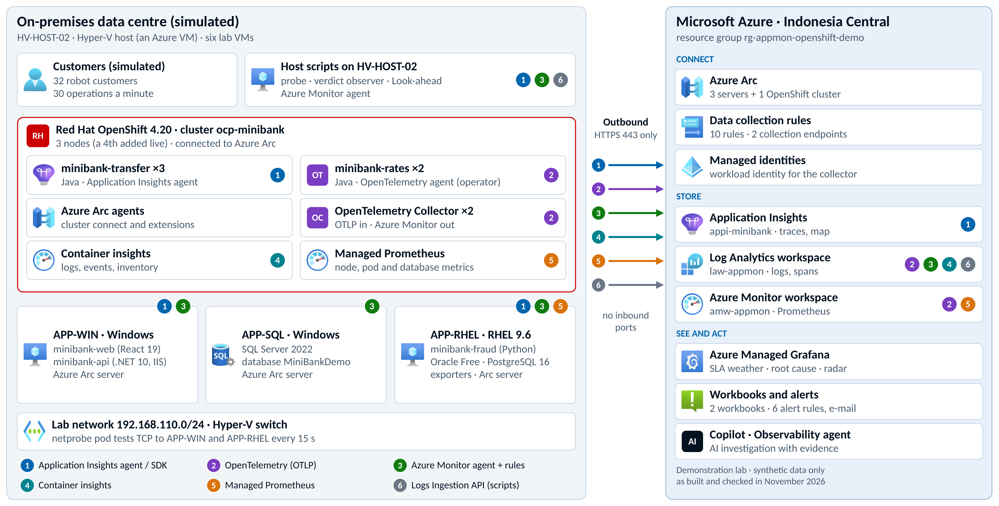
</p>

## Why this one is different

- **One verdict, not fifty dashboards.** A single KQL function reads the last six minutes of every layer and applies nine readable rules in a fixed order (R0 to R9: schema change, killed containers, network path, VM pressure, slow database, new exception, a few slow transactions, host CPU contention, and a hold while slower sources catch up). The first rule that matches names the layer, the component and the evidence. Red appears in exactly one place, so nobody has to guess.
- **Tested blind, scored honestly.** A fault command breaks one layer at a time on purpose (VM CPU, OpenShift OOM kills, network delay and loss, a null reference in the API, a renamed Oracle table, a noisy neighbour on the hypervisor) and undoes it by itself. In *mystery mode* the presenter does not know which card was drawn; the board has to name it, and a grader scores every answer against written rules.
- **It looks ahead, not only back.** A risk register turns capacity trends, expiry dates, known weaknesses and the error budget into a radar, a trail you can fast-forward and an Outlook-style month view: what will hurt next, when, and who owns it.
- **Zero-code onboarding, zero secrets.** A Java service on OpenShift is instrumented by Red Hat's OpenTelemetry operator without touching its code, and the collector signs in to Azure Monitor with workload identity: no keys, no passwords.
- **Business language on top.** Service weather for the SLA board, error budgets against 99.9 %, business impact in currency, and 32 synthetic customers whose browser journeys are measured end to end.
- **Every layer, every signal, one place.** Logs, metrics, traces, availability, Prometheus and custom tables all land in one Log Analytics workspace and one Azure Monitor workspace, read by Application Insights, workbooks, Grafana, alerts and an AI investigation agent.

## Proven in the lab, not just on slides

| Readiness test (15 to 17 November 2026) | Result |
|---|---|
| Live fault cards, one every 16 minutes, graded by the host itself | **10 of 10** named the right layer in time, no false alarm |
| Quiet night, 23:45 to 06:45 (the false-alarm test) | **836** readings, **no** red answer and no confirmed pair |
| Two blind series on a working day, order unknown to the observer | **7 of 7** and **7 of 7** |
| Mystery draws through the presenter's control window | **18 of 18** right; the first confirmed answer after about 2 to 4 minutes |
| Replay of all 57 stored runs since 13 November with the final rules | 0 wrong answers, 0 false alarms (2 late) |

The full records, including the misses that shaped the rules, are in [Chapter 35](docs/guide/35-test-results-and-readiness-13-november-2026.md) and [Chapter 38](docs/guide/38-version-2-0-the-mystery-control-window-the-approved-grading.md).

## What it watches, layer by layer

| Layer | What runs there | How it reaches Azure | What the board can say |
|---|---|---|---|
| **Host** | HV-HOST-02, an Azure VM running Hyper-V (the "data centre") | Azure Monitor Agent with a host performance rule; scripts with the Logs Ingestion API | *Host CPU contention* (R9): true load and VMs waiting for a processor |
| **Guest VMs** | APP-WIN (Windows Server, IIS), APP-SQL (SQL Server 2022), APP-RHEL (RHEL 9) | Azure Arc-enabled servers, Azure Monitor Agent, data collection rules | *VM pressure* (R4): CPU and memory with the busiest process |
| **Network** | A Hyper-V lab network between OpenShift and the VMs | A probe pod measures TCP connect time every 15 seconds into Container insights | *Network path* (R3): slow or lost connects to a named target |
| **Kubernetes** | Red Hat OpenShift 4.20, three nodes, plus a fourth added live | Azure Arc-enabled Kubernetes, Container insights, managed Prometheus | *Containers killed* (R2): restarts and OOMKilled in the namespace |
| **App servers** | IIS 10, OpenShift routes, Podman on RHEL | IIS logs through a rule that drops health checks at ingestion; container logs | Failure point and status codes per tier |
| **Databases** | SQL Server 2022, Oracle Database Free, PostgreSQL 16 | Route A: snapshots into a custom table. Route B: Prometheus exporters scraped by managed Prometheus | *Schema change* (R1) and *Database slow* (R5) |
| **Applications** | .NET 10 API, React web, Java 21 transfer and rates services, Python fraud service | Application Insights SDKs and Java agent; OpenTelemetry operator, collector and OTLP ingestion | *New exception* (R6) and *A few slow transactions* (R8) |
| **Business** | Transfers, QRIS payments and statements from robot and generated customers | Custom dimensions on every request, synthetic journeys, availability probe | SLA tiles, error budget, service weather, impact in currency |

## See it

<table>
<tr>
<td width="50%">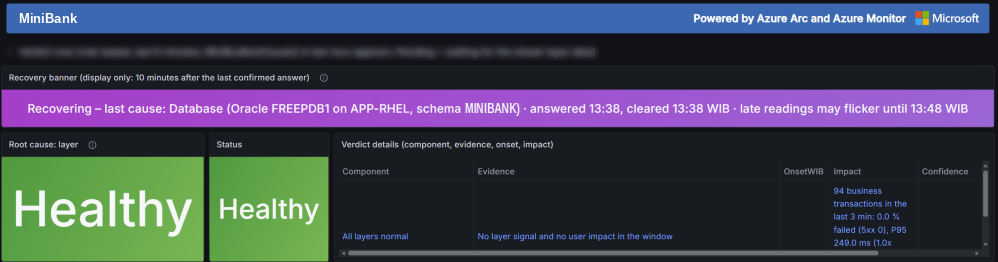<br><sub><b>Cross-layer root cause.</b> One verdict across VM, OpenShift, network, application and database, with a recovery banner that remembers the last cause.</sub></td>
<td width="50%">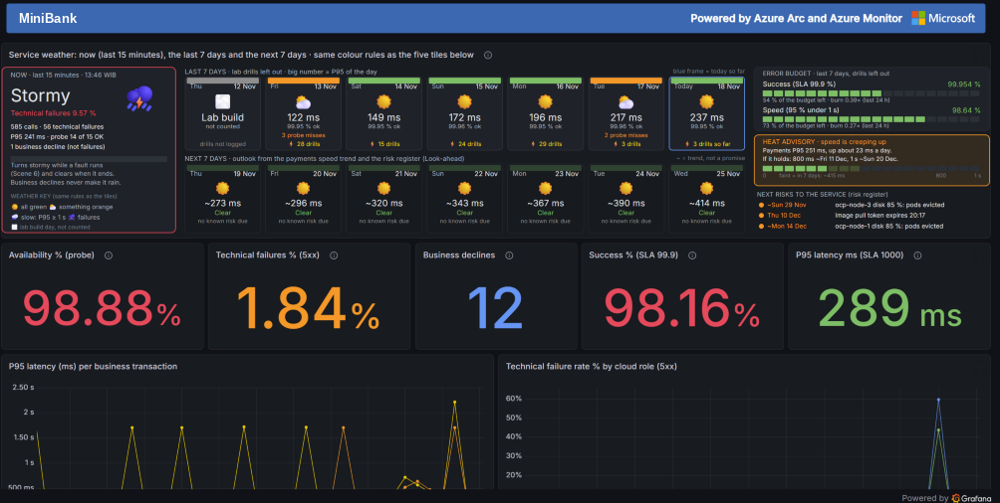<br><sub><b>SLA and service weather.</b> Now, the last 7 days and a 7-day outlook, error budgets against 99.9 % and a heat advisory when speed creeps up.</sub></td>
</tr>
<tr>
<td>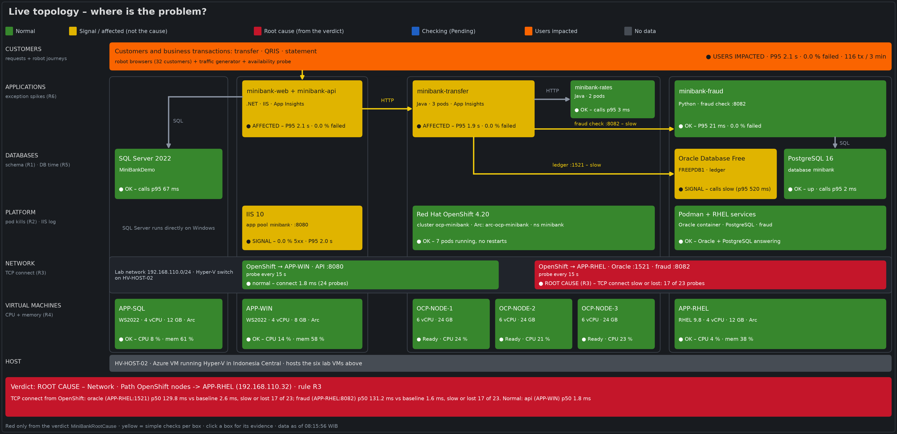<br><sub><b>Live topology during a network fault.</b> Only the slow network path turns red; the parts it slows down turn yellow.</sub></td>
<td>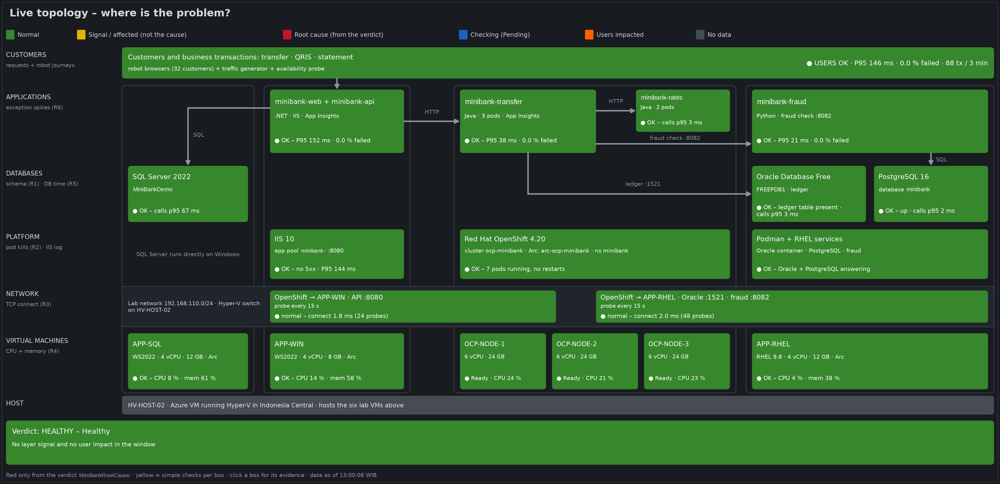<br><sub><b>Live topology, healthy.</b> From the customers down to the Hyper-V host, every box coloured by the same verdict.</sub></td>
</tr>
<tr>
<td>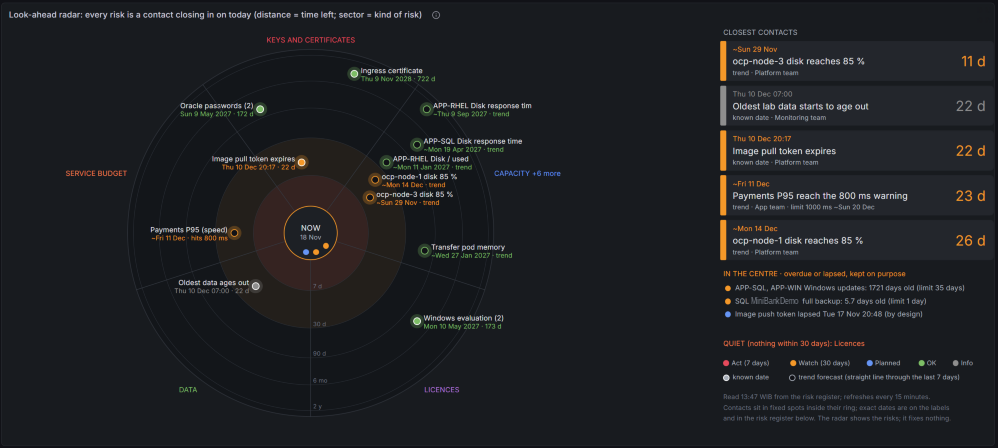<br><sub><b>Look-ahead radar.</b> Every dated risk is a contact closing in on today: distance is time left, sector is the kind of risk.</sub></td>
<td>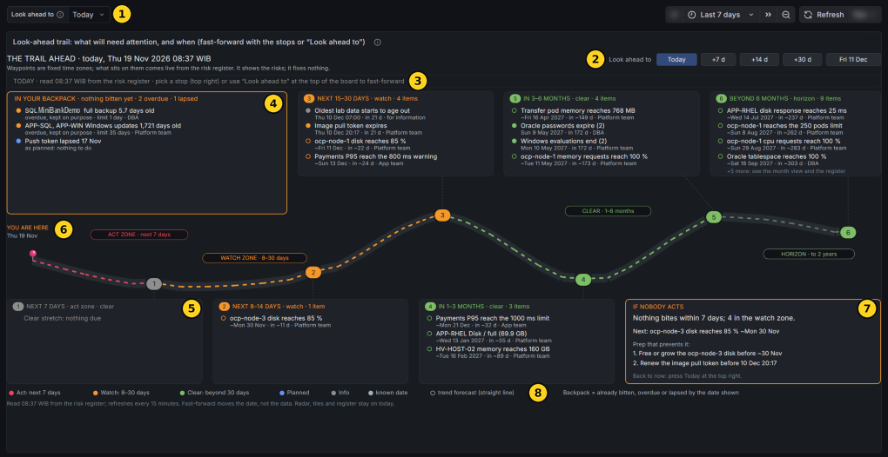<br><sub><b>Look-ahead trail.</b> What will need attention next, and when; one click fast-forwards the board to that day.</sub></td>
</tr>
<tr>
<td>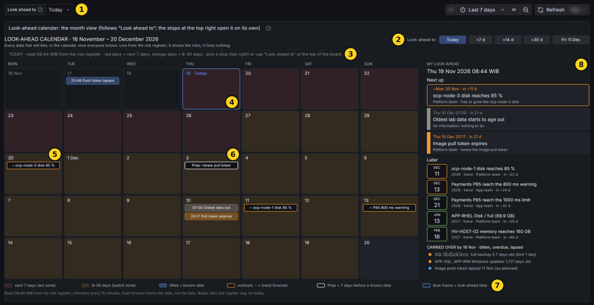<br><sub><b>Month view.</b> The same risks as an Outlook-style calendar, following the same fast-forward date.</sub></td>
<td>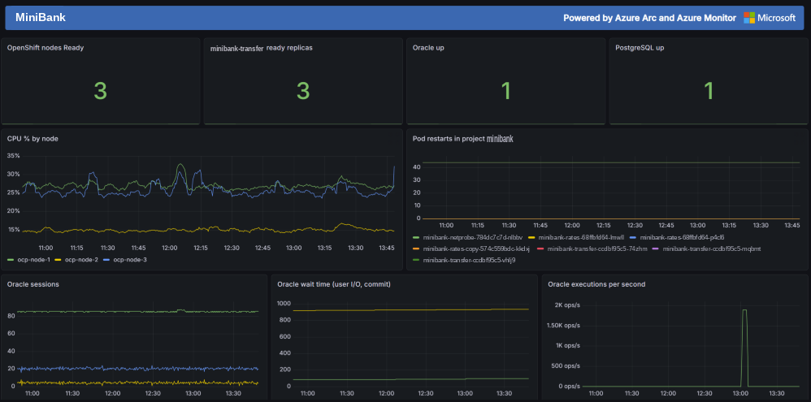<br><sub><b>OpenShift and databases.</b> Managed Prometheus for nodes, pods, Oracle and PostgreSQL internals.</sub></td>
</tr>
<tr>
<td>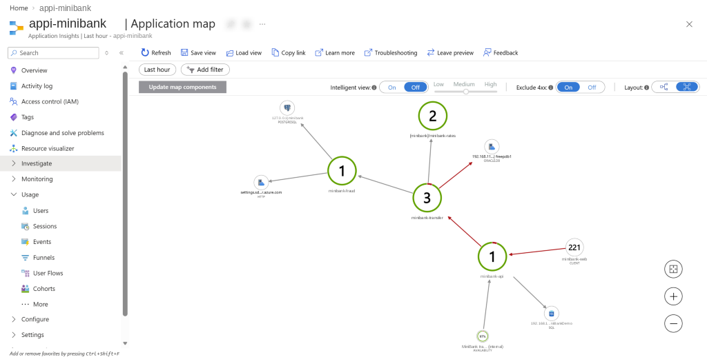<br><sub><b>Application map.</b> Five services in four languages, three databases and an availability probe, in one map.</sub></td>
<td>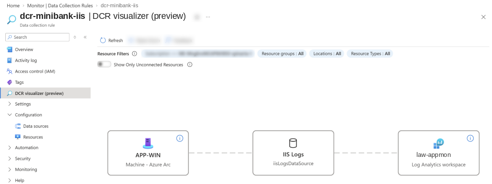<br><sub><b>Data collection rules, visualised.</b> What is collected, from where, what is dropped and where it is stored.</sub></td>
</tr>
</table>

## Six ways telemetry reaches Azure

Every signal in the lab takes one of six documented paths. Scenes 13A to 13C of the demo walk through each of them on the live system, from the agent or package in the code to the table it lands in.

<p align="center">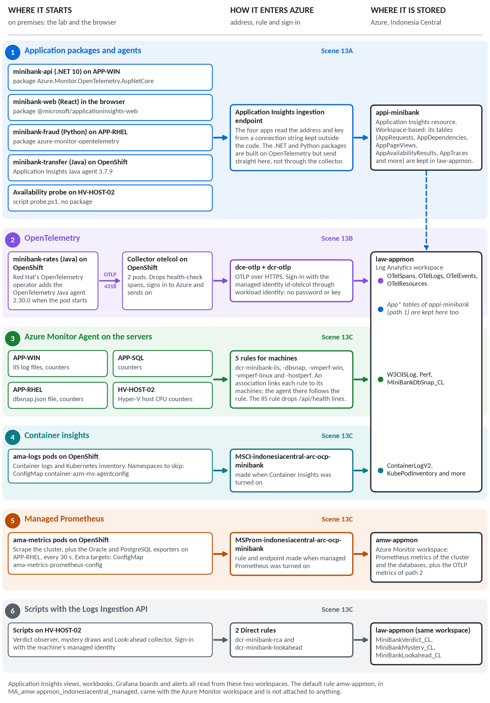</p>

1. **Application Insights packages and agents**: the Azure Monitor OpenTelemetry distro for .NET and Python, the JavaScript SDK in the browser and the Application Insights Java agent on OpenShift.
2. **OpenTelemetry, vendor-neutral**: the Red Hat build of OpenTelemetry injects the Java agent into a running service; a collector on OpenShift sends OTLP to an Azure Monitor data collection endpoint, signed in with workload identity.
3. **Azure Monitor Agent and data collection rules** on the Arc-enabled servers and the host, including an ingestion-time transformation that drops health-check noise.
4. **Container insights** for logs, events and inventory of the OpenShift cluster.
5. **Managed Prometheus** for the cluster and the Oracle and PostgreSQL exporters.
6. **Scripts with the Logs Ingestion API** for the verdict history, the mystery runs and the look-ahead register.

## The demo

The [demo rundown](docs/DEMO-RUNDOWN.md) is a 24-scene, two-and-a-half-hour script with a talk track for every scene, written so that someone who did not build the lab can still present it. Highlights:

- **Scene 2**: onboard a running Java service on OpenShift live, with no code change.
- **Scene 7C**: the audience picks a hidden fault; the board must name the layer before the reveal.
- **Scene 7D**: fast-forward the look-ahead board to the day the next risk bites.
- **Scene 9**: lose an OpenShift node and watch the platform and the monitoring react.
- **Scenes 13A to 13C**: how each application, the OpenTelemetry path and every data collection rule are set up, on the live system.

## What is in this repository

```text
.
├── app/                  MiniBank: five services, databases, OpenShift manifests, monitoring assets, traffic and robot
│   ├── web/              React 19 + Vite (Application Insights JavaScript SDK)
│   ├── api/              ASP.NET Core minimal API on .NET 10 (Azure Monitor OpenTelemetry distro)
│   ├── transfer/         Java 21, Spring Boot (Application Insights Java agent), built with ACR Tasks
│   ├── rates/            Java service onboarded with zero code by the OpenTelemetry operator
│   ├── fraud/            Python 3.11 FastAPI (azure-monitor-opentelemetry)
│   ├── db/               SQL Server, Oracle and PostgreSQL schemas and synthetic data
│   ├── openshift/        Deployments, routes, PDB, OpenTelemetry operator, collector and instrumentation
│   ├── monitoring/       Data collection rules, KQL, workbook, Grafana boards, alerts, Route A and Route B
│   ├── robot/            Browser robot: 32 synthetic customers walking real journeys
│   └── scripts/          Traffic generator, availability probe, incidents, onboarding, balance top-up
├── lab-export/           The live lab, exported read-only: Grafana boards, workbooks, KQL functions,
│                         data collection rules and endpoints, alert rules, custom tables and host scripts
├── build-helpers/        Panel JSON and queries for the newest board features
├── diagrams/             Architecture as an editable draw.io file and a PNG
└── docs/
    ├── guide/            The build and demo guide: 43 chapters and 5 appendices
    ├── DEMO-RUNDOWN.md   The scene list with timings and links into the talk track
    ├── deploy/           Step-by-step deployment notes for the zero-code and business-impact features
    └── images/           Screenshots and figures
```

## Build it yourself

Start with the [guide index](docs/guide/README.md). The guide is written for beginners: every step names the window or Azure Portal page, the menu and the field, gives the command to paste, and shows what you should see and what to do if you do not.

**You will need**

- An Azure subscription where you can create resources and role assignments, with quota for one large memory-optimised VM (the lab uses Standard_E20s_v5) in a region that offers Azure Monitor, Azure Arc and Azure Managed Grafana.
- A Red Hat account: the guide installs OpenShift with the Assisted Installer on a trial, and registers RHEL with the no-cost Red Hat Developer subscription.
- Azure Cloud Shell, a browser and some patience: the OpenShift installation alone runs for 60 to 90 minutes, the cluster must then run 24 hours without interruption, and the guide is long because it leaves nothing out.

**Placeholders.** Names and identifiers were neutralised before publication. Replace these with your own values wherever they appear:

| Placeholder | Meaning |
|---|---|
| `<SUBSCRIPTION_ID>`, `<YOUR_SUBSCRIPTION_NAME>`, `<TENANT_ID>`, `<TENANT>` | Your Azure subscription and Microsoft Entra tenant |
| `<GRAFANA_HOST>` | The host name of your Azure Managed Grafana instance |
| `<ACR_NAME>` | Your Azure Container Registry |
| `<DCE_NAME>`, `<IMMUTABLE_ID>` | Your data collection endpoint and the immutable ID of a data collection rule |
| `<OTELCOL_IDENTITY_CLIENT_ID>`, `<HOST_IDENTITY_PRINCIPAL_ID>`, `<GRAFANA_IDENTITY_PRINCIPAL_ID>` | Client and principal IDs of the managed identities you create |
| `<LAB_ADMIN_UPN>`, `alerts@example.com` | Your admin account and the mailbox for alert e-mails |
| `<EXEMPT_TAG>=<EXEMPT_VALUE>` | A cost-governance exemption tag, only if your subscription's policies stop or delete untagged resources; otherwise leave it out |
| `<GUID>` | Any other identifier that was unique to the original lab |

The demo logins of MiniBank (`ANDI.WIJAYA`, `SITI.RAHAYU`, `BUDI.SANTOSO`, password `Demo123!`, PIN `123456`) are synthetic and documented on purpose; all customers, accounts and amounts are made up.

## Clean up

The lab lives in one resource group plus the managed resource group that Azure creates for the Azure Monitor workspace. [Chapter 22](docs/guide/22-daily-operations-cost-and-removal.md) explains daily operations, what keeps costing money while the lab runs, and how to remove everything, including the Azure Arc registrations.

## Scope and caveats

- This is a personal lab and learning resource. Nothing here is an official Microsoft deliverable, product or support statement, and it comes with no warranty.
- MiniBank is a demo application with synthetic data. It is not a real bank's application.
- Product names, versions, menus and limits are as tested in November 2026. Some capabilities used here (for example Java auto-instrumentation through the Red Hat OpenTelemetry operator, and the Azure Copilot Observability agent) were in preview at the time; check their current status before you rely on them.
- Prices are not quoted. The lab runs a large VM around the clock while it is in use; use the Azure pricing calculator for your region.
- The guide keeps its "as built" notes, decisions and test records, including what went wrong, because that is where most of the learning is.

## Licence

[MIT](LICENSE)
