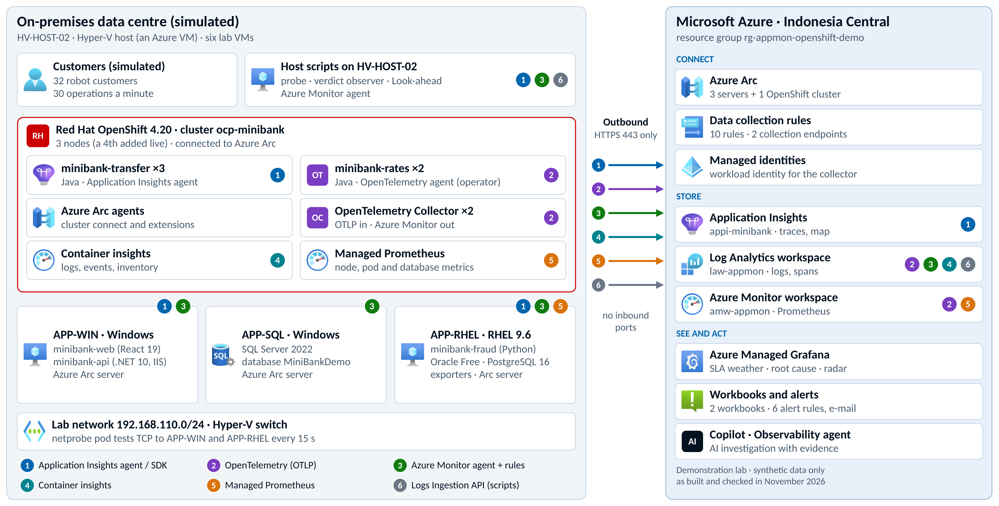

# 4. Demo design

Part A - Understand and prepare &nbsp;|&nbsp; [Guide index](README.md)

## 4.1 The story

MiniBank is a small internet-banking application. A customer signs in with a User ID, sees the account balance on the Home screen, and sends a transfer or pays a merchant with QRIS. Each payment travels through four services and three databases, which is exactly the kind of chain the bank wants to observe:

1. The browser shows the MiniBank screens (React) and sends the request to the MiniBank API.
1. The API (.NET in IIS on APP-WIN) checks the PIN, writes the transaction into SQL Server on APP-SQL, and calls the transfer service.
1. The transfer service (Java, three containers on OpenShift) writes the ledger entry into Oracle on APP-RHEL and asks the fraud service for a decision.
1. The fraud service (Python on APP-RHEL) scores the payment, stores the score in PostgreSQL and returns APPROVE or REVIEW.
1. The answer travels back, the API updates the balance and the customer sees the proof of transaction.

Every hop carries the same W3C trace ID, so Azure shows the whole chain as one transaction. The presenter can make any hop slow or failing with one click on a presenter page, and can switch off an OpenShift node while traffic is running.

## 4.2 Architecture

Figure 4-1 shows the whole lab on one page. Read it from top to bottom: the people and outside services that you use, the Azure network with HV-HOST-02 and everything that runs inside it, and at the bottom the Azure services that receive and show the monitoring data.

*Figure 4-1. MiniBank on Red Hat OpenShift: the demo environment as built in November 2026. Editable source: [diagrams/host-to-code-observability-architecture.drawio](../../diagrams/host-to-code-observability-architecture.drawio).*

**Version 1.5:** Figure 23-1 in Chapter 23.5 shows the same lab with the Priority 1 features (OpenTelemetry operator and collector, minibank-rates, the browser robot, two more alert rules and the Observability Agent).

How to read the diagram:

| What you see | What it means |
|---|---|
| Top row, OUTSIDE AZURE | Microsoft Entra ID (your sign-in), the Red Hat Hybrid Cloud Console (installs OpenShift) and you, the presenter or lab engineer, working only in a browser |
| Blue bar AZURE | Everything below it is in region Indonesia Central, in the new resource group rg-appmon-openshift-demo |
| Light blue frame vnet-appmon | The Azure virtual network. HV-HOST-02 sits in snet-appmon-host; Bastion and the NAT gateway sit at the right |
| Black frame HV-HOST-02 | The Azure VM that plays the bank's on-premises data centre. Everything inside it is a Hyper-V guest or the host itself |
| Dashed frame AppMonNAT | The private lab network 192.168.110.0/24 that exists only inside HV-HOST-02 |
| Frame with the red bar | The Red Hat OpenShift 4.20 cluster ocp-minibank: three nodes, plus OCP-NODE-4 that you add during the demo |
| Black arrows 1 to 6 | One customer payment: browser, API, SQL Server, transfer service on OpenShift, Oracle, fraud service and PostgreSQL (Chapter 4.1) |
| Green dashed arrows, green letters A to D | Monitoring data. It always leaves the lab outbound over HTTPS 443 through the NAT gateway; nothing connects into the lab |
| Blue letter E | Azure Arc management traffic of the three servers and the cluster |
| Grey letters F and G | The container image that OpenShift pulls, and the source pack that HV-HOST-02 downloads |
| Blue arrows | Your admin path through Bastion, and the dashboards and alerts that read the stored data |
| Dashed boxes | Added during the demo or optional: OCP-NODE-4, the Azure Policy extension and the storage account |
| Box Managed Grafana | The lab's own Azure Managed Grafana amg-appmon in rg-appmon-openshift-demo (gate G6) with its two dashboards. It reads only the lab's workspaces |

Where each letter is built:

| Letter | What travels | Built in |
|---|---|---|
| A | Requests, dependencies, exceptions and traces of the four services, and the availability results of the probe, to Application Insights | Chapters 10.2, 15 and 17.1 |
| B | IIS log files and database snapshots, through the Azure Monitor Agent and the data collection rules, to Log Analytics | Chapters 11.7, 16.1 and 17.7 |
| C | Container logs and the Kubernetes inventory of OpenShift (Container insights) to Log Analytics | Chapter 13.5 |
| D | Prometheus metrics of the cluster and of the Oracle and PostgreSQL exporters to the Azure Monitor workspace | Chapters 13.6 and 16.2 |
| E | Azure Arc agents of APP-WIN, APP-SQL, APP-RHEL and the OpenShift cluster to Azure Arc | Chapters 11.6 and 13.2 |
| F | OpenShift pulls the minibank-transfer image from the container registry | Chapters 10.4 and 15.2 |
| G | HV-HOST-02 downloads the source pack from the storage account (optional: as built, a governance policy blocked the link and the pack came from OneDrive) | Chapters 10.5 and 10.6 |

> [!TIP]
> **Beginner tip**
>
> There are two different networks. The Azure virtual network (10.60.x.x) connects HV-HOST-02 to Azure. The Hyper-V internal network (192.168.110.x) exists only inside HV-HOST-02 and connects the lab virtual machines to each other. The host translates (NAT) the lab traffic so that the lab machines can reach the internet and Azure, just like an on-premises data centre behind a firewall.

> [!TIP]
> **Beginner tip**
>
> If the region check in Chapter 6.4 sends Azure Arc-enabled Kubernetes or the Azure Monitor workspace to Southeast Asia, only the region of those two items changes. The rest of Figure 4-1 stays the same.

> [!TIP]
> **Beginner tip**
>
> To change the diagram, open diagrams/host-to-code-observability-architecture.drawio in draw.io (the desktop app, or app.diagrams.net with File, Open from, Device). The Azure icons come from the Azure library that is built into draw.io, so they appear without any download. After editing, use File, Export as, PNG with Zoom 200% and replace the PNG next to it.

## 4.3 Components, hosts and ports

| Component | Technology | Runs on | Address and port | How it sends telemetry |
|---|---|---|---|---|
| minibank-web | React 19 single-page app built with Vite | APP-WIN, served by the API | http://192.168.110.31:8080/ | Application Insights JavaScript SDK |
| minibank-api | ASP.NET Core on .NET 10, hosted in IIS | APP-WIN | 192.168.110.31:8080 | Azure Monitor OpenTelemetry Distro for .NET |
| minibank-transfer | Java 21, Spring Boot, container image from Azure Container Registry | OpenShift project minibank, 3 replicas | http://minibank-transfer.apps.ocp-minibank.minibank-demo.lab | Application Insights Java agent inside the image (no code change) |
| minibank-fraud | Python 3.11, FastAPI | APP-RHEL | 192.168.110.32:8082 | Azure Monitor OpenTelemetry Distro for Python |
| Oracle database | Oracle AI Database 26ai Free (container), pluggable database FREEPDB1 | APP-RHEL | 192.168.110.32:1521 | Dependency calls from Java; internals through Routes A and B |
| PostgreSQL database | PostgreSQL 16 (RHEL package) | APP-RHEL | 127.0.0.1:5432 (local only) | Dependency calls from Python; internals through Routes A and B |
| SQL Server database | SQL Server 2022 Developer | APP-SQL | 192.168.110.33:1433 | Dependency calls from .NET |
| Oracle exporter | Oracle observability exporter (container) | APP-RHEL | 192.168.110.32:9161 | Scraped by managed Prometheus in OpenShift |
| PostgreSQL exporter | postgres_exporter (container) | APP-RHEL | 192.168.110.32:9187 | Scraped by managed Prometheus in OpenShift |
| Snapshot collector | Bash script and systemd timer | APP-RHEL | writes /var/log/minibank/dbsnap.json | Read by the Azure Monitor Agent |
| Traffic and probe | PowerShell scripts, running all the time as the scheduled tasks minibank-traffic and minibank-probe | HV-HOST-02 | calls 192.168.110.31:8080 | Probe sends availability results to Application Insights |
| Balance top-up | PowerShell script and SQL file, scheduled task minibank-topup every 6 hours | APP-SQL | local SQL Server | None; it writes C:\BuildLog\topup.log |

## 4.4 Scenarios you can trigger

Each payment carries a scenario name. The presenter chooses it on the presenter page (http://192.168.110.31:8080/#/demo) and the traffic script can pick scenarios automatically.

| Scenario | What happens | What you show in Azure |
|---|---|---|
| normal | Everything succeeds in about 150 to 400 ms | A healthy end-to-end transaction |
| slow-sql | The API waits 1.5 seconds inside SQL Server (WAITFOR DELAY) | Slow SQL dependency on minibank-api |
| slow-oracle | Java waits 2 seconds inside Oracle (DBMS_SESSION.SLEEP) | Slow Oracle dependency on minibank-transfer, and the wait in Oracle's own statistics (Scene 12) |
| slow-python | The fraud service sleeps 1.5 seconds in Python code | Time spent inside minibank-fraud itself |
| slow-postgres | The fraud service waits 1.5 seconds inside PostgreSQL (pg_sleep) | Slow PostgreSQL dependency, and the slow statement in PostgreSQL statistics |
| fail-oracle | Java queries a table that does not exist (ORA-00942) | Failure point: Oracle call in minibank-transfer, then HTTP 500 and 502 up the chain |
| fail-java | Java throws an exception | Failure point inside minibank-transfer code |
| fail-python | Python raises an exception | Failure point inside minibank-fraud code |
| fail-api | The .NET API throws an exception before calling anything | Failure point inside minibank-api |

When a payment fails, the MiniBank proof-of-transaction screen shows a Trace ID. Paste it into Application Insights (Transaction search) to jump straight to that transaction.

From version 1.3 every chapter uses two different words for a payment that does not succeed:

| Outcome | What it is | Result code | Counts against the SLA |
|---|---|---|---|
| Technical failure | A server error: every fail-\* scenario above, and every real fault | HTTP 5xx | Yes |
| Business decline | A correct answer of the bank on the customer's side, for example a transfer or a QRIS payment for more than the account balance. The API answers "Insufficient balance." (code INSUFFICIENT_FUNDS). No money moves and nothing is written to the databases | HTTP 409 | No |

Application Insights marks every 4xx response as a failed request (Success = false) by default. The dashboards, the workbook and the alerts therefore use the result code: toint(ResultCode) &gt;= 500 for technical failures and ResultCode == "409" for declines. The SLA in this demo is 99.9 percent of business requests without a technical failure, with P95 under 1,000 ms. Declines do not use the error budget, but they are shown on the dashboards and an unusual number of them raises its own alert (Chapter 17.5).

## 4.5 Lab machines, addresses and sizes

| Machine | Role | vCPU | Memory | Disk | IP address | MAC address |
|---|---|---|---|---|---|---|
| HV-HOST-02 | Azure VM, Hyper-V host, NAT gateway and DNS for the lab | 20 | 160 GiB | OS 128 GiB + 5 data disks | 10.60.1.4 (Azure), 192.168.110.1 (lab) | Azure |
| OCP-NODE-1 | OpenShift control plane and worker | 6 | 24 GB fixed | 120 GB on P: | 192.168.110.21 | 00:15:5D:6E:00:21 |
| OCP-NODE-2 | OpenShift control plane and worker | 6 | 24 GB fixed | 120 GB on Q: | 192.168.110.22 | 00:15:5D:6E:00:22 |
| OCP-NODE-3 | OpenShift control plane and worker | 6 | 24 GB fixed | 120 GB on R: | 192.168.110.23 | 00:15:5D:6E:00:23 |
| OCP-NODE-4 | OpenShift worker, added live in Scene 11 | 4 | 16 GB fixed | 120 GB on S: | 192.168.110.24 | 00:15:5D:6E:00:24 |
| APP-WIN | IIS, minibank-api, minibank-web | 4 | 8 GB | 127 GB on F: | 192.168.110.31 | automatic |
| APP-RHEL | Oracle Free, PostgreSQL 16, minibank-fraud, exporters | 4 | 12 GB | 127 GB on F: | 192.168.110.32 | automatic |
| APP-SQL | SQL Server 2022 Developer | 4 | 12 GB | 127 GB on F: | 192.168.110.33 | automatic |

Virtual addresses used by OpenShift: 192.168.110.10 is the API address (api.ocp-minibank.minibank-demo.lab and api-int.ocp-minibank.minibank-demo.lab) and 192.168.110.11 is the application ingress address (\*.apps.ocp-minibank.minibank-demo.lab). The OpenShift nodes move these addresses between themselves, so no single machine owns them.

## 4.6 Capacity check

| Situation | vCPU assigned | Memory assigned | vCPU per host vCPU | Memory left for the host |
|---|---|---|---|---|
| Normal running (3 OpenShift nodes + 3 application VMs) | 30 | 104 GB | 1.5 | about 48 GB (after 8 GB kept for Windows and Hyper-V) |
| Add-a-node scene (fourth worker running) | 34 | 120 GB | 1.7 | about 32 GB |

The application VMs use about a third of their assigned CPU most of the time, so 1.5 to 1.7 virtual CPUs per host CPU is safe for a demo. Memory is never over-committed: all OpenShift nodes use fixed memory.

## 4.7 New Azure items

All new items go into rg-appmon-openshift-demo and carry the tags purpose=appmon-openshift-demo, demo=minibank and owner=labadmin, and from version 1.3 also &lt;EXEMPT_TAG&gt;=&lt;EXEMPT_VALUE&gt; (Chapter 7.1).

| Name | Type | Purpose |
|---|---|---|
| vnet-appmon with subnets snet-appmon-host (10.60.1.0/24) and AzureBastionSubnet (10.60.250.0/26) | Virtual network | Network for HV-HOST-02 and Bastion |
| nsg-snet-appmon-host | Network security group | Protects the host subnet; no inbound rule from the internet |
| natgw-appmon and pip-natgw-appmon | NAT gateway and public IP | Outbound internet for downloads, Azure Arc and agents |
| bas-appmon and pip-bas-appmon | Azure Bastion (Basic) and public IP | Browser-based remote desktop to HV-HOST-02 |
| HV-HOST-02 and its disks HV-HOST-02-data-apps, HV-HOST-02-data-ocp1 to -ocp4 | Virtual machine and managed disks | The Hyper-V host |
| law-appmon | Log Analytics workspace | Application Insights data, Container insights, IIS logs, database snapshots |
| appi-minibank | Application Insights (workspace-based) | Telemetry from the four MiniBank services |
| amw-appmon | Azure Monitor workspace | Prometheus metrics from OpenShift and the database exporters |
| amg-appmon | Azure Managed Grafana (Standard, Grafana 12) | Grafana dashboards for the SLA, OpenShift and the databases. Its managed identity has Monitoring Reader on the resource group and Monitoring Data Reader on amw-appmon; the presenter has Grafana Admin |
| &lt;ACR_NAME&gt; plus four digits | Azure Container Registry (Basic) with the tokens minibank-pull (30 days) and minibank-push (7 days) | Stores the minibank-transfer image |
| stminibank plus four digits | Storage account with private container media (optional) | Carries the source pack to HV-HOST-02; a governance policy blocks its download link in this subscription (Chapter 10.5) |
| arc-ocp-minibank | Azure Arc-enabled Kubernetes | The OpenShift cluster as an Azure resource |
| APP-WIN, APP-RHEL, APP-SQL | Azure Arc-enabled servers | The application VMs as Azure resources |
| dcr-minibank-iis | Data collection rule | IIS logs from APP-WIN, with a transformation that drops health checks |
| dcr-minibank-dbsnap and table MiniBankDbSnap_CL | Data collection rule and custom table | Oracle and PostgreSQL snapshots (Route A) |
| MiniBank - SLA and Failure Rate | Azure Workbook | SLA and failure-rate dashboard in the Azure Portal |
| alr-minibank-failure-rate-high, alr-minibank-decline-spike, alr-ocp-node-not-ready | Log search alert rules without notifications | Alerts shown in Scenes 7 and 9 |
| Role assignment Azure Arc Kubernetes Viewer for the presenter, on arc-ocp-minibank only | Azure role assignment | Lets the Portal open the Kubernetes resources view of the cluster (Chapter 13.4) |

Azure also creates some items for you: Application Insights creates the smart detection alert rule Failure Anomalies - appi-minibank (Chapter 17.5), the Azure Monitor workspace creates a managed resource group named MA_amw-appmon_indonesiacentral_managed with a data collection endpoint and rule, and the two OpenShift monitoring extensions create data collection rules whose names start with MSCI- and MSProm-. Do not edit or delete these items; they disappear when their parent is deleted. The only change you make to them is the tag &lt;EXEMPT_TAG&gt;=&lt;EXEMPT_VALUE&gt; (Chapter 7.1).

## 4.8 Impact on the existing Hyper-V demo

| Area | Impact |
|---|---|
| Resource group rg-hyperv-arc-monitor-demo | Not touched at all: no new items, no role assignments and no changes. |
| HV-HOST-01 and its guests | None. MiniBank no longer uses WIN2022-GUEST, RHEL94-GUEST or SQL2019-GUEST, so the Hyper-V CPU, memory and storage scenes stay exactly as calibrated. |
| law-arc-monitor-poc, alert rules, workbook, shift report | None. MiniBank has its own workspace and its own alert rules. |
| Grafana of the Hyper-V demo | None. Since version 1.3 the lab uses its own Grafana amg-appmon in rg-appmon-openshift-demo, so nothing is added to the Grafana of the Hyper-V demo. |
| Quota | ESv5 family usage rises from 16 to 36 of 100 vCPU and regional usage from 32 to 52 of 100. |
| Cost | Separate, see Chapter 22.1. |

## 4.9 MiniBank screens and look

MiniBank follows the screen patterns that most internet-banking apps share: a login card, a greeting band with the account card, a menu grid, transfers with a PIN and a proof of transaction. It is synthetic and belongs to no real bank.

| Screen | What the customer sees | What it calls |
|---|---|---|
| Log in | "Hello, Welcome!" card with User ID and Password, a rounded blue Log in button, help links and Instant Access shortcuts | API, SQL Server |
| Home | Blue greeting band, account card with a masked account number and a hidden balance (eye icon), round blue menu icons, last three transactions | API, SQL Server, transfer service, Oracle |
| Transfer | Choose the source account, the destination and the amount (with a 000 key), confirm, enter the 6-digit PIN, proof of transaction | API, SQL Server, transfer service, Oracle, fraud service, PostgreSQL |
| QRIS Pay | Choose a demo merchant (simulated scan), amount, confirm, PIN, proof of transaction | Same chain as Transfer |
| Account statement | Transactions of the last 30 days | API, transfer service, Oracle |
| Presenter page (#/demo) | Scenario switch, visible only to the presenter | Nothing; it changes the scenario of the next payments |

Look and data rules built into MiniBank:

- One solid brand blue (hex #0066AE) without tints or gradients.
- Typeface Calibri, with Arial when Calibri is not available.
- The header shows the text wordmark MiniBank. You can drop your own logo file into the web project (Chapter 15.4); it is shown on the white header bar only.
- A yellow banner on every screen: "DEMO APPLICATION - not a real bank app. Synthetic data only."
- English by default; the EN/ID switch in the header changes the labels to Indonesian.
- Icons and pictures are drawn for this demo.
- All customers, account numbers and amounts are synthetic. The demo logins are ANDI.WIJAYA, SITI.RAHAYU and BUDI.SANTOSO, each with password Demo123! and PIN 123456.

> [!CAUTION]
> **Be honest**
>
> MiniBank is a demo application with synthetic data only; it is not a real bank's application and contains no real code or data. Keep the DEMO banner visible whenever you share your screen.

---

[&larr; 3. What the bank asked for and how this demo answers it](03-what-the-bank-asked-for-and-how-this-demo-answers-it.md) &nbsp;|&nbsp; [Guide index](README.md) &nbsp;|&nbsp; [5. Values, tools and the start of every session &rarr;](05-values-tools-and-the-start-of-every-session.md)
