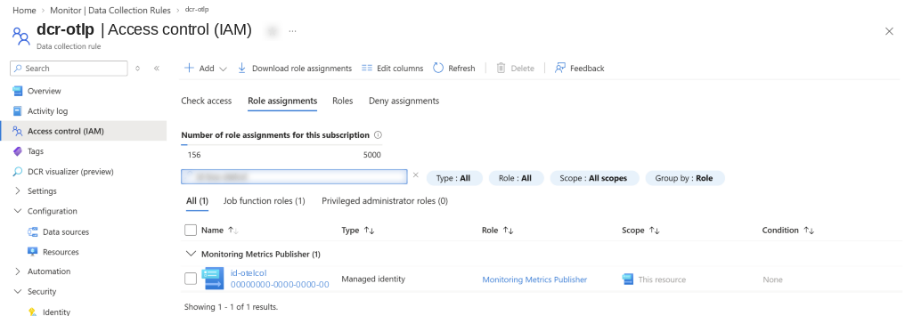
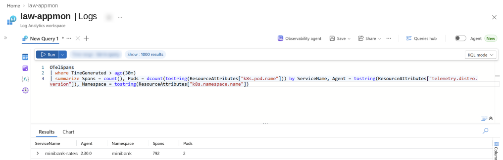
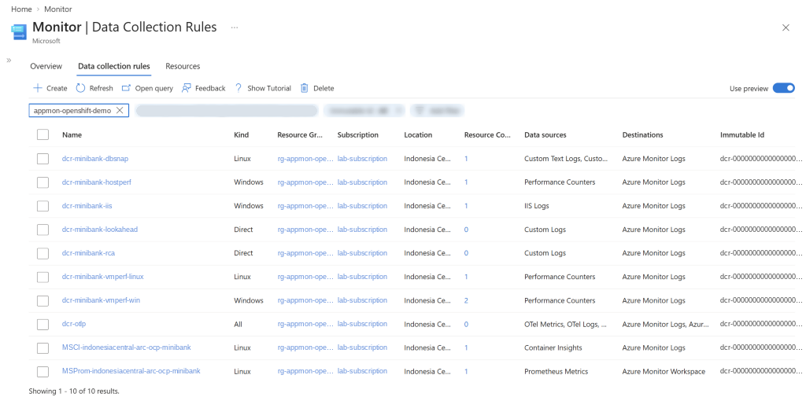
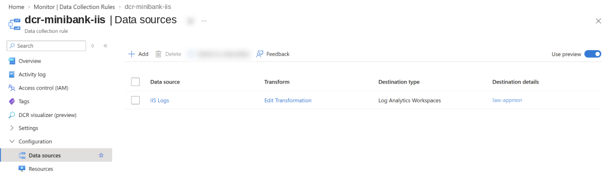
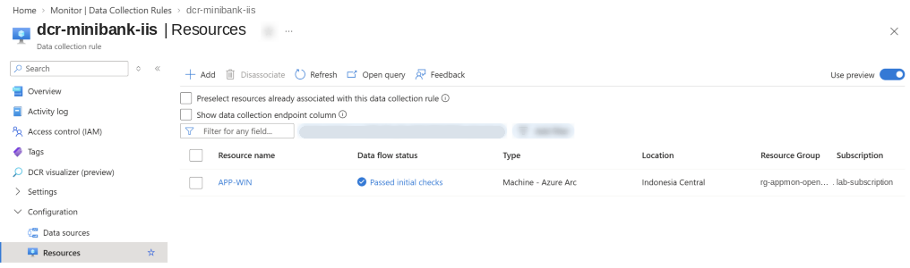
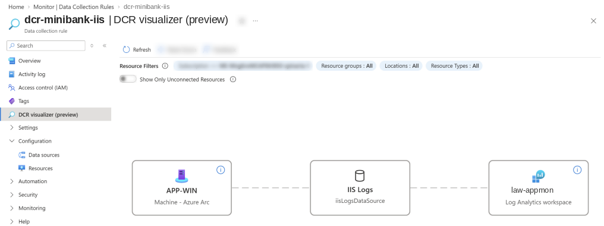
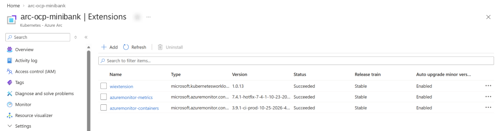

# 19. Demo scenes and talk track

<sub>Part E - Rehearse, present, reset and remove &nbsp;|&nbsp; [Guide index](README.md)</sub>


Version 1.7: this chapter is the complete script for the demo. The Priority 1 features are part of Scenes 2, 3, 4, 5, 6, 7 and 15, the new Scenes 7A (the customer's view) and 7B (the AI investigation) follow Scene 7, Scene 7C (version 1.7) lets the bank pick a hidden fault that the cross-layer board must name, and Scene 0A tours the technology stack before Azure is shown. Every command and query has a WHERE TO RUN IT box. Chapter 28 keeps the summary of what version 1.5 changed; Part G (Chapters 30 to 35) is the reference for Scene 7C.

## 19.1 Before the session

1. Two hours before: run the acceptance checklist (18.2).
1. Thirty minutes before: run the balance top-up by hand on APP-SQL (Chapter 17.10). On HV-HOST-02, check that the tasks minibank-traffic and minibank-probe are Running and that traffic.log shows ok about 30 and failed=0 (Chapter 17.1). Make sure that the session does not run across 00:00, 06:00, 12:00 or 18:00 WIB, when the scheduled top-up changes the balances on screen.
1. On your own computer, open these browser tabs in this order: Azure Arc cluster arc-ocp-minibank (Overview); appi-minibank (Application map); appi-minibank (Failures); appi-minibank (Performance); the workbook MiniBank - SLA and Failure Rate; law-appmon (Logs) with the queries of Scenes 5, 6, 9 and 12 in separate query tabs (they are printed in the scenes); Grafana dashboards MiniBank - SLA and Failure Rate and MiniBank - OpenShift and Databases (amg-appmon, addresses /d/minibank-sla and /d/minibank-openshift-db); the Red Hat console with cluster ocp-minibank, tab Add hosts.
1. In the Bastion session on HV-HOST-02, open Hyper-V Manager, one PowerShell (Admin) window with the start block of Chapter 5.5, a second PowerShell (Admin) window, the presenter's window (item 11), Edge with two tabs: MiniBank (http://192.168.110.31:8080) and the presenter page (http://192.168.110.31:8080/#/demo), and a third tab with the OpenShift web console.
1. On the presenter page, choose **normal** and click **Apply**.
1. Priority 1 checks (Chapter 18.2, the last three rows): the robot log shows a journey every 2 minutes with result=success, the collector runs with 2 pods, and minibank-rates-copy is not onboarded. If a rehearsal ran, run the reset of Chapter 20.1 first.
1. Close every fired alert, including alr-minibank-failed-value-idr and alr-minibank-journey-success-low (Chapter 20.3), so that Scenes 6, 7, 7A and 7B start from an empty alert list.
1. On the demo day, before the session: run the backup AI investigation of Scene 7B (Step 6) and keep its tab open; check that at least two of the five deep investigations are left (Chapter 27.4).
1. Extra browser tabs on your own computer: appi-minibank (Users, under Usage); law-appmon (Logs) with queries E7 and E9 of Scene 7A in two query tabs; Monitor (Alerts); the workbook MiniBank - SLA and Failure Rate scrolled to the group Business impact (IDR).
1. Extra windows on HV-HOST-02 for Scene 0A: the Edge tab with the OpenShift web console, already signed in as kubeadmin (Chapter 12.6; never type the password while the screen is shared); three more PowerShell (Admin) windows, one with an APP-RHEL - Bash session (ssh -i F:\Build\ocp\id_ed25519 labadmin@192.168.110.32), one with an APP-SQL - PowerShell Direct session and one with an APP-WIN - PowerShell Direct session (Chapter 5.6).
1. The presenter's window (item 4): PowerShell (Admin), the start block of Chapter 5.5, then Set-Location F:\Build\minibank\scripts, with a large font (Ctrl and the mouse wheel). Scenes 2, 5, 7B and 15 run their commands there.
1. Cross-layer board (Scene 7C, version 1.7): open the Grafana board MiniBank - Cross-layer root cause (amg-appmon, address /d/minibank-rootcause) with the time range Last 1 hour, refresh 30s and the variable verdict on show. Status Healthy, the Recovery banner reads No recovery in progress, and the verdict history has a reading every 30 seconds (Chapter 32). Keep the workbook group Root cause across all layers open in a second tab.
1. Morning history (version 1.7): on the demo morning, at least 2 hours before the session, start one blind test series (.\fault.ps1 -Series, 96 minutes), then the labelled pair schema-oracle and fail-oracle (Chapter 33.6, 32 minutes). Read the score (Chapter 35.1): every fault on the right layer within 5 minutes and no false alarm in the healthy slot. A card that failed stays out of the session: draw again if the bank picks it.
1. Before the session: .\fault.ps1 -Status shows no active run, .\fault.ps1 -LeakCheck -Hours 6 finds no giveaway word (Chapter 33.7), and every alert is closed (Chapter 20.3). Each fired alert has also sent an e-mail to alerts@example.com (Chapter 34).
1. Error 599 pre-flight: Azure Portal &gt; arc-ocp-minibank &gt; Kubernetes resources &gt; Workloads must list the deployments. If Error (599) appears, select Try again once; if it stays, restart the cluster-connect agent (Chapter 21, about 1 minute) and reload the page. Repeat this check after any restart of the Arc agents.
1. Look-ahead board (Scene 7D, versions 2.1, 2.2 and 2.5): open the Grafana board MiniBank - Look-ahead (amg-appmon, address /d/minibank-lookahead) with the time range Last 7 days, and check that the box Look ahead to at the top left of the board reads Today. The radar at the top shows its contacts (give it up to half a minute on the first load), Risks by status shows numbers, the risk register is filled and its row Look-ahead collector last run reads less than 2 hours ago (Chapter 39.9). Scroll down once to the heading Calendar: dates that will bite so that the trail and the month view draw (up to half a minute each), then back to the top. For the widest radar, close Grafana's side menu. Keep the workbook MiniBank - Look-ahead open in a second tab as the backup.
1. Telemetry walkthrough (Scenes 13A to 13C, version 2.4): on your own computer open five more tabs: Monitor | Data Collection Rules with the filter rg-appmon-openshift-demo; dcr-otlp (Overview); id-otelcol (Federated credentials); arc-ocp-minibank (Extensions); law-appmon (Logs) with queries W1, W2 and W3 in three query tabs. On HV-HOST-02 the scenes use the presenter's window (item 11) for the oc and Select-String lines, and the APP-RHEL - Bash and APP-WIN - PowerShell Direct windows of item 10.
## 19.2 Scene list

| Scene | Topic | Minutes | Requirement |
|---|---|---|---|
| 0 | The story and MiniBank | 3 | Context |
| 0A | The technology stack: Hyper-V, OpenShift web console, Oracle, PostgreSQL, SQL Server (new) | 6 | R7, R9 |
| 1 | OpenShift in Azure Arc (and start adding a node) | 6 | R9, R10 |
| 2 | How easy it is to onboard each language, with live zero-code onboarding on OpenShift | 10 | R5, R7, R8 |
| 3 | Application Map | 6 | R3 |
| 4 | One transaction end to end | 6 | R1 |
| 5 | Latency and a slow Oracle call (starts the incident command) | 6 | R1 |
| 6 | Failure rate and failure point | 6 | R2 |
| 7 | SLA and failure-rate dashboards with the service weather (new), alert and business impact in IDR | 8 | R4, R8 |
| 7A | The customer's view: journeys and users (new) | 5 | R1, R4 |
| 7B | Ask the AI to investigate (new) | 6 | R2 |
| 7C | Mystery fault: one board names the layer across VM, OpenShift, network, application and database (new) | 10 | R2, R9, R11 |
| 7D | Look-ahead: what will need attention next - the radar, capacity, expiry dates on the trail and the month view with fast-forward, known weaknesses, speed and the error budget (new) | 5 | R4, R9, R11 |
| 8 | Inside OpenShift: Container insights and Prometheus | 6 | R9 |
| 9 | Lose a node | 8 | R10 |
| 10 | Planned maintenance (drain) | 5 | R10 |
| 11 | The new node is already monitored | 5 | R10 |
| 12 | Oracle and PostgreSQL internals | 8 | R11 |
| 13 | Filtering telemetry | 6 | R6 |
| 13A | How each application sends telemetry: the Java agent, the .NET, Python and browser packages, the probe and their connection strings (new) | 9 | R5, R7 |
| 13B | The OpenTelemetry path: operator, injected agent, collector, endpoint, rule and workload identity (new) | 8 | R5, R8 |
| 13C | Data collection rules: what is collected, from where, what is dropped and where it is stored (new) | 9 | R6, R9, R11 |
| 14 | Optional: governance with Azure Policy | 4 | R9 |
| 15 | Wrap-up: Cloudera, OpenTelemetry with the collector callback, next steps | 4.5 | R7, R8 |
| Total | 151.5 minutes without the optional Scene 14. If time is short, move Scenes 13A to 13C (26 minutes) to a separate session for the bank's engineers first, then drop Scene 14, then show only the radar and the risk register of Scene 7D (2 minutes), then shorten Scene 0A to the OpenShift web console (2 minutes), then show Scene 7C from the morning history only (4 minutes). | 155.5 | - |

## 19.3 Scene 0 - The story and MiniBank

Show the architecture (Figure 4-1 in Chapter 4.2) and explain that HV-HOST-02 plays the bank's data centre. Then switch to Edge on HV-HOST-02 and log in to MiniBank as ANDI.WIJAYA with password Demo123!. Show the Home screen, the hidden balance, the menu, and click the EN/ID switch once to show the Indonesian labels; switch back to EN.

> [!IMPORTANT]
> **Say this**
>
> "MiniBank is a small demo banking app. Behind these screens are four services in four languages, three databases and a three-node OpenShift cluster, all running on premises from Azure's point of view."

## 19.3A Scene 0A - The technology stack tour (new in version 1.6, 6 minutes)

Before Azure comes in, show the estate as the bank would run it on premises: the hypervisor, the OpenShift cluster with a Red Hat operator, the three databases and the application servers. Each stop uses the product's own console, so the audience sees that nothing was rebuilt or wrapped for Azure. Open every window before the session (19.1, item 10), so that each stop takes one click and no sign-in.

| Stop | Where | What to point at | Time |
|---|---|---|---|
| 1. The data centre | Hyper-V Manager on HV-HOST-02 | The lab VMs: three application servers and the OpenShift nodes | 30 s |
| 2. OpenShift | OpenShift web console in Edge on HV-HOST-02 | Cluster version 4.20, three nodes, the MiniBank pods, the Red Hat build of OpenTelemetry operator | 2 min |
| 3. Oracle | APP-RHEL - Bash, then SQL\*Plus | Oracle AI Database Free in a Podman container, pluggable database FREEPDB1 | 1 min |
| 4. PostgreSQL | APP-RHEL - Bash, then psql | PostgreSQL 16, database minibank, the table fraud_check and pg_stat_statements | 1 min |
| 5. SQL Server | APP-SQL - PowerShell Direct, sqlcmd | SQL Server 2022 Developer, database MiniBankDemo, customers per tier | 1 min |
| 6. Application servers | APP-WIN - PowerShell Direct and APP-RHEL - Bash | IIS site minibank-api (.NET API and React screens), the robot task, the Python service | 30 s |

**Step 1. The data centre (30 seconds).** In the Bastion session, open Hyper-V Manager (Start, type Hyper-V Manager) and select HV-HOST-02 in the left pane. Point at APP-WIN (IIS and the .NET API), APP-SQL (SQL Server 2022), APP-RHEL (Oracle, PostgreSQL and the Python service) and OCP-NODE-1 to OCP-NODE-3 (OpenShift), all Running. OCP-NODE-4 is Off: it joins the cluster live in Scenes 1 and 11.

**Step 2. OpenShift (2 minutes).** Switch to the Edge tab with the OpenShift web console and show, in this order:

> [!NOTE]
> **Where to run it**
>
> Microsoft Edge on HV-HOST-02 (inside the Bastion session): https://console-openshift-console.apps.ocp-minibank.minibank-demo.lab, signed in as kubeadmin before the session (password in ENVIRONMENT.txt, Chapter 12.6). If Edge shows a certificate warning, click Advanced, then Continue.

- Home &gt; Overview: the cluster ocp-minibank with OpenShift 4.20 (4.20.46 on 12 November 2026), its status and its inventory.
- Compute &gt; Nodes: ocp-node-1, ocp-node-2 and ocp-node-3 Ready, each with the roles control-plane and worker.
- Workloads &gt; Pods, project minibank: three minibank-transfer pods (Java with the Microsoft agent), two minibank-rates pods and one minibank-rates-copy pod (the Java services of Scene 2, Part 2). Switch the project to minibank-otel: the two otelcol collector pods.
- Ecosystem &gt; Installed Operators (Operators &gt; Installed Operators in older OpenShift versions), project All Projects: Red Hat build of OpenTelemetry (version 0.158 on 12 November 2026), installed from Red Hat's catalog.

**Step 3. Oracle (1 minute).** In the APP-RHEL window, list the containers and open SQL\*Plus inside the Oracle container:

> [!NOTE]
> **Where to run it**
>
> APP-RHEL - Bash, the window opened before the session (ssh -i F:\Build\ocp\id_ed25519 labadmin@192.168.110.32 from HV-HOST-02 - PowerShell (Admin), Chapter 5.6); as built, sudo needs no password. The second block runs at the SQL&gt; prompt of SQL\*Plus inside the container: type or paste one line at a time.

```bash
sudo podman ps --format "table {{.Names}}\t{{.Image}}\t{{.Status}}"
sudo podman exec -it minibank-oracle sqlplus / as sysdba
```

At the SQL&gt; prompt:

```text
ALTER SESSION SET CONTAINER = FREEPDB1;
SELECT banner_full FROM v$version;
SELECT COUNT(*) AS ledger_rows FROM minibank.ledger_entry;
SELECT username, account_status FROM dba_users WHERE username LIKE 'MINIBANK%';
EXIT
```

> [!TIP]
> **What you should see**
>
> podman ps lists minibank-oracle, minibank-oracle-exporter and minibank-postgres-exporter, all Up. SQL\*Plus connects as SYS without a password (operating-system authentication inside the container) and shows the SQL&gt; prompt. The banner shows the Oracle AI Database Free release; LEDGER_ROWS returns the rows of the ledger (30 right after Chapter 14.2); MINIBANK and MINIBANK_MON are OPEN. EXIT returns to Bash.

**Step 4. PostgreSQL (1 minute).** In the same APP-RHEL window, open psql as the postgres user on the database minibank:

> [!NOTE]
> **Where to run it**
>
> APP-RHEL - Bash, the same window as Step 3. The second block runs at the minibank=# prompt of psql: type or paste one line at a time.

```bash
sudo -u postgres psql -d minibank
```

At the minibank=# prompt:

```text
SELECT version();
\dt
SELECT count(*) AS fraud_checks FROM fraud_check;
SELECT calls, round(mean_exec_time) AS avg_ms, left(query, 60) AS query FROM pg_stat_statements ORDER BY calls DESC LIMIT 5;
\q
```

> [!TIP]
> **What you should see**
>
> PostgreSQL 16 on Red Hat Enterprise Linux 9; the table fraud_check, where minibank-fraud writes one row for every fraud check, so the count grows with every payment; and the most frequent statements from pg_stat_statements, the same statistics that Route A reads (Chapter 16.1). \q returns to Bash.

**Step 5. SQL Server (1 minute).** In the APP-SQL window, show the service and two read-only queries with sqlcmd:

> [!NOTE]
> **Where to run it**
>
> APP-SQL - PowerShell Direct, the window opened before the session (Enter-PSSession -VMName APP-SQL from HV-HOST-02 - PowerShell (Admin), Chapter 5.6). sqlcmd is installed with SQL Server (ODBC Driver 17 tools). Always pass the query with -Q: an interactive sqlcmd prompt does not work inside a PowerShell Direct session.

```powershell
Get-Service MSSQLSERVER | Format-Table Name, Status, StartType
sqlcmd -S localhost -E -W -Q "SELECT @@VERSION"
sqlcmd -S localhost -E -d MiniBankDemo -W -Q "SELECT Tier, COUNT(*) AS Customers FROM dbo.Customers GROUP BY Tier; SELECT COUNT(*) AS Accounts FROM dbo.Accounts; SELECT COUNT(*) AS Transfers FROM dbo.Transfers"
```

> [!TIP]
> **What you should see**
>
> MSSQLSERVER Running and Automatic; Microsoft SQL Server 2022 (RTM) 16.0.1000.6, Developer Edition; customers per tier Prioritas 7, Reguler 24 and Solitaire 2; 66 accounts; and the number of transfers stored so far.

**Step 6. The application servers (30 seconds).** In the APP-WIN window:

> [!NOTE]
> **Where to run it**
>
> APP-WIN - PowerShell Direct, the window opened before the session (Enter-PSSession -VMName APP-WIN from HV-HOST-02 - PowerShell (Admin), Chapter 5.6).

```powershell
Import-Module WebAdministration
Get-Website | Format-Table Name, State, PhysicalPath
Get-ScheduledTask minibank-robot | Format-Table TaskName, State
```

Then, in the APP-RHEL window:

> [!NOTE]
> **Where to run it**
>
> APP-RHEL - Bash, the same window as Steps 3 and 4.

```bash
systemctl status minibank-fraud --no-pager
```

> [!TIP]
> **What you should see**
>
> minibank-api Started, with its files in C:\inetpub\minibank-api: IIS serves the .NET API and the React screens on port 8080 (Default Web Site is the unused IIS default). The task minibank-robot is Running: these are the simulated customers of Scene 7A. On APP-RHEL the Python service minibank-fraud is active (running).

> [!IMPORTANT]
> **Say this**
>
> "Before we bring Azure in, this is the bank's world in miniature: Windows and IIS, Red Hat Enterprise Linux, a three-node OpenShift cluster with a Red Hat operator, and Oracle, PostgreSQL and SQL Server, each managed with its own tools. Nothing here was rebuilt for Azure. In the next scenes Azure Arc and Azure Monitor connect to exactly this estate, as it is."

> [!CAUTION]
> **Be honest**
>
> Everything runs nested on one Azure VM that plays the bank's data centre, so the hardware is not the bank's. The database views are the products' own command-line consoles; the bank's DBAs would normally use Oracle Enterprise Manager or SQL Developer, pgAdmin and SQL Server Management Studio, which are not installed in this lab.

> [!WARNING]
> **If something goes wrong**
>
> The OpenShift console does not load: in HV-HOST-02 - PowerShell (Admin), after the start block of Chapter 5.5, run oc get nodes and oc get pods -n openshift-console, and keep the scene going with the Hyper-V view and the database consoles. sudo asks for a password in APP-RHEL - Bash (only without the lab sudo rule, for example after a manual installation): type the labadmin password from ENVIRONMENT.txt (nothing is shown while you type), or copy it on HV-HOST-02 as in Chapter 5.6. sqlcmd is not recognised in APP-SQL: use the query block of Chapter 14.1, Step 3.

## 19.4 Scene 1 - OpenShift in Azure Arc

1. Azure Portal tab arc-ocp-minibank, **Overview**: point at Status Connected, Distribution openshift, Kubernetes version 1.33, Total node count 3.
1. Click **Kubernetes resources**, then **Workloads**: filter on namespace minibank and open the deployment minibank-transfer with 3 of 3 pods. The Portal signs you in with your own account (Chapter 13.4); no token is needed. The detail page shows 3 desired, 3 available and the pods on ocp-node-1, ocp-node-2 and ocp-node-3.
1. Click **Settings** (a collapsed group in the left menu), then **Extensions**: azuremonitor-containers (Container insights) and azuremonitor-metrics (managed Prometheus), both Succeeded. Do not click Uninstall.
1. Now start the add-a-node work so that it finishes by Scene 11: switch to the Red Hat console tab (cluster ocp-minibank, **Add hosts**), check that ocp-node-4 shows Ready, and click **Install ready hosts**. In HV-HOST-02 PowerShell, start the certificate approval loop from Chapter 12.8, step 6.

> [!IMPORTANT]
> **Say this**
>
> "Azure Arc gives one inventory and one control plane for every Kubernetes cluster you run: OpenShift in your data centre, AKS in Azure or Kubernetes at a branch. The cluster itself is unchanged; a small set of agents connects out to Azure over HTTPS, so no inbound firewall rule is needed."

> [!WARNING]
> **If something goes wrong**
>
> Error (599) "Unable to reach the api server" in Kubernetes resources: the presenter has no OpenShift binding (Chapter 13.4). To keep the scene going, show the same deployment in arc-ocp-minibank, Insights, tab Controllers: minibank-transfer with 3 pods.

> [!CAUTION]
> **Be honest**
>
> Azure role-based access control for Kubernetes authorization is not supported for OpenShift, so access to the cluster stays with OpenShift's own role-based access control: the Portal view signs in with your Microsoft Entra account, and a read-only OpenShift binding decides what you see. The Kubernetes resources view is a preview feature.

## 19.5 Scene 2 - How easy it is to onboard

**Part 1 - the Microsoft agents (6 minutes).** Show these files from F:\Build\minibank on HV-HOST-02. Open each one in Notepad, for example with notepad F:\Build\minibank\transfer\Dockerfile in HV-HOST-02 - PowerShell:

| Language | File | What to point at |
|---|---|---|
| Java | transfer\Dockerfile | Two lines: the Application Insights Java agent is downloaded into the image and started with -javaagent. No Java code changed. |
| Java | transfer\applicationinsights.json, and on the cluster the ConfigMap minibank-transfer-ai-config (applicationinsights-oracle.json, Chapter 15.2 Step 3) | Role name, sampling, masking rules and the oracle.db name, all outside the code |
| .NET | api\Program.cs | One package (Azure.Monitor.OpenTelemetry.AspNetCore) and one line: UseAzureMonitor() |
| Python | fraud\app.py | One package (azure-monitor-opentelemetry) and two lines: import and configure_azure_monitor() |
| React | web\src\telemetry.js | One package (@microsoft/applicationinsights-web) and one small file |

> [!IMPORTANT]
> **Say this**
>
> "For Java, which is most of the bank's estate, onboarding is an agent, not a code change, and it works the same on a VM, in a container or on OpenShift. The connection string comes from an environment variable or a Kubernetes secret, so the same image runs in every environment."

**Part 2 - zero-code onboarding on OpenShift (feature B, live, 4 minutes).** The files above show the Microsoft agents and packages. Now show that a Java service on OpenShift can be onboarded without touching its code, its image or its build: minibank-rates-copy is an un-instrumented copy of minibank-rates, and onboard-live.ps1 adds one annotation, instrumentation.opentelemetry.io/inject-java: "true", so that Red Hat's OpenTelemetry operator injects the open-source Java agent (Chapter 24).

**Step 1.** Switch to the presenter's window on HV-HOST-02 and run the live act. The script shows the pod BEFORE (no init container, no -javaagent), shows the one-line patch, applies it with oc patch, waits for the new pod and shows it AFTER (init container opentelemetry-auto-instrumentation-java, -javaagent in JAVA_TOOL_OPTIONS, the same image digest), then makes three test calls through the Route. It takes about 28 seconds; talk through each part as it appears.

> [!NOTE]
> **Where to run it**
>
> HV-HOST-02 - PowerShell (Admin), the presenter's window: in the Bastion session, after the start block of Chapter 5.5, run Set-Location F:\Build\minibank\scripts so that the prompt is PS F:\Build\minibank\scripts&gt;. Paste the line and press Enter.

```powershell
powershell -ExecutionPolicy Bypass -File .\onboard-live.ps1
```

**Step 2.** On your own computer: Azure Portal &gt; appi-minibank &gt; Application map (left menu, under Investigate), time range Last 30 minutes. Click Refresh until [minibank]/minibank-rates-copy appears next to [minibank]/minibank-rates, 2 to 4 minutes after Step 1; if it is slow, continue with Step 3 and come back at the end of Scene 3. Transaction search (left menu, under Investigate) shows the three test calls.

**Step 3.** Show the collector settings for one minute, in the same presenter's window. Point at the exporter otlphttp/azuremonitor, which sends the data to the data collection endpoint in Indonesia Central, and at the extension azure_auth with workload_identity: no key and no password in the cluster.

> [!NOTE]
> **Where to run it**
>
> HV-HOST-02 - PowerShell (Admin), the same presenter's window (prompt PS F:\Build\minibank\scripts&gt;). Scroll the output to the exporters and extensions sections.

```bash
oc get configmap otelcol-config -n minibank-otel -o yaml
```

> [!TIP]
> **What you should see**
>
> BEFORE: no init container. AFTER: the init container and -javaagent, with the same image digest. In Application map, [minibank]/minibank-rates-copy appears within 2 to 4 minutes, and Transaction search shows the three test calls. The configuration lists the exporter otlphttp/azuremonitor and the extension azure_auth with workload_identity.

If the map is slow, prove the arrival with query B.1 instead; minibank-rates-copy appears 1 to 2 minutes after the test calls:

> [!NOTE]
> **Where to run it**
>
> Azure Portal &gt; search box at the top: law-appmon &gt; open the Log Analytics workspace law-appmon &gt; Logs (left menu). Close the Queries hub if it opens. At the top right of the query window switch from Simple mode to KQL mode, paste the whole query into the query editor, leave Time range on Set in query and click Run.

```kusto
OTelSpans
| where TimeGenerated > ago(15m)
| summarize spans = count(), lastSeen = max(TimeGenerated) by ServiceName, RoleName, agent = tostring(ResourceAttributes["telemetry.distro.version"])
| order by lastSeen desc
```

> [!IMPORTANT]
> **Say this**
>
> "One annotation, no code, no new image: Red Hat's operator adds the open-source OpenTelemetry agent at start-up. The collector sends the data with the open OTLP protocol to Azure Monitor in Indonesia Central and signs in with a managed identity, so there is no secret to rotate. If the bank already uses OpenTelemetry or Grafana Tempo today, this is the same standard."

> [!WARNING]
> **If something goes wrong**
>
> No new pod after the patch, or no spans in Azure: keep talking, show the already onboarded [minibank]/minibank-rates in Application map instead, and run onboard-reset.ps1 after the session. The checks are in Chapter 24.5.

> [!CAUTION]
> **Be honest**
>
> Onboarding is per runtime: one agent or package per service. The Microsoft agents need the small changes shown in Part 1; for Java on OpenShift, Red Hat's operator can inject the open-source OpenTelemetry agent with one annotation (Part 2). The operator and the collector are supported by Red Hat, but Java auto-instrumentation through the operator is Technology Preview. A single host agent of a commercial APM suite instruments a whole host at once; Azure Monitor itself does not inject agents into OpenShift workloads.

## 19.6 Scene 3 - Application Map

1. appi-minibank, **Application map** (under Investigate). Set the time range to Last 30 minutes.
1. Point at the flow: minibank-web, minibank-api, SQL Server on 192.168.110.33, minibank-transfer, Oracle (192.168.110.32 | freepdb1, type oracle.db), minibank-fraud, PostgreSQL.
1. Click minibank-transfer: the side panel shows 3 instances, which are the three OpenShift pods.
1. Point at [minibank]/minibank-rates below minibank-transfer: the name in brackets is the OpenShift namespace of a service that sends OpenTelemetry data through the collector (Scene 2, Part 2). It sits in the same map as the services with the Microsoft agents.

> [!IMPORTANT]
> **Say this**
>
> "Nobody drew this map. It is built from the W3C trace context that every hop passes on, so it stays correct when services or back-ends change."

## 19.7 Scene 4 - One transaction end to end

1. In MiniBank, make a transfer of IDR 250.000 from ANDI.WIJAYA's first account to his second account, confirm, PIN 123456. The proof of transaction appears.
1. appi-minibank, **Transaction search** (under Investigate), time range Last 30 minutes, type the reference number shown on the proof (or search for POST /api/transfer) and open the newest result.
1. The end-to-end transaction view shows one bar per hop, with the duration of each call and the pod name of the Java hop.
1. Point out that the transaction spans both kinds of agent: minibank-api, SQL Server, minibank-transfer (Microsoft Java agent), [minibank]/minibank-rates (OpenTelemetry agent through the collector), minibank-fraud, PostgreSQL and Oracle in one view.

> [!IMPORTANT]
> **Say this**
>
> "This is distributed tracing: one click from a business transaction to the exact time spent in each service and each database."

## 19.8 Scene 5 - Latency and a slow Oracle call

**Start the incident first (version 1.6).** At the very start of Scene 5, run the incident command in the presenter's window. It returns at once and runs for 15 minutes by itself: 5 minutes of slow-oracle for this scene (every slow payment takes about 2 seconds, and every third robot payment is slow too), then 10 minutes of fail-oracle for Scene 6. The browser robot on APP-WIN follows within 30 seconds, so its customers see the same incident in their browsers (Scene 7A). It replaces the second traffic window of version 1.4.

> [!NOTE]
> **Where to run it**
>
> HV-HOST-02 - PowerShell (Admin), the presenter's window: in the Bastion session, after the start block of Chapter 5.5, run Set-Location F:\Build\minibank\scripts so that the prompt is PS F:\Build\minibank\scripts&gt;. Paste the line and press Enter.

```powershell
powershell -ExecutionPolicy Bypass -File .\incident.ps1 -Scene 5
```

> [!TIP]
> **What you should see**
>
> The command prints the two phases with their end times in host time (WIB) and returns. C:\BuildLog\incident.log on HV-HOST-02 records the window, and robot.log on APP-WIN shows mode=incident:slow-oracle within 30 seconds (Chapter 26.4).

> [!WARNING]
> **If something goes wrong**
>
> To end the incident early, run powershell -ExecutionPolicy Bypass -File .\incident.ps1 -Stop in the same window; the robot returns to normal within 30 seconds. If you skip Scene 5, run .\incident.ps1 -Scene 6 at the start of Scene 6 instead.

1. Presenter page: choose **slow-oracle**, click **Apply**. Make two transfers in MiniBank; each takes about 2 seconds longer.
1. appi-minibank, **Performance**, operation POST /api/transfer: the duration chart rises. Click **Drill into... Samples**, open one: the Oracle dependency of minibank-transfer takes about 2 seconds.
1. In law-appmon, **Logs**, run query A.4 (P50, P95, P99 per transaction) and query A.5 (slowest dependencies; the Oracle calls show the type oracle.db):

**Query A.4** - Latency percentiles per transaction

> [!NOTE]
> **Where to run it**
>
> Azure Portal &gt; search box at the top: law-appmon &gt; open the Log Analytics workspace law-appmon &gt; Logs (left menu). Close the Queries hub if it opens. At the top right of the query window switch from Simple mode to KQL mode, paste the whole query into the query editor, leave Time range on Set in query and click Run.

```kusto
AppRequests
| where TimeGenerated > ago(1h) and AppRoleName == "minibank-api"
| summarize Calls = count(), P50 = percentile(DurationMs, 50), P95 = percentile(DurationMs, 95),
            P99 = percentile(DurationMs, 99) by Name
| order by P95 desc
```

**Query A.5** - Slowest and failing dependencies

```kusto
AppDependencies
| where TimeGenerated > ago(30m)
| summarize Calls = count(), AvgMs = round(avg(DurationMs), 0), P95 = round(percentile(DurationMs, 95), 0),
            Failed = countif(Success == false) by AppRoleName, DependencyType, Target
| order by P95 desc
```

1. Presenter page: choose **normal** again.

> [!IMPORTANT]
> **Say this**
>
> "Percentiles matter more than averages for SLA: P95 tells you what one customer in twenty experiences."

## 19.9 Scene 6 - Failure rate and failure point

Nothing to start for Scene 6: the incident command of Scene 5 switches from slow-oracle to fail-oracle by itself after 5 minutes and runs for 10 more minutes. Fallback only, if incident.ps1 cannot run: start the incident window of version 1.4 in the presenter's window. It adds failed payments from the traffic generator only, so the robot's customers (Scene 7A) and the IDR alert (Scene 7) do not see the incident.

> [!NOTE]
> **Where to run it**
>
> HV-HOST-02 - PowerShell (Admin), the presenter's window: in the Bastion session, after the start block of Chapter 5.5, run Set-Location F:\Build\minibank\scripts so that the prompt is PS F:\Build\minibank\scripts&gt;. Paste the line and press Enter. Fallback only: never run it while incident.ps1 is running.

```powershell
powershell -ExecutionPolicy Bypass -File .\traffic.ps1 -Minutes 10 -PerMinute 6 -Scenario fail-oracle
```

> [!TIP]
> **Beginner tip**
>
> The background traffic has almost no technical failures (0.05 percent, Chapter 17.1), so a few clicks on the presenter page alone do not reach the 2 percent alert threshold. The fail-oracle phase of incident.ps1 adds 6 failed payments per minute from the generator, and every third robot payment fails, for 10 minutes, far above the threshold: alr-minibank-failure-rate-high fires within about 5 to 10 minutes and is ready for Scene 7.

1. Presenter page: choose **fail-oracle**, click **Apply**. Make one transfer: MiniBank shows Transaction failed and a Trace ID.
1. appi-minibank, **Failures**: the failed request count rises. Open **Dependencies**: the Oracle call of minibank-transfer (type oracle.db, target 192.168.110.32 | freepdb1) fails with ORA-00942. Open **Exceptions**: the Java exception with its stack trace.
1. Copy the Trace ID from the MiniBank screen and run query A.7 below with it: every hop of that one failed payment, with the failing one marked.

**Query A.7** - One transaction by its Trace ID

Replace &lt;TRACE-ID&gt; with the 32-character Trace ID shown on the MiniBank failure screen.

> [!NOTE]
> **Where to run it**
>
> Azure Portal &gt; search box at the top: law-appmon &gt; open the Log Analytics workspace law-appmon &gt; Logs (left menu). Close the Queries hub if it opens. At the top right of the query window switch from Simple mode to KQL mode, paste the whole query into the query editor, leave Time range on Set in query and click Run.

```kusto
let tid = "<TRACE-ID>";
union AppRequests, AppDependencies, AppExceptions, AppTraces
| where OperationId == tid
| project TimeGenerated, Type, AppRoleName, AppRoleInstance, Name, Target, DurationMs, Success, ResultCode
| order by TimeGenerated asc
```

1. Repeat quickly with **fail-python** to show a failure point inside the Python code. Then choose **normal**.

> [!IMPORTANT]
> **Say this**
>
> "The failure point is visible without searching logs on four servers: the first red hop is where the problem started, and the hops above it only passed the error on."

Business decline is not a failure. Keep the scenario on **normal** for these steps.

1. In MiniBank as ANDI.WIJAYA, open **Transfer** and choose the Giro account as the source; the account list shows its balance (about IDR 15 million after the top-up of Chapter 18.1). Enter an amount above that balance, for example IDR 100,000,000 (any amount above the balance, up to IDR 500,000,000, works), any destination and PIN 123456. The receipt shows "Insufficient balance." with a Trace ID.
1. Grafana, dashboard MiniBank - SLA and Failure Rate: the Business declines tile goes up by one and the table Latest business declines lists the transfer with its Trace ID. The Technical failures and Success tiles do not move, and neither does the weather strip above them (version 2.3): a decline only adds one to the line business declines (not failures) of the NOW block.
1. appi-minibank, **Transaction search** with the Trace ID: the request has result code 409, the two SQL calls succeeded, and there is no failed dependency and no exception.

> [!IMPORTANT]
> **Say this**
>
> "The bank said no correctly. That is a business outcome, not an outage, so it does not burn the SLA error budget. We still track it, and an unusual spike raises its own alert."

## 19.10 Scene 7 - SLA and failure-rate dashboards and alert

1. Open the workbook **MiniBank - SLA and Failure Rate**: availability (from the probe), technical failure rate, business declines, success and P95 tiles; P95, technical failures and declines per business transaction; technical failures by service.
1. Open the same dashboard in Grafana (amg-appmon, address &lt;Grafana endpoint&gt;/d/minibank-sla). Since version 2.3 it opens on the service weather strip (Chapter 41): while the fault of Scene 6 runs, and for up to 15 minutes after it ends, the NOW block reads Stormy with the technical failure rate, and the Success bar of the error budget shows what the incident cost against the 99.9 % SLA. Below the strip are the five tiles, and at the bottom the bars of business declines (blue) and technical failures (red). The incident window of Scene 6 shows as red bars, the background declines as small blue bars.
1. Azure Portal, **Monitor**, **Alerts**: the alert alr-minibank-failure-rate-high fired during Scene 6 (it needs a few minutes). Open it to show the query, which counts only technical failures (result code 500 and above), and the threshold of 2 percent over 5 minutes. The smart detection alert Failure Anomalies - appi-minibank (severity 3) may appear as well (Chapter 17.5); show it as a bonus if it fired, but do not promise it.
1. Optional, decline burst: in the presenter's window run the line below (about 20 declines in 5 minutes). After 5 to 10 minutes alr-minibank-decline-spike (severity 3) fires, while alr-minibank-failure-rate-high stays quiet: a business anomaly, not a technical failure.

> [!NOTE]
> **Where to run it**
>
> Optional. HV-HOST-02 - PowerShell (Admin), the presenter's window: in the Bastion session, after the start block of Chapter 5.5, run Set-Location F:\Build\minibank\scripts so that the prompt is PS F:\Build\minibank\scripts&gt;. Paste the line and press Enter.

```powershell
powershell -ExecutionPolicy Bypass -File .\traffic.ps1 -Minutes 5 -PerMinute 0 -DeclinesPerHour 240
```

> [!IMPORTANT]
> **Say this**
>
> "The same data serves two audiences: the Azure workbook for operations, and Grafana for teams that already live in Grafana. The SLA target in this demo is 99.9 percent of business requests without a technical failure and P95 below 1,000 ms. Declines are a business KPI with their own alert, not part of the error budget." "The weather strip at the top says it in one glance: stormy right now, how the last week went, and what the next week holds."

**Business impact in IDR (feature D, 2 minutes).** After the SLA tiles and the failure-rate chart, show what the failures mean in rupiah.

**Step 1.** In the same workbook (Azure Portal &gt; appi-minibank &gt; Workbooks, left menu under Monitoring &gt; MiniBank - SLA and Failure Rate), scroll to the last group, Business impact (IDR): the failed payment value in the time range and in the last 10 minutes (with the alert threshold), customers affected and failed payments; tables by tier, by amount band and by traffic source; and the latest failed payments with User ID, tier, channel, amount and trace ID. With no incident the IDR tiles show 0.

**Step 2.** Azure Portal &gt; Monitor &gt; Alerts: alr-minibank-failed-value-idr fires once the failed payments pass IDR 100,000,000 in 10 minutes. That happens when HARYANTO.TJAHJADI's IDR 150,000,000 transfer fails, about 4 minutes into the failure phase, plus up to 5 minutes for ingestion and evaluation. Open it and show the condition: the sum of the amounts of failed Transfer and QRIS payments (result code 500 or above), not a count of HTTP errors.

Optional, the number behind the tile (query E2):

> [!NOTE]
> **Where to run it**
>
> Azure Portal &gt; search box at the top: law-appmon &gt; open the Log Analytics workspace law-appmon &gt; Logs (left menu). Close the Queries hub if it opens. At the top right of the query window switch from Simple mode to KQL mode, paste the whole query into the query editor, leave Time range on Set in query and click Run.

```kusto
// E2 Failed payment value in IDR (5xx of Transfer and QRIS), last 10 minutes and last hour
AppRequests
| where TimeGenerated > ago(1h) and AppRoleName == "minibank-api" and (Name endswith "/api/transfer" or Name endswith "/api/qris/pay")
| where toint(ResultCode) >= 500
| extend AmountIdr = todouble(Properties["minibank.amountIdr"]), UserId = tostring(Properties["minibank.userId"])
| summarize FailedValueIdr1h = sum(AmountIdr * ItemCount), FailedValueIdr10m = sumif(AmountIdr * ItemCount, TimeGenerated > ago(10m)),
            FailedPayments1h = sum(ItemCount), CustomersAffected1h = dcountif(UserId, isnotempty(UserId))
```

> [!IMPORTANT]
> **Say this**
>
> "Ops sees a failure rate. The business sees rupiah: in ten minutes payments worth more than 200 million rupiah failed for six customers, two of them Prioritas and one Solitaire. This alert is about money, not about HTTP codes, and it opens the same trace as the engineer's view."

> [!CAUTION]
> **Be honest**
>
> The alert rules of this lab (five since version 1.5: failure rate, declines, node not ready, failed value in IDR and journey success) have no notification. The automatic Failure Anomalies rule uses machine learning, so it may or may not fire after the incident window. In production the rules would call an action group: email, Teams, ITSM or an automation runbook.

## 19.10A Scene 7A - The customer's view: journeys and users (feature C, new in version 1.6, 5 minutes)

The browser robot on APP-WIN plays 32 demo customers on the real MiniBank page all day: one journey every 2 minutes, and during the incident one payment journey every 30 seconds. Each customer has its own browser profile, so Application Insights sees real users, sessions and page views, plus the event minibank.journey at the start and the end of every transfer, QRIS payment or statement. The traffic-source label keeps people (real persons), robot, traffic, probe and unknown apart (Chapter 26.2). Show this scene during or right after the fail-oracle phase.

**Step 1.** Azure Portal &gt; appi-minibank &gt; Users (left menu, under Usage), time range Last 24 hours. Click Add filter, choose the custom property trafficSource and the value robot: the simulated customers with their sessions and page views. Change the value to people to show only real persons, such as your own clicks in Scenes 4 to 6. Sessions (under Usage) works the same way.

**Step 2.** The journey success rate, query E7. During the fail-oracle phase the robot's success rate drops to about 70 percent (14 of 20 journeys), while the generator and the probe show their own rows.

> [!NOTE]
> **Where to run it**
>
> Azure Portal &gt; search box at the top: law-appmon &gt; open the Log Analytics workspace law-appmon &gt; Logs (left menu). Close the Queries hub if it opens. At the top right of the query window switch from Simple mode to KQL mode, paste the whole query into the query editor, leave Time range on Set in query and click Run.

```kusto
// E7 Customer journeys: success rate per 10 minutes by journey type and traffic source
AppEvents
| where TimeGenerated > ago(6h) and Name == "minibank.journey" and tostring(Properties["stage"]) == "end"
| summarize Journeys = sum(ItemCount), Failed = sumif(ItemCount, tostring(Properties["success"]) != "true")
            by bin(TimeGenerated, 10m), JourneyType = tostring(Properties["journeyType"]), TrafficSource = tostring(Properties["trafficSource"])
| extend SuccessPct = round(100.0 * (Journeys - Failed) / Journeys, 1)
| order by TimeGenerated desc
```

**Step 3.** The failed journeys with the customer, query E9, in a second query tab of the same Logs page: click + next to the first tab, switch it to KQL mode, paste and click Run. One row per failed journey with the User ID, the journey type, the failed step, the amount, the error code and the trace ID.

```kusto
// E9 Failed journeys with the customer and the API trace ID
AppEvents
| where TimeGenerated > ago(24h) and Name == "minibank.journey" and tostring(Properties["stage"]) == "end"
      and tostring(Properties["success"]) != "true"
| project TimeGenerated, UserId = UserAuthenticatedId, JourneyType = tostring(Properties["journeyType"]),
          FailedStep = tostring(Properties["failedStep"]), AmountIdr = todouble(Properties["amountIdr"]),
          ErrorCode = tostring(Properties["errorCode"]), TraceId = tostring(Properties["traceId"])
| top 20 by TimeGenerated desc
```

**Step 4.** Copy one TraceId from E9 and open that transaction: Azure Portal &gt; appi-minibank &gt; Transaction search (left menu, under Investigate), paste the trace ID into the search box and open the result. It is the same failing Oracle call as in Scene 6, now tied to a named customer and an amount.

**Step 5.** Azure Portal &gt; Monitor &gt; Alerts: alr-minibank-journey-success-low (severity 2) fires when fewer than 90 percent of the journeys succeed with at least 2 failures in 10 minutes; in the incident it fires about 3 minutes into the failure phase, plus ingestion and evaluation time. Open it: it measures customers' journeys, not servers.

**Optional.** Let one person in the room make a payment in Edge on HV-HOST-02 (http://192.168.110.31:8080; the page is reachable only inside the lab network), then show that session in Users with the label people.

> [!IMPORTANT]
> **Say this**
>
> "These are customers, not servers: each line is a person who tried to pay and saw an error, with the step where it happened and the trace behind it. We can see who was affected and by how much, and filter out test robots and probes."

> [!CAUTION]
> **Be honest**
>
> The customers are simulated by a robot that uses the real page; the label robot keeps them apart from real people. In production the same events come from real browsers or the mobile app.

> [!WARNING]
> **If something goes wrong**
>
> Users shows no robot sessions: in APP-WIN - PowerShell Direct run Get-Content C:\BuildLog\robot.log -Tail 8 (one line per journey); result=error with step launch means that the task does not run as Administrator (Chapter 26.3). E7 shows no robot rows: wait 2 to 5 minutes for ingestion and run it again.

## 19.10B Scene 7B - Ask the AI to investigate (feature A, new in version 1.6, 6 minutes)

The Azure Copilot Observability Agent investigates the incident without hints. It reads the same alerts, metrics, traces, logs, changes and resource health that the earlier scenes showed, and writes what happened, where it failed and what to do next, with the evidence. The link between the subscription and amw-appmon that it needs was set on 12 November 2026 (Chapter 27.1); each deep investigation counts against the budget of five (Chapter 27.4).

**Step 1.** Azure Portal &gt; search box: Monitor &gt; Alerts (left menu). Set the filter Resource group to rg-appmon-openshift-demo and open the fired alert alr-minibank-failed-value-idr, or alr-minibank-failure-rate-high.

**Step 2.** In the alert details, select Investigate. A temporary chat opens with the investigation plan: the time window, the alert, the workspace and the related resources. Read the plan out in one sentence.

**Step 3.** Select Start investigation. A deep investigation runs for several minutes. Keep talking about what the agent looks at (metrics, traces, logs, changes, resource health), or take questions, and come back to the tab.

**Step 4.** Show the result: the finding (on 12 November 2026 it was minibank-transfer SQL failure caused minibank-api 502s), the summary, What can be done next, and Supporting data with the failure timeline and the failed operations. A suggested follow-up such as Show the failing trace can be clicked, and a follow-up question can be typed into the I want to... box at the bottom of the chat.

**Step 5.** To keep the result, select Create Issue or Download report. Do not select Set up automatic investigation or Create agent: they create a resource or run investigations without you, outside the plan and the budget (Chapter 27.2).

**Step 6, backup for the live demo.** On the demo day, run one investigation in the morning on a short rehearsal incident and keep that tab open. Start the incident in the presenter's window:

> [!NOTE]
> **Where to run it**
>
> HV-HOST-02 - PowerShell (Admin), the presenter's window: in the Bastion session, after the start block of Chapter 5.5, run Set-Location F:\Build\minibank\scripts so that the prompt is PS F:\Build\minibank\scripts&gt;. Paste the line and press Enter.

```powershell
powershell -ExecutionPolicy Bypass -File .\incident.ps1 -Scene 6
```

Wait until alr-minibank-failure-rate-high has fired (about 5 to 10 minutes), run Steps 1 to 4 on it, keep the tab open (or select Create Issue), then close the alert (Chapter 20.3). If the live investigation in the session is slow, switch to this tab.

> [!IMPORTANT]
> **Say this**
>
> "The agent read the same telemetry you just saw and wrote what happened, where it failed and what to do next, with the evidence. It found the failing Oracle query behind the 502 errors without being told where to look."

> [!CAUTION]
> **Be honest**
>
> The telemetry stays in Indonesia Central, but the AI analysis runs in the agent's supported regions, which do not include Southeast Asia today. Each deep investigation has a cost (up to about US$5) and is limited in this lab (Chapter 27.4).

> [!WARNING]
> **If something goes wrong**
>
> The investigation runs longer than the scene allows: switch to the morning backup tab (Step 6) and come back to the live result at the end of the session. Investigate is not offered on the alert: check the subscription link of Chapter 27.1 and that the alert is still in the state Fired.

## 19.10C Scene 7C - Mystery fault: one board names the layer (new in version 1.7, 10 minutes)

The bank picks a number from 1 to 6. Behind each number is one real fault in a different layer: a runaway process on a server, containers killed in OpenShift, a slow and lossy network path to the database server, a bug in the API, a table renamed in Oracle, or a noisy neighbour that keeps the processors of the Hyper-V host busy (card 6, in the draw since 16 November 2026). Nobody in the room, the presenter included, knows which fault the number hides; the answer is sealed with a fingerprint before the fault starts. The board MiniBank - Cross-layer root cause watches every layer and names the layer, the component and the evidence in about 3 minutes. Chapters 30 to 38 explain how it works and how it was tested.

Step 1. Open the board and walk it from top to bottom (1 minute): the Recovery banner, Root cause: layer and Status (Healthy now), Verdict details, the Live topology map (Chapter 36: the whole stack in one picture, every box green now), the Verdict history, the user rows (failed business transactions, P95, robot journeys), the layer rows (VM CPU, OpenShift restarts, TCP connect time from OpenShift, exceptions, the Oracle schema check and the database time) and the scorecard with this morning's test series.

> [!NOTE]
> **Where to run it**
>
> Microsoft Edge on your own computer: Grafana amg-appmon (https://&lt;GRAFANA_HOST&gt;) &gt; Dashboards &gt; folder MiniBank &gt; MiniBank - Cross-layer root cause (address /d/minibank-rootcause). Time range Last 1 hour, refresh 30s, variable verdict = show.

Step 2. Ask the bank for a number from 1 to 6. In the Mystery control window press that number (or let the computer pick the number), then Start the draw and confirm. Read the sealed fingerprint out loud and press Copy to paste it into the meeting chat. Backup, if the window is not available: run the line below in the presenter's window, with the bank's number instead of 3.

> [!NOTE]
> **Where to run it**
>
> HV-HOST-02, in the Bastion session: the Mystery control window (version 2.0, Chapter 38.6). Open it before the session from the presenter's window (Windows PowerShell as administrator, after the start block of Chapter 5.5, prompt PS F:\Build\minibank\scripts&gt;) with .\mystery-window.ps1; it opens in its own window and leaves the prompt free. Backup: paste the line below into the presenter's window and press Enter.

```powershell
.\fault.ps1 -Mystery -Pick 3
```

> [!TIP]
> **What you should see**
>
> In the window: Number &lt;n&gt;, chosen by the bank, then Number sealed. Checking that the fault took effect (up to 90 seconds) ..., the fingerprint in large letters (four groups of four characters) above the line Draw M&lt;date-time&gt; | number &lt;n&gt;, and within 90 seconds Fault is active - watch the board. Reveal when it shows a verdict, with a line that counts the time since the fault started and until it ends by itself (8 minutes). In the presenter's window (backup): Draw M&lt;date-time&gt;: number 3 is sealed. Sealed fingerprint: four groups of four characters. The fault runs 8 minutes, until &lt;time&gt; WIB. Checking that it took effect ... and within 90 seconds: Fault is active. Watch the board.

Step 3. Watch the board (about 3 minutes). The user rows show the impact first: failed transactions, a higher P95 or failed robot journeys. Status turns blue, Pending (checking all layers), for 1 to 2.5 minutes: the board waits for the slower VM, OpenShift, network and schema data before it names a layer, so an application symptom is never blamed for a lower-layer cause; since rules v2.10 it does not wait for the host data when the host was clearly quiet. Then Status shows RootCause with the layer, and Verdict details show the component and the evidence. The Live topology map tells the same story in one picture: the customer bar turns orange, the parts that feel the fault turn yellow, and with the answer the box of the named layer turns red (Figure 36-2). Card 6 looks different: customers are at most about 2 times slower, so about 2 minutes after the start the board names the host in yellow (Status Warning) and the host box shows the true load next to what Windows on the host shows. Point to the red box, or the yellow host box, first, then to the layer row that proves it:

| Answer | Evidence on the board | Row to point at |
|---|---|---|
| VM | CPU 100 % since &lt;time&gt; WIB on APP-WIN, busiest process powershell (about 370 % of one core); typical response 2.5 times normal | VM: CPU % of the Arc-enabled servers |
| OpenShift | 3 container restarts in 3 pods; last termination reason OOMKilled (exit 137, memory limit 768Mi) | OpenShift: container restarts in namespace minibank |
| Network | TCP connect from OpenShift: oracle (APP-RHEL:1521) slow or lost in 4 or more probes; median about 250 ms instead of 2 ms | Network: TCP connect time from OpenShift |
| Application | System.NullReferenceException in minibank-api, normally 0; statements fail with HTTP 500 | Application: exceptions per minute |
| Database | MINIBANK.LEDGER_ENTRY missing in the Oracle schema check; latest DDL on LEDGER_ENTRY_BAK; transfers fail with ORA-00942 | Database: Oracle schema check |
| Host | Host CPU about 82 to 86 % busy (true load; Windows on the host shows about 4 %); 6 VMs wait for a processor while each VM's own CPU looks normal; Status Warning (yellow), because customers are at most about 2 times slower | Layer signals: Host HV-HOST-02: true CPU load vs what Windows on the host shows, and CPU wait per dispatch by VM |

Step 4. The answer counts when two readings in a row, about 30 seconds apart, name the same layer: in red when customers are affected, and for the host also in yellow. When customers were not affected at all, the right layer shown twice in a row in yellow counts as an early warning. Say the layer and the evidence out loud before the reveal. Only when the answer is Network: open the fired alert in Monitor &gt; Alerts and select Investigate (Scene 7B) to let the AI confirm the path; skip this for the other answers.

Step 5. When the board has answered, press 3 Reveal the answer in the Mystery control window and confirm (backup: the line below in the presenter's window). The reveal ends the fault at once and records the result; the scorecard shows the new row within about 2 minutes.

> [!NOTE]
> **Where to run it**
>
> The Mystery control window on HV-HOST-02 (button 3 Reveal the answer, then confirm). Backup: HV-HOST-02 - PowerShell (Admin), the presenter's window, prompt PS F:\Build\minibank\scripts&gt;: paste the line and press Enter.

```powershell
.\fault.ps1 -Reveal
```

> [!TIP]
> **What you should see**
>
> The card and its story, Expected layer, the fingerprint shown at the draw and the one recomputed now with MATCH (answer unchanged), Customers: affected from &lt;n&gt; min after the start (two impact readings in a row) - the answer was due by &lt;n&gt; min, or not affected, then Board verdict: &lt;layer&gt; (red or yellow) - &lt;component&gt; at &lt;time&gt; WIB (&lt;n&gt; min &lt;n&gt; s after the fault started) -&gt; RIGHT LAYER, and ledger: 1 row(s) sent. The window colours the verdict line green when it is right, amber when it is late or has no verdict, and red when the layer is wrong.

Step 6. For the next 10 minutes the purple banner reads Recovering - last cause: &lt;layer&gt;. Explain that leftover errors or slow calls are still in the 6-minute window, so the live reading can flicker; the banner shows that the board is recovering from that cause, not finding a new one.

Step 7. Same error, two causes, from the morning history (2 minutes). In the scorecard, show the labelled pair: both runs made transfers fail with ORA-00942, but the board named Database for schema-oracle (the table was renamed: the schema check proves it) and Application for fail-oracle (the code asked for a table that never existed: the schema is intact, so the exception is the cause).

> [!IMPORTANT]
> **Say this**
>
> "One board looks at every layer at once: the servers, OpenShift, the network path, the code and the database. When customers are hurt it waits until every layer has reported, then names the layer and shows the evidence. You chose the fault, we did not know it, and the answer was sealed before it started."

> [!CAUTION]
> **Be honest**
>
> The verdict is rules written for this lab (the KQL function MiniBankRootCause, rules v2.10), not a product feature, and it covers only the faults it was tested on. In the blind draws of 13 and 14 November 2026 it named the right layer for 20 of 21 faults; the one miss came from the earlier rules v2.6. On 15 and 16 November, graded with the approved grading, it named the right layer in 10 of 10 live tests, 14 of 14 blind-series slots and 15 of 15 mystery draws, and on 17 November in 3 of 3 more mystery draws: 18 of 18 so far. Card 6, the busy host, came up once in the mystery draws (17 November) and was named right in yellow after 2 min 12 s, as an early warning; it was also right in all 6 host runs of the blind series and live tests. A VM fault that hardly slows customers shows only as an early warning in yellow.

> [!WARNING]
> **If something goes wrong**
>
> The draw says VOID (the fault did not take effect): everything is already reset; ask the bank for a new number. Status stays Pending longer than 5 minutes, or the layer is wrong: say so, reveal, show the evidence rows and the morning scorecard, and continue. Anything looks stuck: Stop every fault in the window, or .\fault.ps1 -Stop in the presenter's window, ends every fault at once and is safe at any time; a watchdog task also stops it 2 minutes after the planned end. The window does not open or does not answer: close it (a running fault keeps running and ends by itself) and use the PowerShell lines of Steps 2 and 5, which do exactly the same; .\fault.ps1 -Status shows the draw without the card. Panels show No data: reload the browser tab and check the observer (Chapter 32.3).

## 19.10D Scene 7D - Look-ahead: what will need attention next (new in version 2.1, radar in version 2.2, trail and fast-forward in version 2.5, 5 minutes)

Scene 7C showed how quickly one board names the layer once something breaks. Scene 7D turns from the incident to what comes next: which limits the lab will reach, which dates will expire and which weaknesses are already known, before any of them hurts a customer. The Look-ahead board uses the data the lab already collects plus one small read-only collector on HV-HOST-02 (Chapter 39). It shows the risks; it fixes nothing. Since version 2.2 it opens with the Look-ahead radar, a one-picture summary for the executives in the room (Chapter 40.3). Since version 2.5 its Calendar section shows the trail and the month view, which fast-forward to a later date with one click (Chapter 43).

Step 1. Open the board MiniBank - Look-ahead and start with the radar at the top (1 minute). Every risk is a contact closing in on today: the closer to the centre, the sooner it arrives (rings at 7 days, 30 days, 90 days, 6 months and 2 years). The sector names the kind of risk (keys and certificates, capacity, licences, data and service budget) and the colour the status: red Act, orange Watch, blue Planned, green OK and grey Info. A solid dot is a known date, a hollow dot a forecast from a trend. The centre holds what is overdue or lapsed on purpose, and the list on the right names the five closest contacts with their days left. Then scroll to Risks by status and the register below it: the same risks as rows, sorted by status and days left, each with the figure now, the limit, the impact, the action and the owner.

> [!NOTE]
> **Where to run it**
>
> Microsoft Edge on your own computer: Grafana amg-appmon (https://&lt;GRAFANA_HOST&gt;) &gt; Dashboards &gt; folder MiniBank &gt; MiniBank - Look-ahead (address /d/minibank-lookahead). Time range Last 7 days. Backup: Azure Portal &gt; rg-appmon-openshift-demo &gt; the workbook MiniBank - Look-ahead, which runs the same functions (tabs Capacity, Calendar, Service budget, Posture, Prediction scorecard and Collector). At the start, the box Look ahead to at the top left of the board reads Today.

Step 2. A trend, not an alarm (1 minute). Point at the closest contact. On 17 November 2026 it was ocp-node-3, a hollow orange dot in Capacity inside the 30-day ring: its node disk was 61 % used and growing, so at that pace it would reach 85 % in about 11 days, the level at which OpenShift starts to remove images and evict pods. Show the line and the dashed red limit in Capacity trends &gt; Disk used (% of size). Nothing is wrong today, but the date is known and so is the owner.

Step 3. Dates, the trail and the fast-forward (2 minutes). On the radar the known dates are the solid dots: show the pull token of the container registry in Keys and certificates (due on 10 December 2026 at 20:17 WIB: after that OpenShift can no longer pull the MiniBank image for a new or restarted pod) and the dates further out, such as the Oracle passwords and the Windows evaluation in May 2027. Then scroll down to the heading Calendar: dates that will bite. The trail shows the same dates as a road from today (YOU ARE HERE) through six time zones, with If nobody acts at the bottom right (Figure 43-1). Click the stop Fri 11 Dec at the top right of the trail: the page reloads and shows the trail on its own on 11 December, the day after the token expires, with the amber FAST-FORWARD banner (Figure 43-2). Two risks are already in the backpack (the ocp-node-3 disk and the expired pull token) and two more arrive within 7 days. Click Today, then Back to dashboard (or press Esc), and point at the month view under the trail: the same dates as a calendar, with Prep: renew pull token on 3 December (Figure 43-3). The backpack at today holds the weaknesses the lab keeps on purpose, the same as the centre of the radar and the Posture section further down: the Windows VMs that have not been updated for a long time and the SQL Server demo database without a recent full backup. They are shown, not fixed.

Step 4. Speed, the service budget and the scorecard (1 minute). The targets are 99.5 % of the business transactions succeed and 95 % finish under 1 second, over the last 7 days, with the test and drill minutes left out. Show how much of each error budget is left and how fast the last 24 hours used it (on 17 November 2026: 88 % of the success budget and 66 % of the speed budget left, used at 0.13 and 0.36 times the allowed pace). Then the speed item, the hollow orange dot in Service budget: the payments still meet the 1-second target, but their P95 grows by about 23 ms a day, so the register already says Watch, with the 800 ms warning about 12 December (Chapter 40.2). End on the Prediction scorecard: every day at 10:00 WIB the collector writes down its forecast for the next 24 hours, and the next day the board checks whether the actual figure fell inside the band.

> [!TIP]
> **What you should see**
>
> The radar under the logo header with about a dozen contacts, three items in its centre and the five closest contacts on the right (on 17 November 2026 at 20:55 WIB: ocp-node-3 disk in 11 days, the oldest lab data in 22 days, the pull token in 23 days, the payments P95 warning in 25 days and ocp-node-1 disk in 27 days); Risks by status with a count for each status (on 17 November 2026: 0 Act, 7 Watch, 1 Planned, 52 OK and 13 Info); a register of about 70 rows with the Watch rows at the top; six capacity charts with a dashed red limit line; under Calendar: dates that will bite the trail and the month view on today (on 19 November 2026 at 08:37 WIB: nothing in the next 7 days, the ocp-node-3 disk in zone 2 about 30 November, four items in zone 3 and Prep: renew pull token on 3 December) and, after the click on Fri 11 Dec, the amber banner with 2 risks already bitten and 2 more within 7 days; the Expiry dates table in the collapsed row Calendar details: expiry dates table (click to open); Error budget left above 25 % for both targets and the speed panels with the P95 near 230 ms; Forecast checks with Hit or Miss for each item; and the register row Look-ahead collector last run at less than 2 hours ago.

> [!IMPORTANT]
> **Say this**
>
> "Scene 7C was about finding the cause fast once customers feel it. This radar is about the next problem: every dot is a risk closing in on today, and the nearer the centre, the sooner it arrives. From the same data the board tells us which limit we will reach, which date will expire, which weakness we already know and even that the payments are slowly getting slower, with the days left and the owner. And we can fast-forward: this is the lab on 11 December if nobody acts. One OpenShift node disk is past its limit and the pull token has expired, and the trail tells us what to prepare this week to keep that from happening. Every morning the board also checks whether yesterday's forecast held."

> [!CAUTION]
> **Be honest**
>
> The register, the forecasts and the scorecard are queries written for this lab (the KQL functions MiniBankLookahead, MiniBankErrorBudget, MiniBankLaForecast and MiniBankLaScore), not a product feature. A trend needs at least a day of readings; until then a row says Too little history for a trend yet. A straight line is a simple forecast: a sudden change, a new workload or a clean-up breaks it, which is why the scorecard shows the misses as well. The lab keeps some weaknesses on purpose (old Windows updates, no regular SQL Server backup); in production they would be fixed, not shown. The registry token dates are entered by hand, because the registry does not report them to Azure Monitor. The radar is a drawing of the register made with Grafana's built-in Canvas panel: each contact sits in a fixed spot inside its ring, so its distance shows the ring, not the exact day; the exact dates are on the labels and in the register. The fast-forward is a projection, not a simulation: known dates are exact, capacity and speed follow the same straight-line trends, nothing is assumed to be fixed, and the radar, the tiles and the register stay on today (Chapter 43.6).

> [!WARNING]
> **If something goes wrong**
>
> Panels show No data or the register is empty: look at the register row Look-ahead collector last run, then at the task minibank-lookahead on HV-HOST-02 (Chapter 39.9). The collector skips a run during a lab drill or while pause.on exists, so a gap of one hour after a mystery draw is normal. Grafana asks you to sign in: sign in with the lab account and reload. If the board cannot be shown, use the workbook MiniBank - Look-ahead. The radar stays empty for up to half a minute while Grafana loads the drawing; if it stays empty, reload the page. If labels on the far right touch the list, close Grafana's side menu or press d and then k for kiosk mode. A stop button on the trail or the month view reloads the page and shows that panel on its own: give it up to half a minute to draw, then click Back to dashboard (or press Esc) to see the whole board again. If the board shows the amber FAST-FORWARD banner when it should not, choose Today in Look ahead to at the top left.

## 19.11 Scene 8 - Inside OpenShift: Container insights and Prometheus

1. arc-ocp-minibank, **Insights** (under Monitoring; the page is titled Monitor). **Nodes** tab: the three nodes with CPU and memory. **Controllers** tab: minibank-transfer. **Containers** tab: select a minibank-transfer container and click **View live data** to show its log lines live.
1. Grafana (amg-appmon), dashboard **MiniBank - OpenShift and Databases** (/d/minibank-openshift-db): nodes ready, CPU per node, available replicas of minibank-transfer, pod restarts. The tiles are green with 3 nodes and 3 replicas.

> [!IMPORTANT]
> **Say this**
>
> "Logs go to Log Analytics and metrics go to managed Prometheus, the same open format OpenShift itself uses, so the bank's PromQL knowledge and Grafana dashboards keep working."

## 19.12 Scene 9 - Lose a node

1. In HV-HOST-02 PowerShell, run oc get pods -n minibank -o wide and show one transfer pod on each node (if two share a node, fix it before the demo with Chapter 20.2).
1. Hyper-V Manager: right-click **OCP-NODE-3**, choose **Turn Off**, confirm. (This is a power cut, not a shutdown.)
1. Keep making transfers in MiniBank. They keep working; at most a few requests fail in the first seconds.
1. After about one minute: arc-ocp-minibank, Insights, Nodes shows ocp-node-3 as Not Ready; Grafana shows Nodes ready 2 in orange.
1. After about two minutes, in HV-HOST-02 - PowerShell (Admin) (start block of Chapter 5.5): oc get pods -n minibank -o wide shows a new transfer pod on one of the two remaining nodes (the pods tolerate an unreachable node for 60 seconds only).
1. Monitor, Alerts: alr-ocp-node-not-ready fires (within 5 minutes). Run query A.9 below in law-appmon, **Logs**.

**Query A.9** - OpenShift node status

> [!NOTE]
> **Where to run it**
>
> Azure Portal &gt; search box at the top: law-appmon &gt; open the Log Analytics workspace law-appmon &gt; Logs (left menu). Close the Queries hub if it opens. At the top right of the query window switch from Simple mode to KQL mode, paste the whole query into the query editor, leave Time range on Set in query and click Run.

```kusto
KubeNodeInventory
| where TimeGenerated > ago(15m)
| summarize arg_max(TimeGenerated, Status, KubeletVersion) by Computer
| project Computer, Status, KubeletVersion, LastSeen = TimeGenerated
| order by Computer asc
```

1. Hyper-V Manager: right-click OCP-NODE-3, **Start**. About 3 to 5 minutes later the node is Ready again and the alert resolves by itself.

> [!IMPORTANT]
> **Say this**
>
> "Losing a node is a non-event for the customer, and a clear, correlated event for operations: node, pods, application errors and alert, in one place."

> [!CAUTION]
> **Be honest**
>
> All three nodes run on one Azure VM in this lab, so this scene shows how Kubernetes and Azure Monitor behave, not hardware resilience. With three control-plane nodes the cluster survives the loss of one; losing two would stop the cluster's control plane.

## 19.13 Scene 10 - Planned maintenance (drain)

> [!NOTE]
> **Where to run it**
>
> HV-HOST-02 - PowerShell (Admin) in the Bastion session (Run as administrator), after the start block of Chapter 5.5, which sets KUBECONFIG and the path of oc. Paste the block at the PS F:\Build&gt; prompt and press Enter.

```bash
oc adm cordon ocp-node-2
oc adm drain ocp-node-2 --ignore-daemonsets --delete-emptydir-data --timeout=5m
oc get pods -n minibank -o wide
oc adm uncordon ocp-node-2
```

Show in Insights that ocp-node-2 is marked unschedulable during the drain and that the transfer pods moved. Show in Application Insights Failures that no transfer failed: the pod disruption budget keeps at least two copies running at all times.

> [!IMPORTANT]
> **Say this**
>
> "This is how the bank patches nodes without downtime: drain, patch, return, while monitoring proves that customers saw nothing."

## 19.14 Scene 11 - The new node is already monitored

1. In HV-HOST-02 PowerShell: oc get nodes. ocp-node-4 is Ready with role worker. (If it still shows NotReady, check that the approval loop from Scene 1 is still running.)
1. arc-ocp-minibank, **Overview**: Total node count 4. Insights, **Nodes**: four nodes. Grafana: Nodes ready 4.
1. Optional, in HV-HOST-02 - PowerShell (Admin): oc scale deployment/minibank-transfer -n minibank --replicas=4, show the fourth pod on ocp-node-4 in Application Map (4 instances), then scale back with oc scale deployment/minibank-transfer -n minibank --replicas=3.

> [!IMPORTANT]
> **Say this**
>
> "Nothing was configured for the new node. The monitoring agents are DaemonSets, so Kubernetes places them on every node that joins, and the node appears in Azure within minutes."

## 19.15 Scene 12 - Oracle and PostgreSQL internals

1. Presenter page: choose **slow-oracle**, make two transfers, then choose **slow-postgres**, make two transfers, then **normal**.
1. Route A, law-appmon, **Logs**: run queries A.14 (sessions), A.15 (top SQL by average time) and A.16 (wait events) below. The Oracle sleep and the PostgreSQL pg_sleep statement appear at the top with about 2,000 ms and 1,500 ms per execution.

**Query A.14** - Latest database snapshot (Route A)

> [!NOTE]
> **Where to run it**
>
> Azure Portal &gt; search box at the top: law-appmon &gt; open the Log Analytics workspace law-appmon &gt; Logs (left menu). Close the Queries hub if it opens. At the top right of the query window switch from Simple mode to KQL mode, paste the whole query into the query editor, leave Time range on Set in query and click Run.

```kusto
MiniBankDbSnap_CL
| where TimeGenerated > ago(10m)
| summarize arg_max(TimeGenerated, Value, Detail, Computer) by DbEngine, SnapshotType, Name
| order by DbEngine asc, SnapshotType asc, Value desc
```

**Query A.15** - Top SQL statements by average time per execution (Route A)

```kusto
MiniBankDbSnap_CL
| where TimeGenerated > ago(10m) and SnapshotType == "topsql"
| summarize arg_max(TimeGenerated, Value, Detail) by DbEngine, Name
| project DbEngine, SqlId = Name, AvgMsPerExecution = round(Value, 1), SqlTextAndExecutions = Detail
| order by AvgMsPerExecution desc
| take 20
```

**Query A.16** - Wait events, and the link to slow Oracle calls (Route A)

Oracle: seconds waited per wait event during the last hour (the value is cumulative, so the query takes the difference).

```kusto
MiniBankDbSnap_CL
| where TimeGenerated > ago(1h) and DbEngine == "Oracle" and SnapshotType == "waits"
| summarize SecondsWaited = round(max(Value) - min(Value), 2) by WaitEvent = Name
| order by SecondsWaited desc
| take 15
```

PostgreSQL: sessions per wait event type over time (slow-postgres shows as Timeout).

```kusto
MiniBankDbSnap_CL
| where TimeGenerated > ago(1h) and DbEngine == "PostgreSQL" and SnapshotType == "waits"
| summarize Sessions = max(Value) by WaitEventType = Name, bin(TimeGenerated, 1m)
| render timechart
```

Database view next to application view: seconds slept in the Oracle wait event PL/SQL lock timer next to the slow Oracle calls that Application Insights saw from minibank-transfer (use it during the slow-oracle scenario).

```kusto
let sleeps = MiniBankDbSnap_CL
| where TimeGenerated > ago(3h) and DbEngine == "Oracle" and SnapshotType == "waits" and Name == "PL/SQL lock timer"
| order by TimeGenerated asc
| extend Delta = Value - prev(Value)
| where Delta >= 0
| summarize SleepSeconds = sum(Delta) by bin(TimeGenerated, 5m);
let slowCalls = AppDependencies
| where TimeGenerated > ago(3h) and AppRoleName == "minibank-transfer" and DurationMs > 1500
| where DependencyType == "oracle.db" or Target has "FREEPDB1"
| summarize SlowOracleCalls = sum(ItemCount) by bin(TimeGenerated, 5m);
sleeps
| join kind=fullouter slowCalls on TimeGenerated
| project TimeGenerated = coalesce(TimeGenerated, TimeGenerated1), SleepSeconds, SlowOracleCalls
| render timechart
```

1. Route B, Grafana dashboard **MiniBank - OpenShift and Databases**: Oracle up, sessions and wait time; PostgreSQL up, connections by state and locks.
1. Go back to appi-minibank and show the same slow calls from the application side (Scene 5). The two views agree.

> [!IMPORTANT]
> **Say this**
>
> "Route A reads the database's own statistics on a schedule and stores them next to the application telemetry, so one query can join them. Route B uses the standard Oracle and PostgreSQL Prometheus exporters, which the bank can reuse anywhere it already runs Prometheus."

> [!CAUTION]
> **Be honest**
>
> These views are built from the standard V$ views and pg_stat views, not from Oracle Enterprise Manager or Oracle's Diagnostics Pack (AWR, ASH). For SQL Server, Azure Arc offers a deeper built-in experience, shown in the Hyper-V demo.

## 19.16 Scene 13 - Filtering telemetry

| Where | What filters | How to show it |
|---|---|---|
| At the source (Java agent) | Sampling override drops /actuator/health requests; a processor masks 10-digit account numbers; a second processor names the Oracle calls oracle.db | applicationinsights-oracle.json in the ConfigMap minibank-transfer-ai-config (Chapter 15.2 Step 3); query A.8 (below the table) shows no health-check requests from minibank-transfer; request names show masked numbers |
| At collection (OpenShift) | Container insights ConfigMap excludes noisy openshift-\* namespaces from log collection; the Prometheus scrape configuration lists only the targets you choose | Query A.13 (below the table): log volume by namespace (before and after the ConfigMap, Chapter 17.6); monitoring\route-b\ama-metrics-prometheus-config.yaml |
| At ingestion (Azure) | Data collection rule transformation drops IIS health-check lines before they are stored | Query A.17 (below the table): no /api/health lines in W3CIISLog |
| Cost guard | Daily cap of 10 GB on law-appmon | law-appmon, Usage and estimated costs |

The queries of this table, to run in law-appmon, **Logs**:

**Query A.8** - Requests handled by each transfer pod (and no health checks)

The OpenShift route keeps each client on one pod for a while (a cookie), so over a few minutes one pod can show most of the requests and another none. Over 30 to 60 minutes every pod shows requests.

> [!NOTE]
> **Where to run it**
>
> Azure Portal &gt; search box at the top: law-appmon &gt; open the Log Analytics workspace law-appmon &gt; Logs (left menu). Close the Queries hub if it opens. At the top right of the query window switch from Simple mode to KQL mode, paste the whole query into the query editor, leave Time range on Set in query and click Run.

```kusto
AppRequests
| where TimeGenerated > ago(30m) and AppRoleName == "minibank-transfer"
| summarize Requests = count(), Failed = countif(Success == false), HealthChecks = countif(Url has "/actuator/health")
          by AppRoleInstance
```

**Query A.13** - Container log volume by namespace

```kusto
ContainerLogV2
| where TimeGenerated > ago(1h)
| summarize MB = round(sum(_BilledSize) / 1024.0 / 1024.0, 2) by PodNamespace
| order by MB desc
```

**Query A.17** - IIS log lines by URL (ingestion filter check)

```kusto
W3CIISLog
| where TimeGenerated > ago(1h)
| summarize Lines = count() by csUriStem
| order by Lines desc
```

> [!IMPORTANT]
> **Say this**
>
> "The bank decides what leaves the data centre at three levels: in the agent, in the collector and in Azure at ingestion. Sensitive values such as account numbers can be masked before they ever leave the server."

## 19.16A Scene 13A - How each application sends telemetry (new in version 2.4, 9 minutes)

Scenes 13A to 13C open the hood for the bank's engineers: they show, on the running lab, how the telemetry of this demo is set up. Nothing is built and nothing is changed; every step only opens a page, lists settings or reads a file. Scene 13A follows the five sources that send to Application Insights, Scene 13B the OpenTelemetry path through the collector, and Scene 13C the data collection rules that tell the Azure Monitor agents and Azure what to collect and where to keep it. Each step says where to run it, what to type and what you should see.

> [!CAUTION]
> **Stay read-only**
>
> Everything in Scenes 13A to 13C only reads. In the Azure Portal never click Add, Create, Delete, Disassociate, Edit Transformation, Configure DCE, Add Credential, Uninstall or a bin icon, and never press Save. In the PowerShell and Bash windows run only the lines printed in these scenes: they list and read, and none of them prints a password or a connection string. If you open something by mistake, close it with the X at its top right or click Cancel: nothing changes until you confirm.

> [!TIP]
> **Beginner tip**
>
> Words used in these scenes. Telemetry: the data that an application or a server sends about itself (requests, calls to databases and other services, errors, logs and performance counters). Application Insights: the part of Azure Monitor that receives application telemetry; in this lab it is appi-minibank. Connection string: one line of text that tells a package or an agent where to send its telemetry (the address) and to which Application Insights resource (the key). Log Analytics workspace: the store where telemetry is kept and searched with queries; here law-appmon. Agent or package: the piece of Microsoft or open-source software inside or next to an application that collects its telemetry.

Short version (about 3 minutes): Steps 1, 2, 3 and 7, then the SAY THIS box at the end of the scene.

Figure 19-1 is the map for all three scenes. Read it from left to right: where the telemetry starts (on premises: the lab on HV-HOST-02 and the customer's browser), how it enters Azure (an address, a rule and a sign-in) and where it is stored (law-appmon and amw-appmon in Indonesia Central). Each path has a number and a colour, and its band names the scene that walks through it. A copy of the picture is in the build-helpers folder next to this runbook (telemetry-paths-figure-19-1.png), so that you can show it full screen.

![Diagram of the six telemetry paths of the demo. Path 1: minibank-api, minibank-web, minibank-fraud, minibank-transfer and the probe send through the Application Insights ingestion endpoint to appi-minibank, which keeps its data in law-appmon. Path 2: minibank-rates with the injected OpenTelemetry agent sends OTLP to the collector otelcol, which sends to dce-otlp and dcr-otlp. Path 3: the Azure Monitor agent on APP-WIN, APP-SQL, APP-RHEL and HV-HOST-02 follows five rules. Paths 4 and 5: Container insights and managed Prometheus on OpenShift. Path 6: scripts on HV-HOST-02 send to two Direct rules. Everything is stored in law-appmon or amw-appmon.](../images/guide/img-02.png)

*Figure 19-1. The six telemetry paths of the demo as built, with the real names in the lab (checked on 18 November 2026): path 1 belongs to Scene 13A, path 2 to Scene 13B and paths 3 to 6 to Scene 13C.*

Step 1. Show the map (about 1 minute). Show Figure 19-1 and read path 1 aloud from left to right: five sources (four services and the availability probe) send to one ingestion address of Application Insights in Indonesia Central, and appi-minibank keeps its data in law-appmon. Then point at paths 2 to 6: they follow in Scenes 13B and 13C.

> [!IMPORTANT]
> **Say this**
>
> "Everything you will see in the next minutes is already running. There are six ways telemetry gets into Azure Monitor in this lab, and each one is set up once: in the application, in an agent on the server, or in a rule in Azure."

Step 2. Let Azure tell you who sends what (about 1 minute). Query W1 lists every service that sends to Application Insights, the package or agent that sent its rows, and how many rows arrived in the last 30 minutes. Starting with the result makes the next steps easy to follow: each of them shows where one of these rows comes from.

> [!NOTE]
> **Where to run it**
>
> Microsoft Edge on your own computer: open https://portal.azure.com and sign in with the lab account. In the search box at the top of the page type law-appmon and select the Log Analytics workspace law-appmon. In its left menu click Logs. If the Queries hub opens, close it with the X at its top right. At the top right of the query window switch from Simple mode to KQL mode. Click into the large empty query editor, paste the whole query (all its lines at once, with Ctrl+V), leave Time range on Set in query and click Run.

Query W1 - Who sends what to Application Insights

```kusto
union AppRequests, AppDependencies, AppPageViews, AppAvailabilityResults, AppEvents, AppTraces, AppExceptions
| where TimeGenerated > ago(30m)
| summarize Rows = count() by Service = AppRoleName, Agent = SDKVersion
| order by Service asc
```


*Figure 19-2. Query W1 in law-appmon &gt; Logs at 11:04 WIB on 18 November 2026: the five services that send to Application Insights, the package or agent of each (column Agent) and their rows in the last 30 minutes.*

> [!TIP]
> **What you should see**
>
> Five rows, one per service (the numbers change with the traffic): minibank-api with an Agent that starts with dotnet, minibank-fraud with one that starts with ulm_py, minibank-probe with an empty Agent, minibank-transfer with java:3.7.9 and minibank-web with javascript:3.4.6, as in Figure 19-2.

> [!TIP]
> **Beginner tip**
>
> How to read the column Agent (Application Insights calls it SDKVersion): the text starts with the language of the package or agent that sent the row. dotnet is the .NET package of minibank-api, ulm_py the Python package of minibank-fraud, java:3.7.9 the Application Insights Java agent 3.7.9 of minibank-transfer and javascript:3.4.6 the browser package of minibank-web. The probe is a small PowerShell script without a package, so its Agent is empty. You do not need to decode the rest of the text.

Step 3. minibank-transfer (Java on OpenShift): the agent is part of the container image (about 30 seconds). The Dockerfile is the recipe from which the container image of minibank-transfer was built. Two kinds of lines matter: one downloads the Application Insights Java agent 3.7.9 into the image, and the start line runs Java with -javaagent, which loads the agent before the application starts. The Java code itself was not changed.

> [!NOTE]
> **Where to run it**
>
> HV-HOST-02 - PowerShell (Admin), the presenter's window (19.1, item 11): in the Bastion session, after the start block of Chapter 5.5, with the prompt PS F:\Build\minibank\scripts&gt;. Paste one line at a time and press Enter.

```powershell
Select-String -Path F:\Build\minibank\transfer\Dockerfile -Pattern 'applicationinsights-agent','javaagent'
```

> [!TIP]
> **What you should see**
>
> Each line starts with the file name and the line number. One line downloads applicationinsights-agent-3.7.9.jar with curl, and the last one is ENTRYPOINT java -javaagent:/opt/appinsights/applicationinsights-agent-3.7.9.jar -jar /deployments/app.jar.

> [!TIP]
> **Beginner tip**
>
> Select-String is PowerShell's search: it prints only the lines of a file that contain one of the words after -Pattern, with their line numbers. It never changes the file.

Step 4. Where the transfer pods get their settings (about 1 minute). Every pod of minibank-transfer reads its settings from environment variables when it starts. This command lists them for the deployment minibank-transfer in the namespace (project) minibank.

> [!NOTE]
> **Where to run it**
>
> HV-HOST-02 - PowerShell (Admin), the same presenter's window (prompt PS F:\Build\minibank\scripts&gt;).

```bash
oc set env deployment/minibank-transfer -n minibank --list
```

> [!TIP]
> **What you should see**
>
> ORACLE_URL, ORACLE_USER=MINIBANK and FRAUD_URL; the line # APPLICATIONINSIGHTS_CONNECTION_STRING from secret minibank-transfer-secrets, key APPLICATIONINSIGHTS_CONNECTION_STRING; APPLICATIONINSIGHTS_ROLE_NAME=minibank-transfer (the name shown on the Application map); and APPLICATIONINSIGHTS_CONFIGURATION_FILE=/config/appinsights/applicationinsights.json (the agent's settings file, Step 5). The Oracle password also shows only as # ORACLE_PASSWORD from secret ...: this command names the secret but never prints its value.

> [!TIP]
> **Beginner tip**
>
> A secret holds sensitive values in OpenShift, a ConfigMap holds normal settings. Never run oc get secret with -o yaml or -o json while you share your screen: it prints the values, only base64-encoded, which anyone can decode.

Step 5. The agent's own settings, outside the code (about 1 minute). The file named in APPLICATIONINSIGHTS_CONFIGURATION_FILE comes from the ConfigMap minibank-transfer-ai-config (Chapter 15.2, Step 3). Scene 13 showed what it filters; this is where that is set.

```bash
oc get configmap minibank-transfer-ai-config -n minibank -o yaml
```

> [!TIP]
> **What you should see**
>
> About 66 lines of settings. Point at four things: the role name minibank-transfer; sampling at 100 percent, with an override that sets the requests to /actuator/health to 0 percent, so health checks are not sent; two rules that mask account numbers before they leave the pod; and a rule that renames the database type oracle to oracle.db, so that the Oracle calls get their own type.

Step 6. Proof that the agent started (about 30 seconds). When a transfer pod starts, the agent writes one line into the pod's log.

```bash
oc logs deployment/minibank-transfer -n minibank --tail=-1 | Select-String -SimpleMatch 'Java Agent' | Select-Object -First 1
```

> [!TIP]
> **What you should see**
>
> One line with Application Insights Java Agent 3.7.9 started successfully, for example (PID 1, JVM running for 8.48 s), and the time the pod started (on 18 November 2026 the pods had been running since 16 November).

> [!TIP]
> **Beginner tip**
>
> oc logs deployment/... reads the log of one pod of the deployment, --tail=-1 means the whole log, and Select-Object -First 1 keeps only the first line found.

Step 7. minibank-api (.NET on APP-WIN): one package and one line of code (about 30 seconds). The API runs in IIS on APP-WIN; its source code is also kept on HV-HOST-02 in F:\Build\minibank\api, so you can show it from the presenter's window. The project file lists the package, and Program.cs holds the one line that switches it on.

> [!NOTE]
> **Where to run it**
>
> HV-HOST-02 - PowerShell (Admin), the same presenter's window (prompt PS F:\Build\minibank\scripts&gt;).

```powershell
Select-String -Path F:\Build\minibank\api\MiniBank.Api.csproj -Pattern 'Azure.Monitor'
Select-String -Path F:\Build\minibank\api\Program.cs -Pattern 'UseAzureMonitor'
```

> [!TIP]
> **What you should see**
>
> From the project file: one PackageReference line for Azure.Monitor.OpenTelemetry.AspNetCore, version 1.6.0. From Program.cs: otel.UseAzureMonitor(); with the comment // requests, SQL + HTTP dependencies, exceptions and logs. That one line makes the API send all of these.

Step 8. Where the API finds its connection string, without showing it (about 1 minute). On APP-WIN the API reads two machine-wide environment variables when IIS starts it (set in Chapter 15.3, Step 4). The first line prints only True or False, never the value; the second prints the service name, which is not secret.

> [!NOTE]
> **Where to run it**
>
> APP-WIN - PowerShell Direct: on HV-HOST-02, the PowerShell (Admin) window with the session to APP-WIN (19.1, item 10; Chapter 5.6: Enter-PSSession -VMName APP-WIN -Credential (Get-Credential Administrator)). The prompt must start with [APP-WIN].

```text
[bool][Environment]::GetEnvironmentVariable('APPLICATIONINSIGHTS_CONNECTION_STRING','Machine')
[Environment]::GetEnvironmentVariable('OTEL_SERVICE_NAME','Machine')
```

> [!TIP]
> **What you should see**
>
> True, then minibank-api.

> [!WARNING]
> **If something goes wrong**
>
> If the first line prints False, the API finds its connection string in another way. Do not look for it while the screen is shared: Figure 19-2 already proves that minibank-api sends. Note it and check it after the session (Chapter 42.4). Never run the first line without [bool] while you share your screen: it would print the connection string.

Step 9. minibank-fraud (Python on APP-RHEL): one package and two lines (about 30 seconds). requirements.txt is the list of Python packages of the service; app.py is its code.

> [!NOTE]
> **Where to run it**
>
> APP-RHEL - Bash: on HV-HOST-02, the PowerShell (Admin) window that holds the SSH session to APP-RHEL (19.1, item 10; Chapter 5.6: ssh -i F:\Build\ocp\id_ed25519 labadmin@192.168.110.32). The prompt must be [labadmin@app-rhel ~]$. Paste one line at a time and press Enter.

```bash
grep -n 'azure' /opt/minibank/fraud/requirements.txt
grep -n 'azure.monitor\|configure_azure_monitor(' /opt/minibank/fraud/app.py
```

> [!TIP]
> **What you should see**
>
> From requirements.txt: line 2, a comment that the package is pinned and instruments FastAPI and psycopg2 automatically, and line 6, azure-monitor-opentelemetry==1.8.12. From app.py: line 11, a comment that telemetry is configured first; line 14, from azure.monitor.opentelemetry import configure_azure_monitor; line 17, configure_azure_monitor(logger_name="minibank.fraud").

> [!TIP]
> **Beginner tip**
>
> grep -n prints the lines of a file that contain a word, with their line numbers. FastAPI is the web framework of the service and psycopg2 its PostgreSQL driver: the package records their requests and database calls by itself, which is why two lines of code are enough.

Step 10. Where minibank-fraud gets its settings (about 1 minute). systemd, the Linux service manager, starts minibank-fraud with the settings file /etc/minibank/fraud.env. The second line prints the names in that file and replaces every value with &lt;hidden&gt;; the third prints only the service name.

> [!NOTE]
> **Where to run it**
>
> APP-RHEL - Bash: on HV-HOST-02, the PowerShell (Admin) window that holds the SSH session to APP-RHEL (19.1, item 10; Chapter 5.6: ssh -i F:\Build\ocp\id_ed25519 labadmin@192.168.110.32). The prompt must be [labadmin@app-rhel ~]$. Paste one line at a time and press Enter.

```bash
systemctl cat minibank-fraud --no-pager | grep -E '^(User|EnvironmentFile|ExecStart)='
sudo sed -E 's/=.*/=<hidden>/' /etc/minibank/fraud.env
sudo grep '^OTEL_SERVICE_NAME=' /etc/minibank/fraud.env
```

> [!TIP]
> **What you should see**
>
> User=minibank, EnvironmentFile=/etc/minibank/fraud.env and ExecStart=/opt/minibank/fraud/.venv/bin/uvicorn app:app --host 0.0.0.0 --port 8082. Then PG_DSN=&lt;hidden&gt;, APPLICATIONINSIGHTS_CONNECTION_STRING=&lt;hidden&gt; and OTEL_SERVICE_NAME=&lt;hidden&gt;. Last: OTEL_SERVICE_NAME=minibank-fraud.

> [!CAUTION]
> **Stay read-only**
>
> Type the sed line exactly as printed. Without the option -i, sed only prints: the file is not changed. Never open this file with cat or an editor while you share your screen: it would show the database password and the connection string.

Step 11. minibank-web (React in the browser): one package and one small file (about 30 seconds). The screens run in the customer's browser, so the package travels with the page. package.json is the list of JavaScript packages; telemetry.js is the small file that starts the package.

> [!NOTE]
> **Where to run it**
>
> HV-HOST-02 - PowerShell (Admin), the same presenter's window (prompt PS F:\Build\minibank\scripts&gt;).

```powershell
Select-String -Path F:\Build\minibank\web\package.json -Pattern 'applicationinsights'
Select-String -Path F:\Build\minibank\web\src\telemetry.js -Pattern 'applicationinsights-web','/api/config'
```

> [!TIP]
> **What you should see**
>
> From package.json: "@microsoft/applicationinsights-web": "^3.4.2". From telemetry.js: a comment that the connection string is not built into the page but loaded at start-up from GET /api/config, the line that imports the package from @microsoft/applicationinsights-web, and the line that calls /api/config.

> [!TIP]
> **Beginner tip**
>
> The caret in ^3.4.2 allows any newer 3.x version when the screens are built, which is why query W1 shows javascript:3.4.6. Because the browser asks the API for the connection string when the page opens, the string is not stored in the page files.

Step 12. The availability probe (about 30 seconds). A scheduled task on HV-HOST-02 runs the script probe.ps1: every minute it makes a small test transfer and sends the result to Application Insights as an availability result (Chapter 17.1). Do not open probe.ps1 or the settings of the task while the screen is shared: the check of 18 November 2026 could not confirm where the running probe keeps its connection string (Chapter 42.4).

> [!NOTE]
> **Where to run it**
>
> HV-HOST-02 - PowerShell (Admin), the same presenter's window (prompt PS F:\Build\minibank\scripts&gt;).

```powershell
Get-ScheduledTask -TaskName 'minibank-*' | Format-Table TaskName, State
```

> [!TIP]
> **What you should see**
>
> minibank-probe, minibank-traffic and minibank-verdict-observer with State Running; minibank-batch-guard and minibank-lookahead with State Ready (they start on their own schedule).

> [!WARNING]
> **If something goes wrong**
>
> A service is missing in query W1: wait a minute and click Run again; the traffic task sends about 30 operations a minute (Chapter 17.1), and minibank-web sends only while the browser robot or a person uses the screens (Chapter 26). oc says Unable to connect or Unauthorized: run the start block of Chapter 5.5 again in that window. The APP-RHEL window shows a PS prompt instead of [labadmin@app-rhel ~]$: the SSH session has closed; run the ssh line of Chapter 5.6 again. The APP-WIN window has no [APP-WIN] prompt: run Enter-PSSession -VMName APP-WIN -Credential (Get-Credential Administrator) again.

> [!CAUTION]
> **Be honest**
>
> Onboarding is per runtime: one agent or package per service, set up once. The .NET and Python packages are Microsoft's Azure Monitor OpenTelemetry Distro: they use OpenTelemetry inside, but they send straight to Application Insights with the connection string, not through the collector of Scene 13B. The masking and the oracle.db rename of the Java agent use telemetry processors, a preview feature of the agent (Chapter 15.2). The browser package needs the connection string in the browser, so anyone who opens the screens can find it with the browser's developer tools; it lets them send data to appi-minibank, not read it.

> [!IMPORTANT]
> **Say this**
>
> "Four languages, two ways in. For Java, an agent is loaded when Java starts, with no code change. For .NET, Python and the browser, one package and one or two lines. In every case the connection string lives outside the code, in a machine setting, a settings file, a Kubernetes secret or behind the API, so the same build runs in test and in production."

## 19.16B Scene 13B - The OpenTelemetry path (new in version 2.4, 8 minutes)

Path 2 of Figure 19-1 uses only open standards. minibank-rates is a Java service whose image has no monitoring agent (Chapter 24.1). Red Hat's OpenTelemetry operator adds the open-source OpenTelemetry Java agent to each of its pods when the pod starts; the agent sends to the OpenTelemetry Collector otelcol inside the cluster, and the collector sends everything with OTLP, the OpenTelemetry protocol, to a data collection endpoint and rule in Indonesia Central. Scene 2 showed this happen live for minibank-rates-copy; this scene shows each link of the chain as it is set up today.

> [!TIP]
> **Beginner tip**
>
> OpenTelemetry: an open standard, supported by many vendors, for traces, metrics and logs. OTLP: its protocol. Operator: a program inside OpenShift that installs and looks after something for you; here the Red Hat build of OpenTelemetry. Instrumentation: a small object that tells the operator which agent to add and where that agent sends. Collector: a relay that receives telemetry, filters it and sends it on. Pod: one running copy of a service; a deployment keeps the right number of pods running. Namespace (in OpenShift also called a project): a folder for the objects of one application, such as minibank or minibank-otel.

Short version (about 3 minutes): Steps 3, 6 and 11, then the SAY THIS box at the end of the scene.

Step 1. The operator (about 30 seconds). The Red Hat build of OpenTelemetry was installed from OperatorHub with updates on Manual: a new version is installed only after an administrator approves it.

> [!NOTE]
> **Where to run it**
>
> HV-HOST-02 - PowerShell (Admin), the presenter's window (19.1, item 11): in the Bastion session, after the start block of Chapter 5.5, with the prompt PS F:\Build\minibank\scripts&gt;. Paste one line at a time and press Enter.

```bash
oc get csv -n openshift-opentelemetry-operator
oc get subscription -n openshift-opentelemetry-operator -o custom-columns=NAME:.metadata.name,APPROVAL:.spec.installPlanApproval,CHANNEL:.spec.channel
```

> [!TIP]
> **What you should see**
>
> A line with opentelemetry-operator.v0.158.0-202611041238, the name Red Hat build of OpenTelemetry and the PHASE Succeeded. Then opentelemetry-product, Manual, stable.

> [!TIP]
> **Beginner tip**
>
> CSV, short for ClusterServiceVersion, is OpenShift's record of an installed operator version. If more lines appear, they belong to other operators that are visible in every namespace; look for the OpenTelemetry line.

Step 2. The Instrumentation: the operator's instructions (about 30 seconds). It names the Java agent to add, an image in the lab's container registry, and the address the agent sends to.

> [!NOTE]
> **Where to run it**
>
> HV-HOST-02 - PowerShell (Admin), the same presenter's window (prompt PS F:\Build\minibank\scripts&gt;).

```bash
oc get instrumentation minibank-java -n minibank -o custom-columns=ENDPOINT:.spec.exporter.endpoint,SAMPLER:.spec.sampler.type,JAVA-AGENT:.spec.java.image
```

> [!TIP]
> **What you should see**
>
> ENDPOINT http://otelcol.minibank-otel.svc.cluster.local:4318, the collector inside the cluster; SAMPLER parentbased_always_on, which keeps every trace unless the calling service decided otherwise; JAVA-AGENT &lt;ACR_NAME&gt;.azurecr.io/otel/autoinstrumentation-java:2.30.0, the OpenTelemetry Java agent 2.30.0 in the lab's registry.

Step 3. One annotation switches it on (about 30 seconds). An annotation is a label with a value on an OpenShift object. The deployment minibank-rates carries instrumentation.opentelemetry.io/inject-java: "true", which asks the operator to add the Java agent to every new pod of minibank-rates.

> [!NOTE]
> **Where to run it**
>
> HV-HOST-02 - PowerShell (Admin), the same presenter's window (prompt PS F:\Build\minibank\scripts&gt;).

```bash
oc get deployment minibank-rates -n minibank -o custom-columns=NAME:.metadata.name,INJECT-JAVA:.spec.template.metadata.annotations.instrumentation\.opentelemetry\.io/inject-java
```

> [!TIP]
> **What you should see**
>
> One line: NAME minibank-rates and INJECT-JAVA true.

> [!TIP]
> **Beginner tip**
>
> Type the backslashes exactly as printed: they tell oc that the dots belong to the name of the annotation.

Step 4. What the operator added to each pod (about 1 minute). Before the service starts, an extra container (an init container) copies the agent into the pod, and the operator adds settings that load the agent and point it at the collector. The second line stores the name of the first pod in $pod; the third lists the settings of that pod that matter here.

> [!NOTE]
> **Where to run it**
>
> HV-HOST-02 - PowerShell (Admin), the same presenter's window (prompt PS F:\Build\minibank\scripts&gt;).

```bash
oc get pods -n minibank -l app=minibank-rates -o custom-columns=POD:.metadata.name,INIT:.spec.initContainers[*].name,NODE:.spec.nodeName
$pod = oc get pods -n minibank -l app=minibank-rates -o name | Select-Object -First 1
oc set env $pod -n minibank --list | Select-String 'JAVA_TOOL_OPTIONS','OTEL_'
```

> [!TIP]
> **What you should see**
>
> Two pods, normally on two different nodes, each with the init container opentelemetry-auto-instrumentation-java (the end of a pod's name changes whenever the pod is replaced). Then JAVA_TOOL_OPTIONS=-XX:MaxRAMPercentage=50 -javaagent:/otel-auto-instrumentation-java-minibank-rates/javaagent.jar, which makes Java load the agent; OTEL_SERVICE_NAME=minibank-rates; OTEL_EXPORTER_OTLP_ENDPOINT=http://otelcol.minibank-otel.svc.cluster.local:4318; and OTEL_PROPAGATORS, OTEL_TRACES_SAMPLER and OTEL_RESOURCE_ATTRIBUTES, which carry the pod, node and namespace names with every span.

> [!TIP]
> **Beginner tip**
>
> -l app=minibank-rates selects the pods that carry the label app=minibank-rates. If the third line prints nothing, run the second line again first: $pod is empty in a new window.

Step 5. The collector (about 1 minute). Two pods of the OpenTelemetry Collector run in the namespace minibank-otel behind one internal address, so that one pod can stop without breaking the path.

> [!NOTE]
> **Where to run it**
>
> HV-HOST-02 - PowerShell (Admin), the same presenter's window (prompt PS F:\Build\minibank\scripts&gt;).

```bash
oc get pods -n minibank-otel -o wide
oc get deployment otelcol -n minibank-otel -o custom-columns=IMAGE:.spec.template.spec.containers[0].image,REPLICAS:.spec.replicas
oc get service otelcol -n minibank-otel
```

> [!TIP]
> **What you should see**
>
> Two pods otelcol-... with STATUS Running, normally on two different nodes; the image &lt;ACR_NAME&gt;.azurecr.io/otel/opentelemetry-collector-contrib:0.164.0 with 2 replicas; and the service otelcol of TYPE ClusterIP (an address inside the cluster only) with the PORT(S) 4317/TCP,4318/TCP, the two OTLP ports (4317 for gRPC, 4318 for HTTP).

Step 6. The collector's settings: how it signs in, what it drops and where it sends (about 1 minute). The settings are in the ConfigMap otelcol-config. The line below prints only the lines that matter; Scene 2, Step 3 shows the whole file.

> [!NOTE]
> **Where to run it**
>
> HV-HOST-02 - PowerShell (Admin), the same presenter's window (prompt PS F:\Build\minibank\scripts&gt;).

```bash
oc get configmap otelcol-config -n minibank-otel -o yaml | Select-String '_endpoint:','authenticator','IsMatch','client_id','scopes'
```

> [!TIP]
> **What you should see**
>
> client_id: ${env:AZURE_CLIENT_ID} and scopes:, the sign-in of the extension azure_auth with workload identity (no password); IsMatch(span.name, ".\*/actuator/health.\*"), the processor filter/health that drops health-check spans; traces_endpoint and logs_endpoint, which start with https://&lt;DCE_NAME&gt;.indonesiacentral-1.ingest.monitor.azure.com/datacollectionRules/dcr-&lt;IMMUTABLE_ID&gt;/streams/, and metrics_endpoint on ...metrics.ingest.monitor.azure.com: where it sends; and authenticator: azure_auth: every send signs in.

> [!TIP]
> **Beginner tip**
>
> The long ID in the address, dcr-&lt;IMMUTABLE_ID&gt;, is the immutable ID of the data collection rule dcr-otlp. You will find the same ID in the Azure Portal in Step 8.

Step 7. The collector sends without errors (about 30 seconds).

> [!NOTE]
> **Where to run it**
>
> HV-HOST-02 - PowerShell (Admin), the same presenter's window (prompt PS F:\Build\minibank\scripts&gt;).

```bash
oc logs deployment/otelcol -n minibank-otel --tail=20
```

> [!TIP]
> **What you should see**
>
> No line with the level error. Two kinds of lines are known and harmless: a warning that the exporter alias otlphttp is deprecated (Chapter 24.3) and, now and then, an info line about an export that was retried and then sent.

Step 8. The Azure side: the rule that receives OTLP (about 1 minute). The collector sends to the data collection endpoint dce-otlp, which hands the data to the data collection rule dcr-otlp.


*Figure 19-3. dcr-otlp, Overview, on 18 November 2026: the immutable ID, Platform Type All, no data sources or connected resources, and the data collection endpoint dce-otlp.*

> [!NOTE]
> **Where to run it**
>
> Microsoft Edge on your own computer: Azure Portal (https://portal.azure.com). Click the search box at the top of the page, type dcr-otlp and select dcr-otlp under Resources. The rule opens on Overview.

> [!TIP]
> **What you should see**
>
> Under Essentials: Resource group rg-appmon-openshift-demo, Location Indonesia Central, Immutable ID dcr-&lt;IMMUTABLE_ID&gt; (the same ID as in the collector's address in Step 6), Platform Type All, Data Collection Endpoint dce-otlp, and Data Sources 0 and Connected resources 0: no agent and no machine is linked to this rule, because the collector sends to it directly.

Then click JSON View at the top right of Essentials. In the pane Resource JSON, scroll down: under destinations you find the two stores, law-appmon and amw-appmon, and under dataFlows the streams Microsoft-OTel-Traces-Spans, Microsoft-OTel-Traces-Events, Microsoft-OTel-Traces-Resources and Microsoft-OTel-Logs, which go to law-appmon, and Custom-Metrics-Otel, which goes to amw-appmon. Close the pane with the X at its top right.

Step 9. Who may send to this rule (about 30 seconds). Only the managed identity id-otelcol has the role that allows sending data to dcr-otlp.



*Figure 19-4. dcr-otlp, Access control (IAM), Role assignments, filtered to id-otelcol: one managed identity with the role Monitoring Metrics Publisher on this resource.*

> [!NOTE]
> **Where to run it**
>
> In dcr-otlp: left menu Access control (IAM), then the tab Role assignments. Click into the box Search by name or email and type id-otelcol.

> [!TIP]
> **What you should see**
>
> One row under the group Monitoring Metrics Publisher: id-otelcol, Type Managed identity, Role Monitoring Metrics Publisher, Scope This resource. Despite its name, this role is the one that lets an identity send logs and traces to a data collection rule.

> [!TIP]
> **Beginner tip**
>
> Always type the name into the search box before you share the screen: without it, the list shows every role assignment that the rule inherits from the subscription, with people's names.

Step 10. How the collector signs in without a password: workload identity (about 1 minute). Azure trusts a token that the Arc-connected cluster gives to exactly one service account, otelcol in the namespace minibank-otel, and lets that service account act as id-otelcol. The link is a federated credential on the managed identity.


*Figure 19-5. id-otelcol, Federated credentials, on 18 November 2026: one credential, fic-otelcol-minibank-otel, with the Azure Arc issuer of the cluster and the subject system:serviceaccount:minibank-otel:otelcol.*

> [!NOTE]
> **Where to run it**
>
> Azure Portal: click the search box at the top, type id-otelcol and select the managed identity id-otelcol under Resources. In its left menu open Settings (click it if it is folded) and click Federated credentials.

> [!TIP]
> **What you should see**
>
> 1 of 20 configured and one row: Name fic-otelcol-minibank-otel, Issuer https://indonesia.oic.prod-arc.azure.com/... (the OIDC issuer of the Azure Arc connection of arc-ocp-minibank) and Subject Identifier system:serviceaccount:minibank-otel:otelcol (namespace minibank-otel, service account otelcol). Do not click the bin icon in the column Delete or the button Add Credential.

Then show the other half of the link in the presenter's window: the service account names the client ID of id-otelcol.

> [!NOTE]
> **Where to run it**
>
> HV-HOST-02 - PowerShell (Admin), the same presenter's window (prompt PS F:\Build\minibank\scripts&gt;).

```bash
oc get serviceaccount otelcol -n minibank-otel -o yaml | Select-String 'azure.workload.identity'
```

> [!TIP]
> **What you should see**
>
> azure.workload.identity/client-id: &lt;OTELCOL_IDENTITY_CLIENT_ID&gt;, the client ID of id-otelcol (its Overview page in the Portal shows the same Client ID).

> [!TIP]
> **Beginner tip**
>
> A client ID is a name, not a password, so it is safe on screen. The pod gets a short-lived token from the cluster and trades it for an Azure token; there is no long-lived password to steal or to rotate.

Step 11. The proof: the spans arrive (about 30 seconds). Query W2 counts the spans of the last 30 minutes per service, with the version of the agent, the namespace and the number of pods.

> [!NOTE]
> **Where to run it**
>
> Azure Portal &gt; search box at the top: law-appmon &gt; open the Log Analytics workspace law-appmon &gt; Logs (left menu). Close the Queries hub if it opens. At the top right of the query window switch from Simple mode to KQL mode, paste the whole query into the query editor, leave Time range on Set in query and click Run.

Query W2 - OpenTelemetry spans per service

```kusto
OTelSpans
| where TimeGenerated > ago(30m)
| summarize Spans = count(), Pods = dcount(tostring(ResourceAttributes["k8s.pod.name"]))
    by ServiceName, Agent = tostring(ResourceAttributes["telemetry.distro.version"]),
       Namespace = tostring(ResourceAttributes["k8s.namespace.name"])
```



*Figure 19-6. Query W2 at 11:08 WIB on 18 November 2026: minibank-rates, agent 2.30.0, namespace minibank, 792 spans from 2 pods in the last 30 minutes.*

> [!TIP]
> **What you should see**
>
> One row: minibank-rates, Agent 2.30.0, Namespace minibank, about 800 spans in 30 minutes from 2 pods, as in Figure 19-6. A second row, minibank-rates-copy, shows only in the 30 minutes after the live act of Scene 2.

> [!WARNING]
> **If something goes wrong**
>
> oc says Unable to connect or Unauthorized: run the start block of Chapter 5.5 again in that window. A command prints No resources found: check the namespace (minibank, minibank-otel or openshift-opentelemetry-operator). No row in query W2: follow Chapter 24.5. A Portal page shows an error or keeps loading: press F5 once.

> [!CAUTION]
> **Be honest**
>
> As built, the collector is the community OpenTelemetry Collector Contrib image, version 0.164.0, run as a plain Deployment; it is not the collector that Red Hat builds and supports (Chapter 42.4). Java auto-instrumentation through the operator is Technology Preview. Azure Monitor's own OTLP ingestion was in preview when this lab was built (12 November 2026): check its status on Microsoft Learn before a the bank pilot.

> [!IMPORTANT]
> **Say this**
>
> "From the agent to Azure, this path uses only open standards: the OpenTelemetry agent, the OTLP protocol and an OpenTelemetry collector. Azure Monitor takes OTLP directly in Indonesia Central, and the collector signs in with a managed identity, so there is no key to leak or rotate. The bank's own OpenTelemetry collectors can send here the same way."

## 19.16C Scene 13C - Data collection rules (new in version 2.4, 9 minutes)

A data collection rule, or DCR, is a small object in Azure that answers four questions: what to collect (its data sources), from which machines or clusters (the resources linked to it; each link is called an association), what to change or drop on the way (an optional transformation) and where to keep it (its destinations). The Azure Monitor agent on each linked machine downloads its rules and does what they say; scripts and the OpenTelemetry collector of Scene 13B send to a rule directly. This scene opens the 10 rules of the demo, and one of them step by step.

> [!TIP]
> **Beginner tip**
>
> Data collection endpoint (DCE): an address in a region where data can be sent to a rule; the rules for the cluster's Prometheus metrics and for OTLP use one. Immutable ID: the fixed ID of a rule (dcr- followed by 32 characters) that senders put in their address. Kind: Windows or Linux means the rule is for the Azure Monitor agent on that kind of machine; Direct means scripts send to it with the Logs Ingestion API; All (no kind) is used here for the OTLP rule. Resource Count: how many machines or clusters are linked to the rule.

Short version (about 3 minutes): Steps 1, 2 and 10, then the SAY THIS box at the end of the scene.

Step 1. The 10 rules of the demo (about 1 minute).



*Figure 19-7. Monitor | Data Collection Rules filtered to rg-appmon-openshift-demo, 18 November 2026: the 10 rules of the demo with their kind, resource count, data sources and destinations.*

> [!NOTE]
> **Where to run it**
>
> Microsoft Edge on your own computer: Azure Portal (https://portal.azure.com), signed in with the lab account. Click the search box at the top of the page, type Data collection rules and select Data collection rules under Services. The page Monitor | Data Collection Rules opens; make sure the tab Data collection rules (under the page title) is selected. Click into the box Filter for any field... above the list and type rg-appmon-openshift-demo.

> [!TIP]
> **What you should see**
>
> Showing 1 - 10 of 10 results, as in Figure 19-7. The columns are Name, Kind, Resource Group, Subscription, Location, Resource Count, Data sources, Destinations and Immutable Id. Without the filter the list also shows the rules of other demos in the same subscription (39 rules on 18 November 2026), so always filter first. The pictures in this scene were taken with the switch Use preview (top right) turned on; if your page looks different, turn it on: it changes only the view, not the rules.

What each rule does, as checked on 18 November 2026 (the path numbers are those of Figure 19-1):

| Rule | Kind | What it collects | Linked to | Stored in | Path, built in |
|---|---|---|---|---|---|
| dcr-minibank-iis | Windows | IIS web logs; a transformation drops the /api/health lines | APP-WIN | law-appmon, W3CIISLog | 3, Chapter 17.7 |
| dcr-minibank-dbsnap | Linux | The JSON file /var/log/minibank/dbsnap.json: Oracle and PostgreSQL snapshots (Route A) | APP-RHEL | law-appmon, MiniBankDbSnap_CL | 3, Chapter 16.1 |
| dcr-minibank-vmperf-win | Windows | 5 performance counters every 30 s; process rows only for processes that use at least 20 % of one core | APP-WIN and APP-SQL | law-appmon, Perf | 3, Chapter 31.1 |
| dcr-minibank-vmperf-linux | Linux | 4 performance counters every 30 s | APP-RHEL | law-appmon, Perf | 3, Chapter 31.1 |
| dcr-minibank-hostperf | Windows | 5 Hyper-V and processor counters of the host every 30 s | HV-HOST-02 | law-appmon, Perf | 3, Chapter 37.2 |
| MSCI-indonesiacentral-arc-ocp-minibank | Linux | Container insights: container logs and Kubernetes inventory | arc-ocp-minibank | law-appmon, ContainerLogV2, KubePodInventory and more | 4, Chapter 13.5 |
| MSProm-indonesiacentral-arc-ocp-minibank | Linux | Prometheus metrics, through the endpoint of the same name | arc-ocp-minibank | amw-appmon | 5, Chapter 13.6 |
| dcr-otlp | All | OTLP traces, logs and metrics, through the endpoint dce-otlp | Nothing: the collector sends directly | law-appmon, OTel tables; amw-appmon, metrics | 2, Chapter 24.2 |
| dcr-minibank-rca | Direct | Verdict history and mystery answers from scripts on HV-HOST-02 | Nothing: sent directly | law-appmon, MiniBankVerdict_CL and MiniBankMystery_CL | 6, Chapter 32.3 |
| dcr-minibank-lookahead | Direct | Look-ahead rows from the collector on HV-HOST-02 | Nothing: sent directly | law-appmon, MiniBankLookahead_CL | 6, Chapter 39.2 |

Step 2. Open one rule: its data sources (about 1 minute). dcr-minibank-iis sends the IIS web logs of APP-WIN to law-appmon and drops the health checks on the way; Scene 13 showed the result.



*Figure 19-8. dcr-minibank-iis, Data sources: IIS Logs to the Log Analytics workspace law-appmon, with a transformation.*

> [!NOTE]
> **Where to run it**
>
> In the list of Step 1 click the name dcr-minibank-iis. In the rule's left menu open Configuration (click it if it is folded) and click Data sources.

> [!TIP]
> **What you should see**
>
> One row: Data source IIS Logs, Transform Edit Transformation, Destination type Log Analytics Workspaces and Destination details law-appmon. Edit Transformation is a link that opens the editor: do not click it; Step 5 shows the transformation without opening the editor.

Step 3. Which machines follow the rule (about 30 seconds). The link between a rule and a machine is called an association. It is the reason why the Azure Monitor agent on APP-WIN collects the IIS logs.



*Figure 19-9. dcr-minibank-iis, Resources: one machine, APP-WIN (Machine - Azure Arc), with the data flow status Passed initial checks.*

> [!NOTE]
> **Where to run it**
>
> In the same rule: left menu, under Configuration, click Resources.

> [!TIP]
> **What you should see**
>
> One row: APP-WIN, Data flow status Passed initial checks, Type Machine - Azure Arc, Location Indonesia Central, in the resource group rg-appmon-openshift-demo. Do not click Add or Disassociate.

Step 4. The rule as a picture (about 30 seconds). The DCR visualizer draws the same three parts: the machine, the data source and the destination.



*Figure 19-10. dcr-minibank-iis in the DCR visualizer (preview): APP-WIN, the data source IIS Logs and the destination law-appmon, joined by dashed lines.*

> [!NOTE]
> **Where to run it**
>
> In the same rule: left menu, DCR visualizer (preview).

> [!TIP]
> **What you should see**
>
> Three boxes joined by dashed lines: APP-WIN (Machine - Azure Arc), IIS Logs (iisLogsDataSource) and law-appmon (Log Analytics workspace). If the boxes do not appear, click Refresh at the top once.

Step 5. The rule as code, with its transformation (about 1 minute). Every rule is stored as a JSON document; JSON View shows it without opening an editor.


*Figure 19-11. The Resource JSON of dcr-minibank-iis (API version 2023-03-11), scrolled to dataFlows: the stream Microsoft-W3CIISLog, the destination law and the transformKql that drops the health checks.*

> [!NOTE]
> **Where to run it**
>
> In the same rule: left menu Overview, then JSON View at the top right of the Essentials section. The pane Resource JSON opens on the right. Scroll down with the mouse wheel to dataFlows. Close the pane with the X at its top right when you are done.

> [!TIP]
> **What you should see**
>
> Under dataSources the entry iisLogs; under destinations the workspace law-appmon with the short name "law"; and under dataFlows the stream Microsoft-W3CIISLog, the destination "law", "transformKql": "source | where csUriStem !~ '/api/health'" and the outputStream Microsoft-W3CIISLog, as in Figure 19-11.

> [!TIP]
> **Beginner tip**
>
> The transformation is a small query that Azure runs on every row before it stores it. source means the incoming rows, and where csUriStem !~ '/api/health' keeps only the rows whose address is not /api/health (!~ means not equal, ignoring upper and lower case). Dropped rows are never stored. Chapter 17.7 shows how the transformation was added.

Step 6. The other machine rules work the same way (about 1 minute). In the list of Step 1 the Resource Count of dcr-minibank-vmperf-win is 2 (APP-WIN and APP-SQL), and every other machine rule has 1. On APP-RHEL you can see both ends of dcr-minibank-dbsnap: the agent that follows the rule and the file that the rule tells it to read.

> [!NOTE]
> **Where to run it**
>
> APP-RHEL - Bash: on HV-HOST-02, the PowerShell (Admin) window that holds the SSH session to APP-RHEL (19.1, item 10; Chapter 5.6: ssh -i F:\Build\ocp\id_ed25519 labadmin@192.168.110.32). The prompt must be [labadmin@app-rhel ~]$. Paste one line at a time and press Enter.

```bash
systemctl is-active azuremonitoragent minibank-dbsnap.timer
ls -l /var/log/minibank/dbsnap.json
```

> [!TIP]
> **What you should see**
>
> active and active: the Azure Monitor agent runs, and the timer minibank-dbsnap.timer writes a new database snapshot every minute. Then one line for the file /var/log/minibank/dbsnap.json (about 50 MB on 18 November 2026), the file that the rule tells the agent to read.

Step 7. Container insights and managed Prometheus (about 1.5 minutes). Both were turned on as extensions of the Arc-connected cluster, and each created its own rule: MSCI-indonesiacentral-arc-ocp-minibank and MSProm-indonesiacentral-arc-ocp-minibank, each linked to the cluster (Resource Count 1).



*Figure 19-12. arc-ocp-minibank, Extensions, on 18 November 2026: wiextension, azuremonitor-metrics and azuremonitor-containers, all Succeeded.*

> [!NOTE]
> **Where to run it**
>
> Azure Portal: click the search box at the top, type arc-ocp-minibank and select arc-ocp-minibank (Kubernetes - Azure Arc) under Resources. In its left menu open Settings and click Extensions.

> [!TIP]
> **What you should see**
>
> Three extensions with Status Succeeded: azuremonitor-containers (Container insights, sends to law-appmon), azuremonitor-metrics (managed Prometheus, sends to amw-appmon) and wiextension (workload identity, used by the collector of Scene 13B). Do not click Add or Uninstall.

What these two collect is set inside the cluster, in two ConfigMaps in the namespace kube-system, and their agents run as pods there:

> [!NOTE]
> **Where to run it**
>
> HV-HOST-02 - PowerShell (Admin), the presenter's window (19.1, item 11): in the Bastion session, after the start block of Chapter 5.5, with the prompt PS F:\Build\minibank\scripts&gt;. Paste one line at a time and press Enter.

```bash
oc get pods -n kube-system -o custom-columns=NAME:.metadata.name,STATUS:.status.phase,NODE:.spec.nodeName | Select-String 'ama-'
oc get configmap container-azm-ms-agentconfig -n kube-system -o yaml | Select-String 'enabled =','containerlog_schema_version','exclude_namespaces'
oc get configmap ama-metrics-prometheus-config -n kube-system -o yaml | Select-String 'job_name','targets','scrape_interval'
```

> [!TIP]
> **What you should see**
>
> The agent pods, all Running: ama-logs on each of the three nodes and ama-logs-rs (Container insights); ama-metrics (two pods), ama-metrics-ksm, ama-metrics-node on each node and ama-metrics-operator-targets (managed Prometheus). From the first ConfigMap: the stdout and stderr logs enabled = true; exclude_namespaces with kube-system, gatekeeper-system, azure-arc and the openshift-... namespaces, whose logs are not collected; env_var enabled = false; and containerlog_schema_version = "v2". From the second: scrape_interval: 30s and two extra jobs, minibank-oracle with the target 192.168.110.32:9161 and minibank-postgres with 192.168.110.32:9187, the database exporters on APP-RHEL (Chapter 16.2).

Step 8. The Direct rules: no agent and no link (about 1 minute). Scripts on HV-HOST-02 (the verdict observer, the mystery tools and the Look-ahead collector) send their rows straight to dcr-minibank-rca and dcr-minibank-lookahead with the Logs Ingestion API, and sign in with the managed identity of HV-HOST-02. That is why both rules show Resource Count 0.

> [!NOTE]
> **Where to run it**
>
> In the list of Step 1 click dcr-minibank-lookahead. In its left menu click Access control (IAM), then the tab Role assignments. Click into the box Search by name or email and type HV-HOST-02.

> [!TIP]
> **What you should see**
>
> A row with the name HV-HOST-02 (the virtual machine's own managed identity), the role Monitoring Metrics Publisher and the Scope This resource: the permission to send rows to this rule.

dcr-minibank-lookahead also sends its own error messages to law-appmon (the diagnostic setting la-dcr-errors). Query W4 counts them; run it in law-appmon &gt; Logs as in Scene 13A, Step 2.

Query W4 - Errors reported by the rules

```kusto
DCRLogErrors
| where TimeGenerated > ago(7d)
| count
```

> [!TIP]
> **What you should see**
>
> Count 0: no errors from dcr-minibank-lookahead in the last 7 days (as on 18 November 2026). Only this rule sends its errors there.

Step 9. The default rule of the Azure Monitor workspace (about 30 seconds). In the list of Step 1, replace the filter text with MA_amw-appmon_indonesiacentral_managed.

> [!TIP]
> **What you should see**
>
> One rule, amw-appmon, with Resource Count 0. Azure created it, with an endpoint of the same name, together with the Azure Monitor workspace amw-appmon (its description reads Default DCR created for Monitoring Account). It is not linked to anything; leave it as it is, and set the filter back to rg-appmon-openshift-demo.

Step 10. The proof for paths 3 to 6 (about 1 minute). Query W3 counts the rows that each table received in the last hour and shows the newest one.

> [!NOTE]
> **Where to run it**
>
> Azure Portal &gt; search box at the top: law-appmon &gt; open the Log Analytics workspace law-appmon &gt; Logs (left menu). Close the Queries hub if it opens. At the top right of the query window switch from Simple mode to KQL mode, paste the whole query into the query editor, leave Time range on Set in query and click Run.

Query W3 - Rows per table in the last hour

```kusto
union withsource = TableName W3CIISLog, Perf, MiniBankDbSnap_CL, ContainerLogV2, OTelSpans, OTelLogs, MiniBankVerdict_CL, MiniBankLookahead_CL
| where TimeGenerated > ago(1h)
| summarize Rows = count(), Newest = max(TimeGenerated) by TableName
| order by TableName asc
```


*Figure 19-13. Query W3 at 11:10 WIB on 18 November 2026 (typed on one line, so the editor shows only its end): eight tables, each with rows in the last hour and the time of its newest row in UTC.*

> [!TIP]
> **What you should see**
>
> Eight rows, each with a Newest time (in UTC, which is WIB minus 7 hours) of the last few minutes, except MiniBankLookahead_CL, which gets its rows once an hour. On 18 November 2026 at 11:10 WIB the counts were ContainerLogV2 3,977, MiniBankDbSnap_CL 1,334, MiniBankLookahead_CL 48, MiniBankVerdict_CL 117, OTelLogs 1,611, OTelSpans 1,610, Perf 228,923 and W3CIISLog 2,313 (Figure 19-13).

Step 11 (optional, for engineers who prefer the command line; not part of the 9 minutes). The same list, and the link of the IIS rule, with Azure CLI. az rest with --method get only reads.

> [!NOTE]
> **Where to run it**
>
> Cloud Shell - PowerShell, after the start block of Chapter 5.4 (it sets $SUB and $RG). Open Cloud Shell with the &gt;_ icon at the top of the Azure Portal; if the prompt starts with labadmin [ ~ ]$, click Switch to PowerShell first.

```bash
az rest --method get --url "https://management.azure.com/subscriptions/$SUB/resourceGroups/$RG/providers/Microsoft.Insights/dataCollectionRules?api-version=2023-03-11" --query "value[].{Name:name, Kind:kind}" -o table
az rest --method get --url "https://management.azure.com/subscriptions/$SUB/resourceGroups/$RG/providers/Microsoft.Insights/dataCollectionRules/dcr-minibank-iis/associations?api-version=2022-06-01" --query "value[].id" -o tsv
```

> [!TIP]
> **What you should see**
>
> A table of the 10 rules with their kind (Kind is empty for dcr-otlp). Then one long ID that ends with /machines/APP-WIN/providers/Microsoft.Insights/dataCollectionRuleAssociations/dcra-minibank-iis; parts of it may print in lower case.

> [!WARNING]
> **If something goes wrong**
>
> The list shows more than 10 rules: the filter is not set; type rg-appmon-openshift-demo into Filter for any field... again. A page shows an error or keeps loading: press F5 once. A machine rule shows Resource Count 0: its association is missing; do not add it during the session, note it and check it afterwards (Chapters 16.1, 17.7, 31.1 and 37.2 show how each was linked). az rest says that the subscription is not found: run the start block of Chapter 5.4 again.

> [!CAUTION]
> **Be honest**
>
> The rules MSCI-indonesiacentral-arc-ocp-minibank and MSProm-indonesiacentral-arc-ocp-minibank were created by Azure when Container insights and managed Prometheus were turned on; change what they collect through the features' own settings and the ConfigMaps of Step 7. The DCR visualizer is a preview page. A transformation that drops more than half of the incoming data of a table adds a data processing charge for the part above half (Azure Monitor pricing on Microsoft Learn).

> [!IMPORTANT]
> **Say this**
>
> "One rule says what to collect, from which machines, what to drop on the way and where to keep it. The agents simply follow their rules, so a change in what the bank collects is one change in Azure, not a visit to every server."

## 19.17 Scene 14 - Optional: governance with Azure Policy

Only if the Azure Policy extension was installed (Chapter 13.7). arc-ocp-minibank, **Policies**: show the audit-only policy assignment and its compliance state, and explain that the same policies can be assigned to every Arc-enabled cluster at once.

## 19.18 Scene 15 - Wrap-up

- Cloudera: Cloudera Manager can export metrics to Prometheus, and Java services that call Hive or Impala already show those calls as dependencies in Application Insights.
- OpenTelemetry: every service here uses OpenTelemetry-based instrumentation. The bank's existing OpenTelemetry Collector can also send OTLP data to Azure Monitor (optional module, Chapter 17.9).
- Callback (30 seconds): when you mention OpenTelemetry, show the collector settings of Scene 2 again in the presenter's window. The same open standard that brought minibank-rates in without code can send data from Cloudera, from teams that use Grafana Tempo, or from any OpenTelemetry source to the same place.

> [!NOTE]
> **Where to run it**
>
> HV-HOST-02 - PowerShell (Admin), the presenter's window (prompt PS F:\Build\minibank\scripts&gt;).

```bash
oc get configmap otelcol-config -n minibank-otel -o yaml
```

- Next steps: agree the open questions (Chapter 3.3), choose three to five pilot services, plan Private Link over ExpressRoute, and size the pilot.

---

[&larr; 18. Rehearsal](18-rehearsal.md) &nbsp;|&nbsp; [Guide index](README.md) &nbsp;|&nbsp; [20. Reset between rehearsals and after the demo &rarr;](20-reset-between-rehearsals-and-after-the-demo.md)
