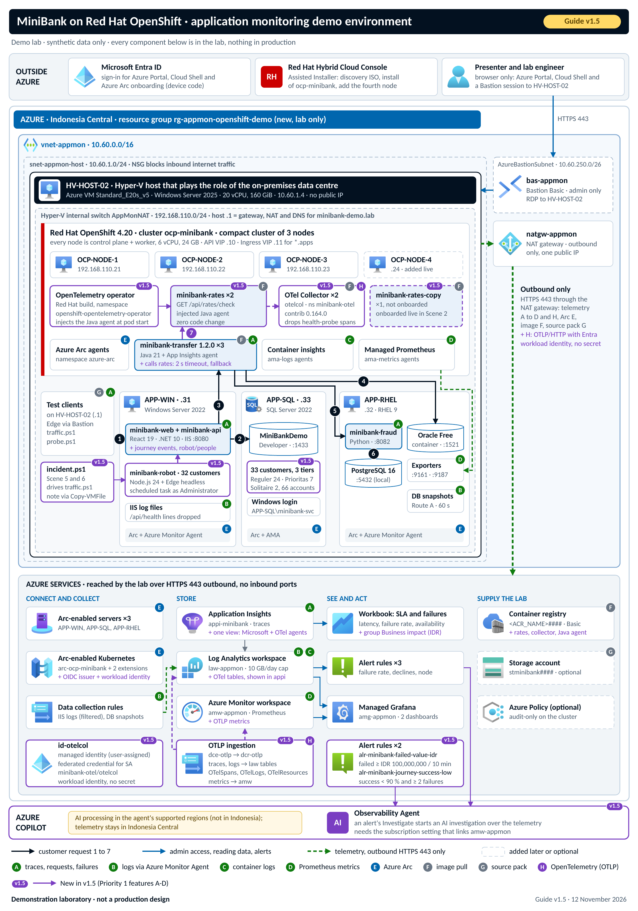

# 23. What version 1.5 adds

Part F - Priority 1 features (version 1.5) &nbsp;|&nbsp; [Guide index](README.md)

## 23.1 The four features in one view

| Feature | What the audience sees | How it is built | Chapter |
|---|---|---|---|
| A - AI investigation | An alert is opened, Investigate is pressed, and the Azure Copilot Observability Agent explains the root cause with evidence | Subscription setting that links the Azure Monitor workspace; no agent resource, no code | 27 |
| B - Zero-code onboarding on OpenShift | A Java service is onboarded live by adding one annotation; the Red Hat operator injects the OpenTelemetry agent and the trace appears | Red Hat build of OpenTelemetry operator, OpenTelemetry Collector, Azure Monitor OTLP ingestion with workload identity | 24 |
| C - Customer journeys | Simulated customers use the real MiniBank page all day; journeys, page views and users per customer, with a journey alert | Browser robot on APP-WIN, journey events in the web page, traffic-source labels, one incident command | 26 |
| D - Business impact in IDR | The failure is counted in rupiah, by tier and customer, with an alert at IDR 100 million | Customer tiers and 30 more customers, payment tags in the API, workbook group, IDR alert | 25 |

## 23.2 What was changed in the lab (12 November 2026)

| Where | What was added or changed | Undo |
|---|---|---|
| Subscription (agreed exception) | Setting Microsoft.Monitor/settings/default links the Azure Monitor workspace amw-appmon for the Observability Agent | Chapter 27.1 |
| rg-appmon-openshift-demo | Managed identity id-otelcol with a federated credential; data collection endpoint dce-otlp; data collection rule dcr-otlp; role Monitoring Metrics Publisher on the rule | Chapter 24.6 |
| rg-appmon-openshift-demo | Alert rules alr-minibank-failed-value-idr and alr-minibank-journey-success-low; workbook group Business impact (IDR) | Chapters 25.7 and 26.7 |
| Azure Arc cluster arc-ocp-minibank | OIDC issuer and workload identity enabled; OpenShift serviceAccountIssuer set to the Arc issuer | Chapter 24.6 |
| OpenShift | Operator opentelemetry-product (Manual approval), namespace minibank-otel with the collector otelcol, Instrumentation minibank-java, new service minibank-rates, spare copy minibank-rates-copy, minibank-transfer 1.2.0 | Chapter 24.6 |
| ACR | Images minibank-rates:1.0.0, minibank-transfer:1.2.0, otel/opentelemetry-collector-contrib:0.164.0, otel/autoinstrumentation-java:2.30.0 | Leave (no cost impact) |
| APP-SQL | Column Customers.Tier, view dbo.DemoBalanceTargets, 30 more customers and 60 more accounts, top-up covers all 66 accounts | Chapter 25.7 |
| APP-WIN | API and web 1.2.0; browser robot (task minibank-robot) | Chapters 25.7 and 26.7 |
| HV-HOST-02 | traffic.ps1 and probe.ps1 send the traffic-source header; incident.ps1; background slow share 2 % instead of 6 % | Chapter 26.7 |

Backups taken before the changes: etcd backups F:\Build\backup\etcd\20261112-1515 and 20261112-1553; database backup MiniBankDemo-before-p1.bak on APP-SQL; source folder C:\Build\minibank-v1.3-backup on APP-WIN and APP-SQL; site C:\inetpub\minibank-api-v1.3 on APP-WIN; F:\Build\minibank\scripts\traffic-v1.3.ps1 and probe-v1.3.ps1 on the host; the workbook as JSON in Cloud Shell (workbook-before-p1-20261112-101608.json).

## 23.3 Cost of version 1.5

| Item | Estimate (12 November 2026) |
|---|---|
| More telemetry (robot, browser telemetry, new tags, OpenTelemetry service) | About 0.19 GB per day, about US$13 per month |
| Two more log search alerts (every 5 minutes) | About US$3 per month |
| Deep investigation (feature A) | Up to 500 agent compute units, about US$5 each; plan at most 5 (build test, rehearsal, morning backup, live, spare). One was used in the build |
| Robot, collector, operator | No Azure cost (run on existing VMs and nodes) |

## 23.4 Honest notes for the presenter

- Data residency: the telemetry of every feature is stored in Indonesia Central. The AI analysis of feature A runs where the Observability Agent is offered (Australia East, East Asia and other listed regions, not Southeast Asia). Say both.
- The Red Hat build of OpenTelemetry operator is supported by Red Hat; Java auto-instrumentation through the operator is a Technology Preview feature of that operator.
- The customers are synthetic demo customers with realistic User IDs. The robot is a simulation of customers, not real traffic; its traffic is labelled robot and can be filtered out.
- The IDR figures use the amount of the failed payment request. In a bank the same tags would come from the payment system.
- The Observability Agent is a preview-era service: results can differ between runs; the morning backup run (Chapter 28.7) is the safety net.
## 23.5 Architecture with the Priority 1 features

Figure 23-1 shows the lab of Figure 4-1 with the four Priority 1 features. Everything that version 1.5 adds carries a purple v1.5 badge or a purple arrow: the OpenTelemetry operator, minibank-rates and its copy for the live act, the collector, the managed identity id-otelcol, the OTLP ingestion through dce-otlp and dcr-otlp, the browser robot and incident.ps1, the customer tiers, the two new alert rules and the Azure Copilot Observability Agent. Arrow 7 is the call from minibank-transfer to minibank-rates (a label, not the call order), and the letter H marks the OpenTelemetry (OTLP) telemetry path; the rest of the reading guide in Chapter 4.2 applies unchanged.

*Figure 23-1. MiniBank on Red Hat OpenShift with the Priority 1 features (version 1.5). Editable source: [diagrams/minibank-openshift-architecture-v1.5.drawio](../../diagrams/minibank-openshift-architecture-v1.5.drawio).*

---

[&larr; Appendix E. Version history](appendix-e-version-history.md) &nbsp;|&nbsp; [Guide index](README.md) &nbsp;|&nbsp; [24. Feature B - onboard a service with no code change &rarr;](24-feature-b-onboard-a-service-with-no-code-change.md)
