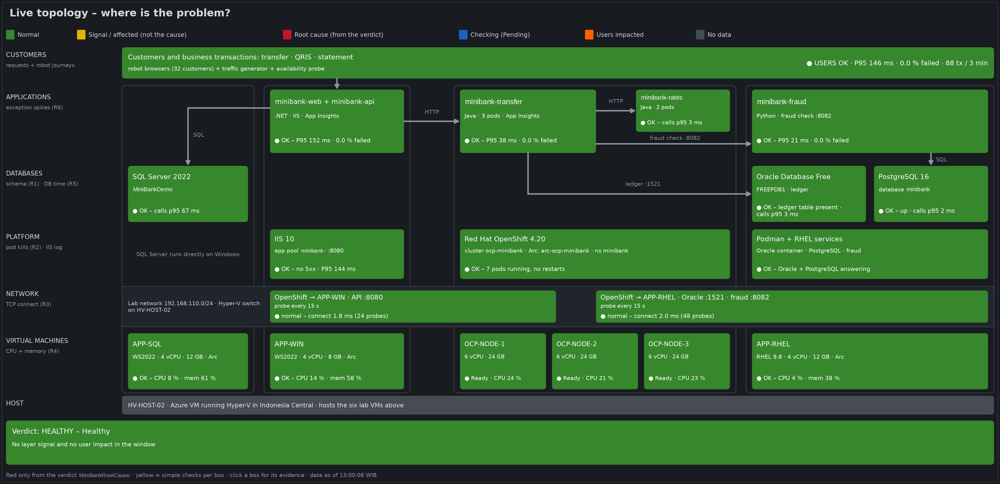
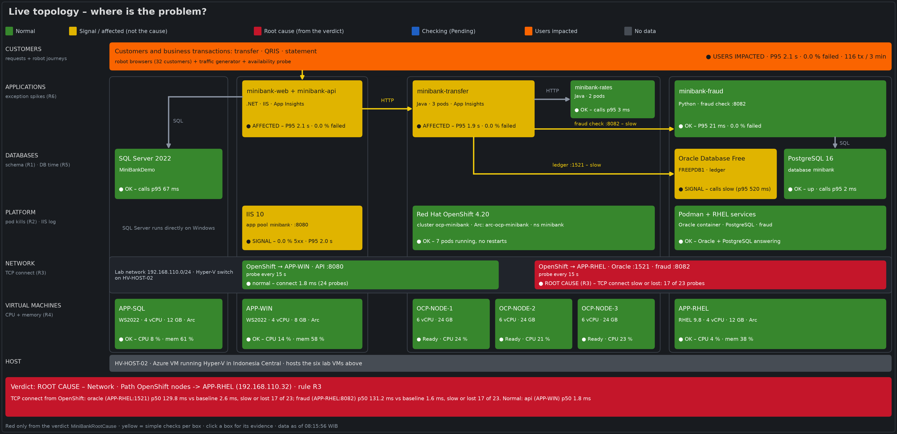
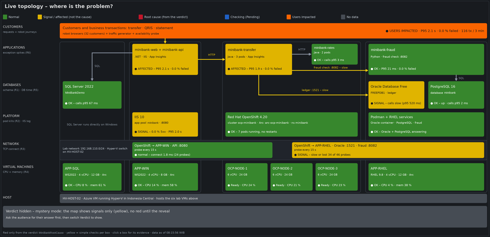

# 36. Live topology map (version 1.8)

<sub>Part G - Cross-layer root cause and mystery mode (version 1.7) &nbsp;|&nbsp; [Guide index](README.md)</sub>


Version 1.8 adds a map to the board MiniBank - Cross-layer root cause. The verdict tiles say which layer is at fault; the map shows where that layer sits in the lab and which other parts feel the problem. It was approved on 14 November 2026 at 10:58 WIB, built the same day, and it changes no rule of the verdict.

## 36.1 What the map shows

The panel Live topology – where is the problem? sits directly under the verdict tiles and uses the full width of the board. It draws the monitored stack of the lab as seven rows: the customers and their business transactions at the top, then the applications, the databases, the platform (IIS and OpenShift), the network paths, the virtual machines and, at the bottom, the Hyper-V host HV-HOST-02. Four columns follow the machines: APP-SQL, APP-WIN, the OpenShift cluster with its three nodes, and APP-RHEL. The lines between the boxes are the calls: the customers to minibank-web and minibank-api, the API to SQL Server and to minibank-transfer, the transfer service to minibank-rates, to the fraud check and to the Oracle ledger, and the fraud service to PostgreSQL.

> [!NOTE]
> **Where to run it**
>
> Microsoft Edge on your own computer: Grafana amg-appmon (https://&lt;GRAFANA_HOST&gt;) &gt; Dashboards &gt; folder MiniBank &gt; MiniBank - Cross-layer root cause (address /d/minibank-rootcause). Time range Last 1 hour, refresh 30s, variable verdict = show. Scroll down past the verdict tiles to the large full-width panel titled Live topology – where is the problem?

Every box has a title, a short description and a status line that is computed from the same telemetry as the rest of the board, and every box and line is coloured. Figure 36-1 shows the map when the lab is healthy.



*Figure 36-1. The Live topology map with a healthy lab. A drawing of the panel made from its own definition, with the same layout and colours; the figures in it are examples.*

## 36.2 How to read the colours

The colours follow one rule: red comes only from the verdict, everything else comes from a simple check per box.

| Colour | Meaning | Where it comes from |
|---|---|---|
| Green | Normal | The simple check of the box finds nothing unusual |
| Yellow | A signal, or a part that feels the problem, but not the cause. A yellow line: the calls are slow or failing, and its label says which | The simple check of the box (next table). Requests, calls and users: the last 3 minutes; layer signals: the last 6 minutes; OpenShift restarts: the last 9 minutes; each compared with a typical minute of the hour before |
| Red | Root cause: the component that the verdict names | Only the verdict MiniBankRootCause (rules v2.8), which the map reads and never changes. At most one component is red; a network answer can name both paths |
| Blue | Checking: the verdict is Pending and waits for the slower layers; blue marks the box of the first signal | The first signal that the verdict reports (rule R5, database slow, or R6, new exception) |
| Orange | Users impacted (the customer bar only) | The verdict status RootCause, Unclassified or Pending. With rule R8 the bar is yellow and reads A FEW SLOW TRANSACTIONS |
| Grey | No data in the window, or context only (HV-HOST-02) | The source has not reported in the window |

The strip under the map repeats the verdict: the status, the layer, the component and the rule, with the evidence underneath. It is green for Healthy, yellow for Warning, blue for Pending, orange for Unclassified and red for RootCause. The footer says when the data was read (data as of hh:mm:ss WIB). The checks behind yellow and red, box by box:

| Box | Yellow when | Red when |
|---|---|---|
| Customers (bar) | Orange when users are impacted; yellow for a few slow transactions (rule R8) | Never |
| minibank-web + minibank-api | At least 5 requests with more than 2 % failing (HTTP 5xx) or a P95 at least 3 times the typical value (and at least 300 ms); a new exception spike; or users are impacted | The verdict names minibank-api or minibank-web (rule R6) |
| minibank-transfer | The same request check, an exception spike, or slow or failing calls to Oracle, the fraud check or minibank-rates | The verdict names minibank-transfer (R6) |
| minibank-rates | Slow or failing calls from minibank-transfer | Never (display only) |
| minibank-fraud | The request check, an exception spike, or slow or failing calls to PostgreSQL | The verdict names minibank-fraud (R6) |
| SQL Server 2022 | The API's SQL calls are slow (P95 at least 5 times typical and at least 100 ms) or failing (2 or more and over 2 %) | The verdict names SQL Server (R5) |
| Oracle Database Free | The schema check misses MINIBANK.LEDGER_ENTRY, or the ledger calls are slow or failing | The verdict names Oracle (R1 schema change, or R5) |
| PostgreSQL 16 | The fraud service's SQL calls are slow or failing | Never |
| IIS 10 | At least 10 requests in the IIS log with more than 2 % 5xx or a P95 of 1 second or more (the log arrives 2 to 3 minutes late) | Never |
| Red Hat OpenShift 4.20 | Container restarts or kills in namespace minibank in the last 9 minutes, a pod that is not running, or a node that is not Ready | The verdict answers OpenShift (R2) |
| Podman + RHEL services | Oracle errors or blocked sessions in the database snapshot | Never |
| OpenShift → APP-WIN and OpenShift → APP-RHEL | At least 4 probes with 2 or more slow (over 50 ms) or lost, or a median connect time at least 3 times typical (and over 20 ms) | The verdict names that path (R3) |
| APP-SQL, APP-WIN, APP-RHEL | Two CPU samples of 85 % or more in 4 minutes, a 4-minute CPU average of 75 % or more, or memory at 92 % or more | The verdict names that server (R4) |
| OCP-NODE-1 to OCP-NODE-3 | Not Ready, CPU at 90 % or more, or memory at 95 % or more | Never (an OpenShift answer turns the OpenShift box red) |
| HV-HOST-02 | Never: context only, always grey | Never |

## 36.3 How it works

The map is a Grafana Canvas panel with one query to law-appmon: MiniBankTopology($__timeTo(), '$verdict'). The function MiniBankTopology reads the verdict MiniBankRootCause for the same moment and runs one simple check per box on the tables the board already uses: AppRequests, AppDependencies and AppExceptions from Application Insights, the network probe in ContainerLogV2, Perf, KubeNodeInventory and KubePodInventory, the IIS log W3CIISLog and the database snapshot MiniBankDbSnap_CL. It returns one row with a state, a colour and a status line for every box and every line of the map.

The function takes the end of the time range, like the verdict tiles, so moving the time range back replays the map as it was at that moment. It is display only: it adds no rule, it does not change the verdict, and nothing else reads it. It is saved in law-appmon in the category MiniBank cross-layer with two parameters: at (datetime; empty means now) and reveal (string; show or hide, default show). To read the map's data yourself, for example before a session:

> [!NOTE]
> **Where to run it**
>
> Azure Portal &gt; search box at the top: law-appmon &gt; open the Log Analytics workspace law-appmon &gt; Logs (left menu). Close the Queries hub if it opens. At the top right of the query window switch from Simple mode to KQL mode, paste the whole query into the query editor, leave Time range on Set in query and click Run.

```kusto
MiniBankTopology(now(), 'show')
| project TimeGenerated, t_users, t_web_api, t_oracle, t_net_rhel, t_vm_win, t_verdict
```

> [!TIP]
> **What you should see**
>
> One row. With a quiet lab t_users starts with ● USERS OK and t_verdict reads Verdict: HEALTHY – Healthy. Without the project line the row has 76 columns: s_ is the state of a box (0 normal, 1 signal, 2 root cause, 3 checking, 4 users impacted, 5 no data), t_ is its status line and e_ is the state of a line.

## 36.4 Using the map in the demo

In Scene 7C (Chapter 19.10C) the map tells the story of a fault in one picture. The customer bar turns orange when customers feel the fault, the parts that feel it turn yellow together with their call lines, and when the verdict answers, the named box turns red and the strip names the layer, the component and the rule. Point at the red box first: that is the cause. The yellow boxes are the symptoms. Figure 36-2 shows the network fault card net-rhel: the slow path to APP-RHEL makes the API, the transfer service, Oracle and IIS look slow as well.



*Figure 36-2. The network fault card net-rhel with the verdict shown: only the path OpenShift → APP-RHEL is red. A drawing of the panel with example values; the replay of 14 November 2026 at 08:15:56 WIB showed the same colours (Chapter 36.5).*

With the variable verdict = hide (the workshop setting of Chapter 32.4) the map never shows red or blue: every signal is yellow and the verdict strip is grey (Figure 36-3). The audience sees all the symptoms and has to decide which one is the cause. Set verdict back to show for the reveal, and the cause turns red.



*Figure 36-3. The same moment with verdict = hide: the network path is one yellow box among several, and the verdict strip stays grey until the reveal.*

Every box opens its evidence in a new browser tab: the matching panel of the same board, full screen, with the same time range and the same verdict setting. The customer bar and IIS open Failed business transactions %, the four services open Application: exceptions per minute, SQL Server opens Database: time spent in database calls, Oracle opens Database: Oracle schema check, OpenShift and its three nodes open OpenShift: container restarts, both network paths open Network: TCP connect time from OpenShift, the three servers open VM: CPU %, and the verdict strip opens Verdict history. PostgreSQL and Podman open the board MiniBank - OpenShift and Databases, and HV-HOST-02 opens the virtual machine in the Azure Portal.

> [!IMPORTANT]
> **Say this**
>
> "This is the same verdict, drawn on the estate. Yellow is every part that feels the problem, red is the one place that causes it, and every box opens its evidence. Operators see the whole chain, from the customer down to the server, in one picture."

> [!CAUTION]
> **Be honest**
>
> The map uses rules written for this lab, like the verdict. Red can only come from the verdict, so the map is never more certain than the verdict, and it needs the same 2 to 3 minutes, because the VM, OpenShift, network and IIS data arrive after the application data. Yellow is a simple check per box and also lights up parts that only feel the problem. The boxes and lines are drawn for this lab; they are not discovered automatically.

> [!WARNING]
> **If something goes wrong**
>
> The lines no longer touch the boxes after the browser window changed size, for example after the side menu was closed: reload the page (F5); the canvas draws its lines only once. A box is grey with NO DATA: that source has not reported in the window; check the sources with the query of Chapter 31.5. The wall screen does not show the map: reload the kiosk tab once after a change to the board.

## 36.5 Tests on 14 November 2026

Before anything was saved, a read-only test ran the function at 17 moments at about 12:20 WIB: the live lab, moments inside the fault windows of all five cards in series 2 and series 4, a moment without a fault, the quiet-night Warning of rule R8 and two moments in mystery mode. Every moment coloured the expected boxes, and no box showed No data:

| Moment | Red | Yellow | Result |
|---|---|---|---|
| Live lab (12:20 WIB) | - | - | Healthy, all green |
| net-rhel (series 2 and 4) | OpenShift → APP-RHEL | minibank-web + minibank-api, minibank-transfer, Oracle, IIS; the lines from the customers, HTTP, fraud check and ledger | As expected |
| cpu-win | APP-WIN | minibank-web + minibank-api | As expected |
| oom-ocp | OpenShift | minibank-web + minibank-api, minibank-transfer and IIS (series 2: the API and IIS); the lines from the customers and HTTP | As expected |
| nullref-api | minibank-web + minibank-api | IIS | As expected |
| schema-oracle | Oracle | minibank-web + minibank-api, minibank-transfer, IIS; the lines from the customers, HTTP and ledger | As expected |
| No fault | - | - | Healthy |
| Quiet night, rule R8 | - | The customer bar (A FEW SLOW TRANSACTIONS) and minibank-web + minibank-api | Warning: No layer at fault |
| Mystery mode, nullref-api | - | minibank-web + minibank-api, IIS; verdict hidden | No red, as expected |
| Mystery mode, net-rhel | - | OpenShift → APP-RHEL | No red, as expected |

After the panel was added, the board itself was checked from 13:00 to 13:10 WIB. Live, every box was green, for example USERS OK · P95 146 ms · 0.0 % failed · 88 tx / 3 min, data as of 13:00:08 WIB, and the lines met the boxes at full width. With the time range set to 07:15:56 to 08:15:56 WIB, 4.5 minutes into the net-rhel slot of series 4, the path OpenShift → APP-RHEL was red with ROOT CAUSE (R3) – TCP connect slow or lost: 17 of 23 probes, the customer bar was orange (P95 2.1 s, 116 transactions in 3 minutes), the API, the transfer service, Oracle and IIS were yellow, and so were the HTTP, fraud check and ledger lines. The same moment with verdict = hide showed that path in yellow (SIGNAL – slow or lost 34 of 46 probes), the grey strip Verdict hidden – mystery mode, and the tiles as hidden (workshop). The evidence link of the network box opened Network: TCP connect time from OpenShift for the replayed time range.

Not yet seen on the board: the blue Checking colour (in the replayed moments the verdict had already answered) and a click inside the canvas (the link of the network box was opened by its address). The links to the board MiniBank - OpenShift and Databases and to HV-HOST-02 were not opened. Watch for blue, and click a few boxes, during the next labelled rehearsal (Chapter 33.3).

## 36.6 Build record, cost and undo

Version 1.8 adds no Azure resource and no new data: the map runs one more query against law-appmon each time the board refreshes. The function and the panel live only in the lab (law-appmon and the board's JSON model); they are not yet in a source pack. The build on 14 November 2026:

| Time (WIB) | What happened |
|---|---|
| 10:58 | Approved: the Live topology panel in Grafana only, under the verdict tiles, with yellow affected boxes and following the verdict switch; this runbook with figures afterwards |
| 11:25-12:00 | Cloud Shell stopped accepting input, so the build moved to the Azure Portal and Grafana in the browser |
| 12:20 | Read-only test of the function: 17 of 17 moments as expected |
| 12:40-12:57 | Function MiniBankTopology saved in law-appmon (Logs &gt; Save &gt; Save as function); the panel carried into Grafana through a temporary helper board and pasted into the board |
| 12:57 and 12:59 | Board versions 5 and 6 saved: the panel directly under the verdict tiles, at full width |
| 13:00-13:10 | Board checked live, in a replay of the network fault, in mystery mode and through an evidence link |

How to undo version 1.8:

| Item | Where | How to undo |
|---|---|---|
| Live topology panel | Grafana amg-appmon | Open MiniBank - Cross-layer root cause &gt; Edit &gt; Settings &gt; Versions and restore version 4 (14 November 2026, 07:52, the logo header), or remove only the panel Live topology – where is the problem? (panel menu &gt; Remove) and save the board |
| Function MiniBankTopology | law-appmon &gt; Logs &gt; Functions | Delete the function MiniBankTopology after the panel is gone. MiniBankRootCause and the other functions are not touched |
| Temporary helper board | Grafana amg-appmon &gt; Dashboards | Delete TEMP - MiniBank live topology carrier (delete after build) if it is still there: open it &gt; Edit &gt; Settings &gt; Delete dashboard. Nothing else uses it |

---

[&larr; 35. Test results and readiness (13 November 2026)](35-test-results-and-readiness-13-november-2026.md) &nbsp;|&nbsp; [Guide index](README.md) &nbsp;|&nbsp; [37. Host CPU contention on HV-HOST-02 (version 1.9) &rarr;](37-host-cpu-contention-on-hv-host-02-version-1-9.md)
