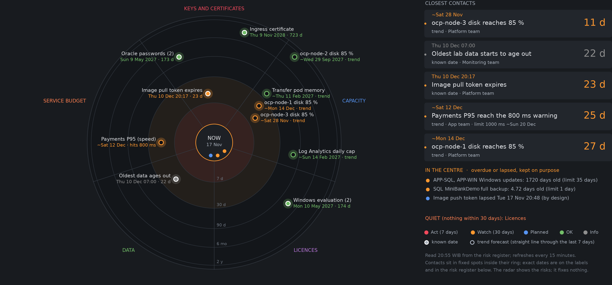

# 40. Look-ahead radar and the speed item (version 2.2)

Part G - Cross-layer root cause and mystery mode (version 1.7) &nbsp;|&nbsp; [Guide index](README.md)

Version 2.2 adds two things to the Look-ahead board of Chapter 39, both on 17 November 2026. The speed item makes the register track how fast the business transactions are, after a read-only check found them about 23 ms slower every day while the 1-second target still looked comfortable. The Look-ahead radar puts the whole register into one picture at the top of the Grafana board, as the executive summary. Both read the same register; the collector and every other part of the demo are unchanged.

## 40.1 Decisions

| Topic | Decision (17 November 2026) |
|---|---|
| Speed item | Add a register row for the business transactions P95 per hour with a 1,000 ms limit and an 800 ms warning, and build it before the board redesign (approved at about 17:00 WIB). |
| Radar | Build the radar first, in the Grafana board only, with the default choices (approved at about 20:21 WIB): pinned to today, directly under the logo header and above Risks by status, drawn for a 1920 x 1080 screen at 100 % zoom. |
| How it is built | Grafana's built-in Canvas panel, no add-on; one query inside the panel that reads only the existing register; no new or changed functions for the radar. |
| Scope and safety | Changes only in rg-appmon-openshift-demo and its managed resource group, with no impact on the existing demo or any other scenario: a trial first, then the change with a backup, then a before-and-after comparison. |
| Still open | The rest of the board redesign was built later: the service weather on the SLA board on 18 November 2026 (version 2.3, Chapter 41), and the trail map with fast-forward, the Outlook-style month view and the collapsed Details row on 18 and 19 November 2026 (version 2.5, Chapter 43). The radar stays on today; it can follow the fast-forward later. |
| Runbook | This version 2.2, written after the build, covering the radar and the speed item. |

## 40.2 The speed item

On 17 November 2026 a read-only check found that the business transactions of minibank-api (transfer, QRIS payment and statement) get slower every day: their P95 rose from about 108 ms on 13 November to about 229 ms on 17 November, roughly 23 ms a day, while the share slower than 1 second stayed at about 1.6 to 1.75 % a day. Only one step grows: the last SQL statement of each successful payment (UPDATE dbo.Transfers ... WHERE ReferenceNo = @ref) takes about 0.565 ms longer for every 1,000 rows in the table, and the table grows by about 39,000 rows a day. The most likely reason is that the application sends @ref as nvarchar while the column is varchar(20), so SQL Server reads the whole table instead of using its index. Nothing has been fixed yet.

The register did not see it, because the speed budget counts only the transactions slower than 1 second. The speed item adds what was missing:

- A new hourly reading in MiniBankLaReadings: the P95 of the business transactions for every complete hour with at least 50 transactions, with the drill minutes left out, against the limit of 1,000 ms and the warning of 800 ms.
- A warning level in MiniBankLookahead: the row turns Watch when the trend reaches the 800 ms warning within 30 days and Act when it reaches the 1,000 ms limit within 7 days. The Limit column reads 1000.0 ms (warning 800.0 ms), the Basis column gives both dates, and the row sits in the Service lens with the owner App team.
- A sixth daily item in MiniBankLaDaily, so the 10:00 WIB forecast of the collector and the scorecard cover the P95 from 18 November 2026. The collector itself was not changed.
- Two panels under the Service budget row of the Grafana board (Business transactions P95 per hour with the warning and limit lines and the trend; Speed trend with the P95 now, the slowdown per day and the days to the warning and to the limit) and three items on the Service budget tab of the workbook.

At 19:30 WIB on 17 November 2026 the row read Watch: 228 ms now, a trend of +23.25 ms a day over 4.2 days (101 hourly readings), the 800 ms warning in 24.6 days (about Saturday 12 December 2026) and the 1,000 ms limit in 33.2 days (about Monday 21 December 2026). The register then held 73 rows: 0 Act, 7 Watch, 1 Planned, 52 OK and 13 Info. The dates move a little with every new hour of readings; by 21:00 WIB the limit read about Sunday 20 December. The fix options, none of them applied:

| Option | What | Effect | When |
|---|---|---|---|
| A | Leave it, and use the slowdown as a demo story. | The trend goes on: the row stays Watch and turns Act when the 1,000 ms limit is 7 days away, about 14 December. | Now |
| B | Database only: change ReferenceNo to nvarchar(20) and recreate its unique index (backup first, in a quiet minute). | The update uses the index again, so the P95 should drop back. | After the demo, with approval |
| C | Code: send typed varchar(20) parameters from the application (source pack v1.5). | The same, fixed at the source. | After the demo, with approval |

When the slowdown is fixed, the P95 chart shows the drop, and the row should return to OK once the trend flattens.

## 40.3 The Look-ahead radar

The radar is the first panel of the board, directly under the logo header. It is an executive summary of the register: every risk is a contact closing in on today.

- The distance is the time left. The rings mark 7 days, 30 days, 90 days, 6 months and 2 years; the band inside 7 days is tinted red and the band up to 30 days orange, like Act and Watch.
- The sector is the kind of risk: Keys and certificates at the top, then Capacity, Licences, Data and Service budget clockwise.
- The colour is the status: red Act, orange Watch, blue Planned, green OK and grey Info. A solid dot is a known date, such as a token or a certificate; a hollow dot is a forecast from a trend, such as a disk that fills up.
- The centre holds what is overdue or lapsed on purpose and is shown, not fixed: on 17 November 2026 the old Windows updates of APP-SQL and APP-WIN, the missing full backup of the SQL Server demo database and the push token that lapsed by design at 20:48 WIB.
- The list on the right names the five closest contacts with their date, owner and days left, then the items in the centre and any quiet sector with nothing within 30 days. The footer says when the register was read; the board refreshes every 15 minutes.

*Figure 40-1. The Look-ahead radar as built. A drawing of the panel made from its own definition, with the same layout and colours and the values the panel showed at 20:55 WIB on 17 November 2026; on the board the values follow the register.*

What the radar showed at 20:55 WIB on 17 November 2026:

| Sector | Contact | Status | Label on the radar |
|---|---|---|---|
| Keys and certificates | Image pull token expires | Watch | Thu 10 Dec 20:17 · 23 d |
| Keys and certificates | Oracle passwords (2) | OK | Sun 9 May 2027 · 173 d |
| Keys and certificates | Ingress certificate | OK | Thu 9 Nov 2028 · 723 d |
| Capacity | ocp-node-3 disk 85 % (trend) | Watch | ~Sat 28 Nov · trend |
| Capacity | ocp-node-1 disk 85 % (trend) | Watch | ~Mon 14 Dec · trend |
| Capacity | Transfer pod memory (trend) | OK | ~Thu 11 Feb 2027 · trend |
| Capacity | Log Analytics daily cap (trend) | OK | ~Sun 14 Feb 2027 · trend |
| Capacity | ocp-node-2 disk 85 % (trend) | OK | ~Wed 29 Sep 2027 · trend |
| Licences | Windows evaluation (2) | OK | Mon 10 May 2027 · 174 d |
| Data | Oldest data ages out | Info | Thu 10 Dec 07:00 · 22 d |
| Service budget | Payments P95 (speed, trend) | Watch | ~Sat 12 Dec · hits 800 ms |
| Centre | Windows updates (APP-SQL, APP-WIN), SQL full backup, push token lapsed 20:48 | Watch, Planned | In the list on the right |

## 40.4 How the radar is built

The radar is one Grafana Canvas panel, built into Grafana with no add-on, with 201 drawing elements: the rings, the five sectors, 30 fixed spots for contacts and the list on the right. One query inside the panel reads the register MiniBankLookahead() and returns a single row of 226 fields: for each spot the name, the date line and the colours, and for the list the five closest contacts, the centre items and the quiet sectors. No function, table or collector was added or changed for it.

Each kind of risk owns a sector, and each sector owns a fixed number of spots per ring (Keys and certificates 7, Capacity 8, Licences 5, Data 5 and Service budget 5). A contact goes into its ring by its days left, and the nearer of two contacts in the same ring takes the inner spot. When a ring is full, the sector name shows +N more and the register keeps the full list. Labels sit on rows 30 pixels apart, so they cannot overlap. Identical items with the same date are combined, such as Oracle passwords (2) and Windows evaluation (2). For the speed row the radar uses the date of the 800 ms warning, because that is what makes the row Watch.

Limits, by design: a contact snaps to a fixed spot inside its ring, so its distance shows the ring and not the exact day (the exact date is on its label); Canvas cannot draw dashed outlines or the sweep of the first sketch, so a forecast is a hollow dot; and the radar shows today only. The fast-forward of the trail map was built in version 2.5 (Chapter 43); the radar stays on today on purpose and can follow it later (about 15 to 30 minutes more work).

Screen: the radar is drawn for a board about 1,500 pixels wide, a 1920 x 1080 screen at 100 % zoom, and the list on the right is anchored to the right edge. On a narrower window close Grafana's side menu, or use kiosk mode, so that long labels on the far right do not touch the list.

> [!NOTE]
> **Where to run it**
>
> Microsoft Edge on your own computer: Grafana amg-appmon (https://&lt;GRAFANA_HOST&gt;) &gt; Dashboards &gt; folder MiniBank &gt; MiniBank - Look-ahead (address /d/minibank-lookahead). The radar is the first panel under the logo header; on the first load it can take up to half a minute to draw. For the widest view close Grafana's side menu, or press d and then k for kiosk mode.

## 40.5 Safety and the no-impact checks

Both builds followed the routine of version 2.1: a read-only fingerprint of the existing demo first, then a trial, then the change with a backup, then the same fingerprint again together with the Azure activity log of the three resource groups.

Speed item: the new queries first ran beside the saved ones without saving anything. Every existing register row stayed the same; the only differences were the new speed rows and a known run-to-run wobble of about 0.03 points in the daily host CPU P95. Every panel and workbook query also ran against renamed test copies. The change was made at 19:29 WIB and checked at 19:53 WIB.

Radar: the radar query ran read-only first. Then a temporary copy of the whole board with the radar showed it in Grafana and ran all 21 panel queries without an error, while the live board stayed untouched; the copy was deleted after the change. The live board was changed at 21:01 WIB and checked at 21:05 WIB.

| What was checked | Speed item (19:16 to 19:53 WIB) | Radar (20:30 to 21:05 WIB) |
|---|---|---|
| Saved functions | 47 other functions unchanged, the root-cause rules included; the 3 Look-ahead functions changed as planned | 50 unchanged |
| Workbooks | The SLA workbook unchanged; the Look-ahead workbook changed as planned | Both unchanged |
| Upload rules, custom tables, alert items | 10, 4 and 6 unchanged | 10, 4 and 6 unchanged |
| Grafana boards | 51 other boards unchanged; the Look-ahead board from version 2 to 3 | 51 other boards unchanged; the Look-ahead board from version 3 to 4 |
| Managed resource group, roles of the host identity | 1 item and 5 roles unchanged | 1 item and 5 roles unchanged |
| Activity log, demo resource group | 3 workbook and 3 saved-search writes by the lab account, and heartbeats of Azure Arc | 10 heartbeats of Azure Arc only |
| Activity log, managed and Hyper-V resource groups | 0 and 0 events | 0 events, and 8 automatic inventory updates of Azure Arc for SQL Server in the Hyper-V group, not from this build |

Result: the existing demo is unchanged. The Hyper-V demo was not touched; its automatic inventory updates come from Azure Arc for SQL Server and happen without any change from this lab.

## 40.6 What changed and where

| Item | Where | Change |
|---|---|---|
| MiniBankLaReadings, MiniBankLookahead and MiniBankLaDaily | law-appmon (saved searches minibank-la-\*) | Version 1.1 queries: the speed reading, the warning level and the sixth daily item |
| Workbook MiniBank - Look-ahead | rg-appmon-openshift-demo | Service budget tab: la-speed-risks, la-speed-chart and la-speed-note |
| Grafana board MiniBank - Look-ahead | amg-appmon, folder MiniBank | Version 3: the two speed panels under Service budget. Version 4: the radar under the logo header, every other panel 20 rows lower |
| Collector, upload rule, table, alert rules, other boards and workbooks | - | Not changed |

## 40.7 Build record, open items and undo

| Time (WIB) | What happened |
|---|---|
| 17 Nov 16:00-16:35 | Read-only check of why the transactions get slower every day: only the last SQL step of each payment grows with the size of dbo.Transfers (Chapter 40.2). |
| 17 Nov 16:47 | Read-only: the Look-ahead board did not spot the slowdown; the speed item was advised. |
| 17 Nov about 17:00 | Speed item approved: limit 1,000 ms, warning 800 ms, before the redesign. |
| 17 Nov 19:16-19:28 | Before fingerprint and trial run of the speed item, read-only. |
| 17 Nov 19:29 | Speed item saved: 3 functions, Grafana board version 3 and the workbook items; checked at 19:31 with 0 problems. |
| 17 Nov 19:45-19:49 | Two workbook tidy-ups: the legend totals hidden, and the note now says purple line. |
| 17 Nov 19:53 | Comparison: the existing demo is unchanged. |
| 17 Nov 20:21 | Radar approved with the default choices. |
| 17 Nov 20:30-20:55 | Before fingerprint and two read-only runs of the radar query (226 fields, none missing). |
| 17 Nov 20:56 | Temporary copy of the board with the radar: the radar drawn correctly and 21 panel queries without an error. |
| 17 Nov 21:01 | Radar saved: Grafana board version 4; 21 panel queries without an error at 21:01. |
| 17 Nov 21:03 | Temporary copy deleted. |
| 17 Nov 21:05 | Comparison: the existing demo is unchanged. |

Open items:

- Decide the slowdown fix: before or after the demo, option B (database only) or C (code), and whether to use the slowdown as a demo story (Chapter 40.2).
- First live forecast check of the P95 on 18 November 2026 at about 10:00 WIB (Chapter 39.6).
- The rest of the board redesign was built later: the service weather on the SLA board on 18 November 2026 (version 2.3, Chapter 41), and the trail map with fast-forward, the Outlook-style month view and the collapsed Details row on 18 and 19 November 2026 (version 2.5, Chapter 43).
- Renew the registry pull token minibank-pull before 10 December 2026 20:17 WIB.
- Update the table of contents in desktop Word: References &gt; Update Table &gt; Update entire table.

How to undo version 2.2, in this order (each step only if you want that part back):

| Step | What to do |
|---|---|
| 1 | Radar: Grafana &gt; MiniBank - Look-ahead &gt; Edit &gt; Settings &gt; Versions &gt; restore version 3. The speed panels stay. |
| 2 | Speed panels: restore version 2 instead of version 3; this also removes the radar. |
| 3 | Workbook: Azure Portal &gt; rg-appmon-openshift-demo &gt; MiniBank - Look-ahead &gt; Edit; on the Service budget tab remove the items la-speed-risks, la-speed-chart and la-speed-note, set the intro text back to "Service (error budget of the business transactions)" and save. |
| 4 | Functions: in law-appmon &gt; Logs &gt; Functions, put back the version 1.0 query of MiniBankLaReadings, MiniBankLookahead and MiniBankLaDaily from the file lookahead-functions-v1.0.kql in the build-helpers folder next to this runbook, and save each under its own name. The register loses the speed row; nothing else changes. |
| 5 | Runbook: in Scene 7D skip the radar and start at Risks by status. |

---

[&larr; 39. Look-ahead: what will need attention next (version 2.1)](39-look-ahead-what-will-need-attention-next-version-2-1.md) &nbsp;|&nbsp; [Guide index](README.md) &nbsp;|&nbsp; [41. Service weather on the SLA board (version 2.3) &rarr;](41-service-weather-on-the-sla-board-version-2-3.md)
