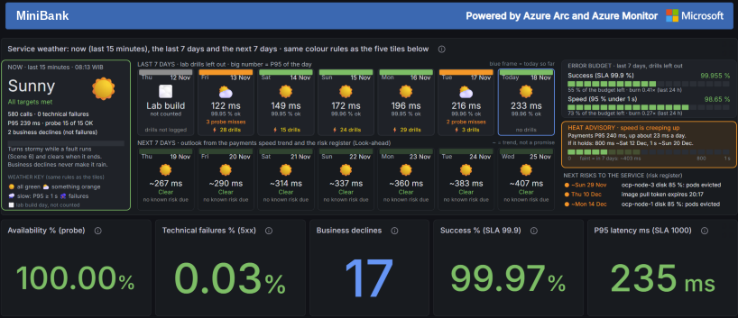
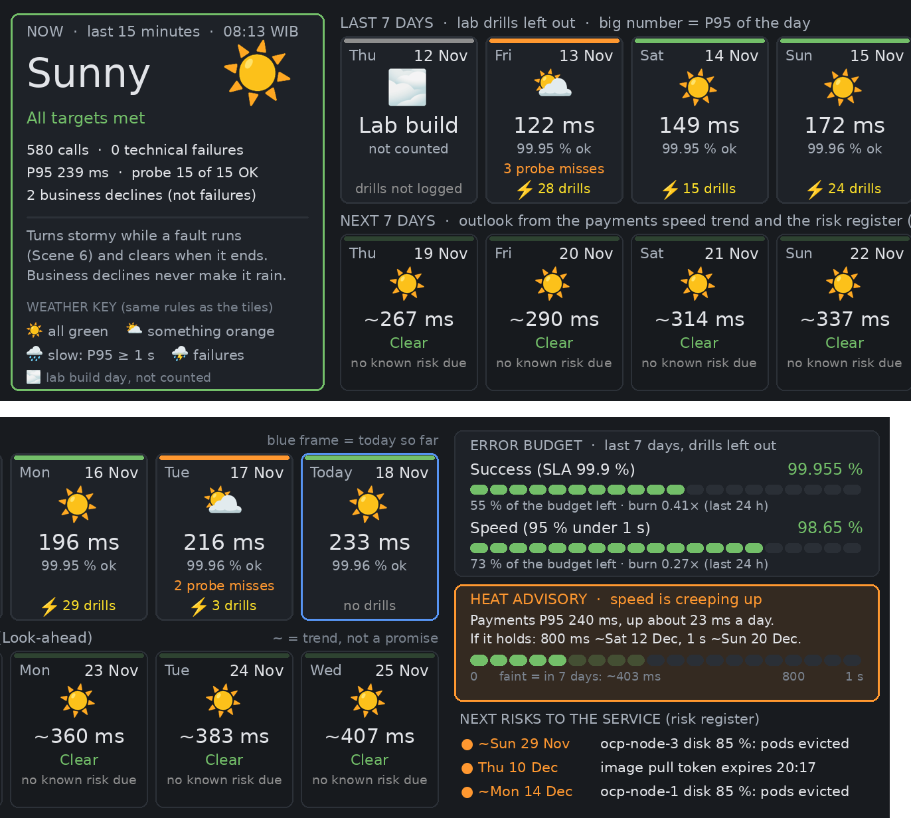

# 41. Service weather on the SLA board (version 2.3)

Part G - Cross-layer root cause and mystery mode (version 1.7) &nbsp;|&nbsp; [Guide index](README.md)

Version 2.3 adds a service weather strip to the Grafana board MiniBank - SLA and Failure Rate, on 18 November 2026. It sits directly under the logo header and above the five tiles, and tells the same story as the tiles in one glance: the weather now (the last 15 minutes), over the last 7 days and for the next 7 days, with the error budget measured against the board's own SLA. It only reads data that already exists; the Azure workbook of the same name and every other part of the demo are unchanged.

*Figure 41-1. The SLA board as built, at 08:13 WIB on 18 November 2026 (browser screenshot): the logo header, the service weather strip and the five tiles below it.*

## 41.1 Decisions

| Topic | Decision (17 and 18 November 2026) |
|---|---|
| Where | Only the Grafana board MiniBank - SLA and Failure Rate (chosen at 14:51 WIB on 17 November). The Azure workbook of the same name is not changed. |
| Size and place | A strip 9 rows high directly under the logo header, above the five tiles; every other panel moves 9 rows lower. On a 1920 x 1080 screen the five tiles stay on the first screen. |
| NOW | The last 15 minutes, live, with nothing left out, so the strip turns stormy while a fault runs and clears when it ends. |
| Error budget bars | Kept in the strip and measured against the board's own SLA (approved at 00:29 WIB on 18 November): success is 99.9 % of the calls without a technical failure; speed is 95 % of the calls under 1 second, which is the same as the P95 below 1,000 ms of the P95 tile. |
| Two budgets | The Look-ahead board keeps its own service budget at 99.5 % (Chapter 39). The SLA board shows the stricter 99.9 %, so the same week shows less budget left here. Aligning the two is an open item (41.8). |
| How it is built | In Grafana only: one built-in Canvas panel with one read-only query; no new function, no add-on and no change to the data collection. |
| Runbook | Version 2.3 after the build (this chapter). |

## 41.2 What the strip shows

| Part | What it shows |
|---|---|
| NOW (left) | The weather of the last 15 minutes, live: the number of calls and technical failures, the P95, the probe result and the business declines (shown as not failures). A short key explains the symbols. |
| LAST 7 DAYS | One tile per day in WIB time: the weather, the P95 of the day (the big number), the share of calls without a technical failure, probe misses and the number of lab drills. Drill minutes are left out. Days before 13 November 2026 were lab build days and show Lab build, not counted. Today has a blue frame and covers the day so far. |
| NEXT 7 DAYS | One tile per day: the expected payments P95 from the speed trend of the Look-ahead register (marked ~, a trend and not a promise) and the outlook: Clear, Warm (the trend is above 800 ms), Slow (above 1 second), Risk due (a dated risk of the register falls on that day) or Budget out (the error budget runs out that day at the pace of the last 24 hours). |
| ERROR BUDGET | Two bars for the last 7 days with lab drills left out, never earlier than 13 November 2026 14:00 WIB: Success against 99.9 % and Speed against 95 % under 1 second. Each shows the actual percentage, the budget left, the burn rate of the last 24 hours (1x means exactly on budget) and, when the budget would run out within 30 days, the date. |
| HEAT ADVISORY | The payments speed row of the Look-ahead register: the P95 now, how much slower it gets per day and when it reaches 800 ms and 1 second. The thermometer runs from 0 to 1 second in steps of 50 ms; the faint part is where the trend will be in 7 days. |
| NEXT RISKS TO THE SERVICE | The three nearest dated risks of the register that can hurt the service (capacity and calendar items with the status Act or Watch), with the same dates as on the Look-ahead board. |

## 41.3 The weather rules

The weather uses the same thresholds as the five tiles below it, applied to the same calls (the business transactions of minibank-api, without the health check):

| Weather | When | Tile colour it matches |
|---|---|---|
| Stormy | Success below 99 %, technical failures 2 % or more, or the probe below 99 % | A red Success, Technical failures or Availability tile |
| Rainy | P95 1,000 ms or more | A red P95 tile |
| Cloudy | Success or the probe below 99.9 %, technical failures 1 % or more, or P95 800 ms or more | An orange tile |
| Sunny | Everything green | All five tiles green |
| Lab build | A day before 13 November 2026 | Not counted |
| No data | No calls in the window | - |

Business declines (HTTP 409, for example Insufficient balance) never change the weather: they are correct answers of the bank, not failures. The strip is pinned to now, so the time picker of the board does not change it, and it refreshes with the board every minute.

## 41.4 What to expect in the demo

| Moment | What the strip shows |
|---|---|
| Normal background | NOW Sunny. A single stray technical failure in the last 15 minutes is enough for Cloudy: 1 failure in about 580 calls is 99.83 %, below 99.9 %. At today's background rate that happens in about 1 window in 5 and clears within 15 minutes. It is the 99.9 % rule at work, not a fault. |
| Scene 5, slow Oracle | Expected to stay Sunny. In the incident rehearsals of 12 November only about 4.5 % of the calls of a 15-minute window were slower than 1 second, and the 15-minute P95 peaked at 265 ms. |
| Scene 6, failing Oracle | Stormy within about 2 minutes of the failure phase; on 12 November the failure rate of the window peaked at 8.4 %. The storm clears about 15 minutes after the fault ends, so Scene 7 opens on a stormy sky. |
| Business declines and the decline burst | No change to the weather; only the decline count in the NOW block moves. |
| After an incident | Today's tile turns Cloudy (about 99.7 to 99.8 % ok). One incident is about 55 technical failures, about 14 % of a week's allowance of about 390 at 99.9 %. For the next 24 hours the Success bar turns red or orange with an out date about 4 to 7 days ahead, and NEXT 7 DAYS shows Budget out on that day. It turns green again once the last 24 hours are back to the normal pace. Against the 99.5 % of the Look-ahead the same incident uses less than 3 %. |
| Lab drills | Mystery and series test runs are left out of LAST 7 DAYS and of the error budget. NOW is live and shows them. |

> [!IMPORTANT]
> **Say this**
>
> "Before you read a single number, look at the weather. Stormy right now, because of the incident we just caused; a good week behind us; and for next week a heat advisory, because the payments get a little slower every day. The tiles below give the exact numbers, measured against our SLA of 99.9 percent."

## 41.5 How the strip is built

One Grafana Canvas panel (232 drawn elements) with one Log Analytics query on the board's own Azure Monitor data source and the workspace law-appmon. The query returns one row of 242 fields that the panel places and colours. It reads, and never writes:

- AppRequests and AppAvailabilityResults of minibank-api: the same calls as the five tiles (AppRoleName minibank-api, names with /api/, without the health check);
- MiniBankDrillMinutes, the drill minutes of the Look-ahead (Chapter 39), to leave lab drills out of LAST 7 DAYS and the error budget;
- MiniBankLookahead, the risk register (Chapters 39 and 40), for the speed trend, the heat advisory and the dated risks.

The query takes about 3 to 10 seconds and runs with the board refresh of 1 minute. Positions are set for a panel 1,340 pixels wide and scale with the width, so on a wider screen the strip only gets more air. The (i) icon of the panel explains the rules in one paragraph.

> [!NOTE]
> **Where to run it**
>
> Microsoft Edge on your own computer: Grafana amg-appmon (https://&lt;GRAFANA_HOST&gt;) &gt; Dashboards &gt; folder MiniBank &gt; MiniBank - SLA and Failure Rate (address /d/minibank-sla). The strip is the first panel under the logo header; on the first load it can take up to half a minute to draw.

*Figure 41-2. The strip drawn from the panel's own definition with the values it showed at 08:13 WIB on 18 November 2026, cut in two halves to fit the page: the NOW block and the first four days on top; the last three days, the error budget, the heat advisory and the next risks below. On the board the values are live.*

## 41.6 Safety and the no-impact checks

The build followed the same safety steps as Chapters 39 and 40: a fingerprint of every demo item before, a test of the query on its own, a temporary copy of the board, the change itself only after a check that the board was still at the expected version, a fingerprint after, and a comparison that includes the activity log of the three resource groups.

| What was checked | Result (18 November 2026) |
|---|---|
| Fingerprint before (07:16 WIB) | Functions 50, workbooks 2, upload rules 10, custom tables 4, host roles 5, alert items 6, items in the managed resource group 1, Grafana boards 52. |
| Query test (07:16 WIB) | One row with all 242 fields the panel needs, none missing, in 10.3 seconds. |
| Temporary copy (07:19 to 07:26 WIB) | A separate copy of the board with the strip, outside the folder MiniBank: drawn correctly at the presenter's screen width; all 13 panel queries without an error. Deleted at 07:32 WIB. |
| Change (07:31 WIB) | Checked first that the live board was still version 6 with the expected content, then saved as version 7, with a backup of version 6. All 13 panel queries without an error at 07:31 WIB. |
| Comparison (07:33 WIB) | Only the Grafana board MiniBank - SLA and Failure Rate changed. Unchanged: 50 functions, 2 workbooks, 10 upload rules, 4 custom tables, 6 alert items, 5 host roles, the managed resource group and the 51 other Grafana boards. |
| Activity log since 07:15 WIB | rg-appmon-openshift-demo: 4 Azure Arc heartbeats (system). MA_amw-appmon_indonesiacentral_managed: none. rg-hyperv-arc-monitor-demo: none. |
| Activity log since 05:30 WIB | rg-appmon-openshift-demo: 45 Azure Arc heartbeats (system) and one listClusterUserCredential on arc-ocp-minibank by the lab account at 05:31 WIB, before the build started (a read of the access credential that changes nothing). Managed resource group: none. rg-hyperv-arc-monitor-demo: 24 automatic inventory updates by Azure Arc for SQL Server (system), the same pattern as on 17 November. |

## 41.7 What changed and where

| Item | Where | Change |
|---|---|---|
| Grafana board MiniBank - SLA and Failure Rate | amg-appmon, folder MiniBank | Version 7: the service weather strip (panel 14) under the logo header, 24 columns wide and 9 rows high; every other panel 9 rows lower. |
| Workbook MiniBank - SLA and Failure Rate | appi-minibank (Azure Portal) | Not changed |
| Functions, collector, alert rules, upload rules, tables, other boards and workbooks | - | Not changed |
| Build helpers | Folder build-helpers next to this runbook | sla-service-weather-panel-v1.0.json (the panel as added) and sla-service-weather-query-v1.0.kql (its query, to read or to test in law-appmon &gt; Logs). |

To add the strip to a board imported again from the source pack (Chapter 17.4): open the board, click Edit, Add, Visualization; in the new panel open the panel menu, Inspect, Panel JSON; replace the text with the content of sla-service-weather-panel-v1.0.json and click Apply; drag the panel directly under the logo header at full width and 9 rows high; then Save dashboard.

## 41.8 Build record, open items and undo

| Time (WIB) | What happened |
|---|---|
| 17 Nov 14:51 | Choice: the SLA board gets the service weather, in Grafana only. |
| 17 Nov 15:05-15:45 | Mock-up of the service weather from live data, read-only. |
| 17 Nov 22:21 | Read-only check of the board (version 6, 13 panels): ready to build. |
| 18 Nov 00:29 | Approved with the default choices; the error budget bars stay in, measured against 99.9 %. |
| 18 Nov 00:30-05:20 | Two attempts stopped because Cloud Shell kept disconnecting; nothing was changed. |
| 18 Nov 07:16 | Fingerprint before and query test: 242 fields, none missing. |
| 18 Nov 07:19-07:26 | Temporary copy of the board: the strip drawn correctly, 13 panel queries without an error. |
| 18 Nov 07:31 | Saved: board version 7; 13 panel queries without an error. |
| 18 Nov 07:32 | Temporary copy deleted. |
| 18 Nov 07:33 | Comparison: the existing demo is unchanged. |
| 18 Nov 08:13 | The live board viewed: NOW Sunny, the tiles below unchanged. |

Open items:

- Align the two error budgets, or keep both and say why: 99.9 % on the SLA board (the SLA) and 99.5 % on the Look-ahead (the planning budget).
- Decide whether NOW stays strict: today one stray technical failure in 15 minutes makes it Cloudy (about 1 window in 5). Keeping it strict is the honest reading of 99.9 %.
- Plan rehearsals with the budget in mind: within 24 hours of an incident rehearsal the Success bar is red or orange and NEXT 7 DAYS shows Budget out (41.4).
- The rest of the Look-ahead redesign (the trail map with fast-forward, the Outlook-style month view and the collapsed Details row) was built on 18 and 19 November 2026 (version 2.5, Chapter 43).
- Update the table of contents in desktop Word: References &gt; Update Table &gt; Update entire table.

How to undo version 2.3:

| Step | What to do |
|---|---|
| 1 | Grafana &gt; MiniBank - SLA and Failure Rate &gt; Edit &gt; Settings &gt; Versions &gt; restore version 6. The strip goes and every panel moves back up; nothing else needs to be undone. |
| 2 | Runbook: in Scene 7 start at the five tiles, and skip Chapter 41. |
| Note | Restoring version 5 or older (the undo of the logo header) also removes the strip. |

---

[&larr; 40. Look-ahead radar and the speed item (version 2.2)](40-look-ahead-radar-and-the-speed-item-version-2-2.md) &nbsp;|&nbsp; [Guide index](README.md) &nbsp;|&nbsp; [42. Telemetry walkthrough scenes (version 2.4) &rarr;](42-telemetry-walkthrough-scenes-version-2-4.md)
