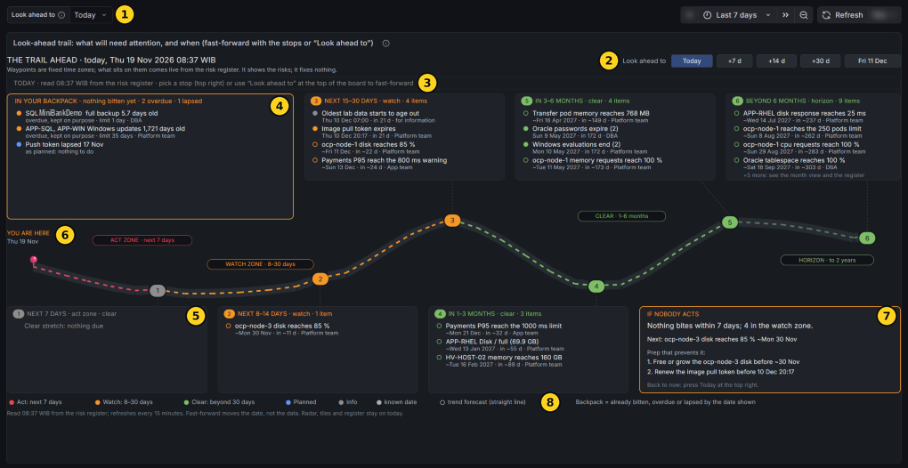
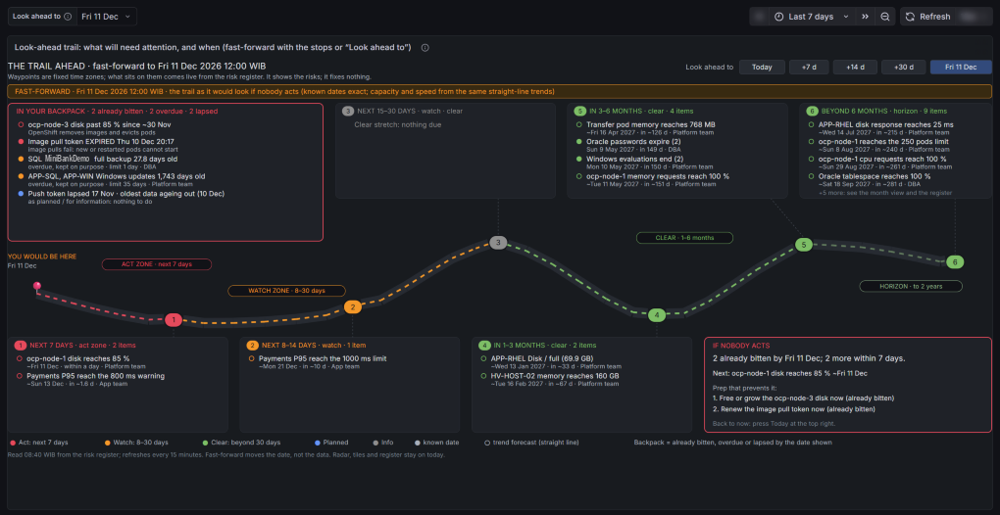
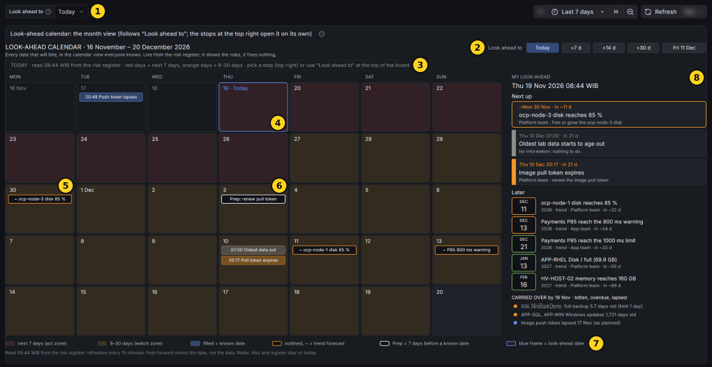
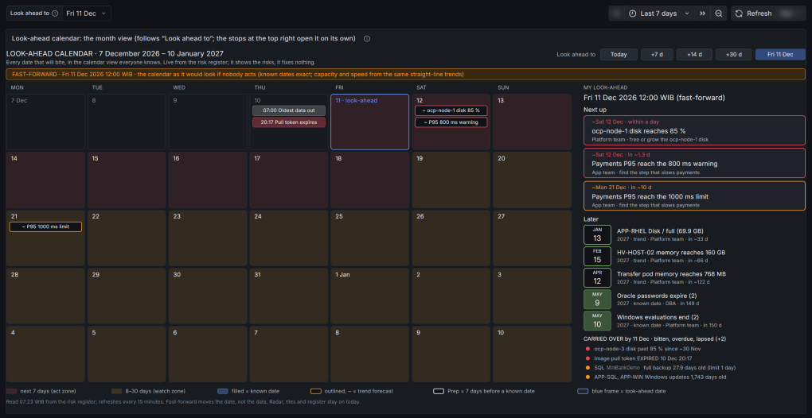

# 43. Look-ahead trail and month view with fast-forward (version 2.5)

Part G - Cross-layer root cause and mystery mode (version 1.7) &nbsp;|&nbsp; [Guide index](README.md)

Version 2.5 completes the redesign of the Calendar section of the Grafana board MiniBank - Look-ahead, on 18 and 19 November 2026. Two new panels show every dated risk of the register: the trail, a road from today into the next two years, and the month view, an Outlook-style calendar of five weeks. Both can fast-forward: one click on a stop, or a date in the board setting Look ahead to, shows the lab as it would look on that day if nobody acts. Both panels only read the risk register MiniBankLookahead (Chapters 39 and 40); nothing else in the demo was changed.

Read this chapter in order the first time: 43.1 says what was decided, 43.2 where the panels sit, 43.3 to 43.5 how to read and use them (with numbered screenshots), and 43.6 to 43.9 how they are built, how the build was checked and how to undo it.

## 43.1 Decisions

| Topic | Decision (18 November 2026) |
|---|---|
| Approval | Approved at 19:03 WIB on 18 November 2026 with all the default choices; built on 18 and 19 November 2026 with no impact on the existing demo and changes only in rg-appmon-openshift-demo and its managed resource group. |
| Where | Only the Grafana board MiniBank - Look-ahead, under its heading Calendar: dates that will bite. The workbook MiniBank - Look-ahead is not changed. |
| Two saves | Version 5: the trail, the board setting Look ahead to and the collapsed row Calendar details with the Expiry dates table. Version 6: the month view under the trail. Each save can be undone on its own (43.9). |
| Fast-forward | Five stops on each panel: Today, +7 d, +14 d, +30 d and Fri 11 Dec (the day after the image pull token expires). A stop opens its panel on its own at that date. The board setting Look ahead to at the top of the board moves both panels in place and also takes any number of days or a date. The board opens on Today. |
| What stays on today | The radar, Risks by status, the register, the charts and every other panel. Fast-forward moves the date, not the data. |
| Month view | Five weeks from the week of the date shown and the list My look-ahead (next up, later, carried over). No day, week or agenda views, no Add to Outlook button and no arrows that would suggest more than the register knows. |
| Screen | Drawn for a 1920 x 1080 screen at 100 % zoom with Grafana's side menu closed; both panels scale with the width. |
| How it is built | Grafana's built-in Canvas panel, no add-on; one read-only query per panel on the existing register; no new or changed function, collector, rule or workbook. |
| Runbook | This version 2.5, written after the build. |

## 43.2 Where the new panels sit

Open the board as in Scene 7D (19.10D) and scroll down past the radar, the register and Capacity trends to the heading Calendar: dates that will bite. Everything above that heading is where it was. The table shows the board from top to bottom, before and after version 2.5.

| Part of the board (top to bottom) | Before (version 4) | After (version 6) |
|---|---|---|
| Top bar | Time range and Refresh | New on the left: the board setting Look ahead to, set to Today. |
| Logo header, radar, Look-ahead and Capacity trends | As built in Chapters 39 and 40 | Not changed. |
| Calendar: dates that will bite | The Expiry dates table, 7 rows high | The trail (20 rows high), then the month view (22 rows high), then the collapsed row Calendar details: expiry dates table (click to open), which holds the same Expiry dates table. |
| Service budget, Posture and Prediction scorecard | As built in Chapters 39 and 40 | Not changed; 36 rows lower on the page. |

To see the Expiry dates table, click the row title Calendar details: expiry dates table (click to open); click it again to close it. Do not save the board for this: the row is closed again the next time the board is opened.

## 43.3 How to read the trail

Figure 43-1 shows the trail as the presenter sees it at the start of Scene 7D, on today: 19 November 2026 at 08:37 WIB. The yellow numbers are not on the board; they point at the parts that the table below explains. Read it like a road trip: you stand on the left (the pin), and the road runs to the right into the future, first through the next 7 days, then the next weeks, then the months ahead.

*Figure 43-1. The trail on today (live board, 19 November 2026, 08:37 WIB; browser screenshot with numbered callouts added).*

| No. | Part | What it tells you |
|---|---|---|
| 1 | Look ahead to (top left of the board) | The board setting that moves the date of the trail and of the month view. It reads Today at the start of the demo (43.4). |
| 2 | Stop buttons (top right of the panel) | Today, +7 d, +14 d, +30 d and Fri 11 Dec. The blue button is the date shown. One click opens this panel on its own at that date (43.4). |
| 3 | Status line | Grey TODAY with the time the register was read, or the amber FAST-FORWARD banner when the panel shows a later date. |
| 4 | In your backpack (top left) | What you already carry at the date shown: risks that have already bitten (red), weaknesses that are overdue and kept on purpose (orange, for example the SQL Server backup and the Windows updates), and dates that lapsed as planned or are only for information (blue or grey). |
| 5 | Zone boxes 1 to 6 | One box per time zone, numbered like the discs on the road. Box 1: the next 7 days (act). Box 2: 8 to 14 days, and box 3: 15 to 30 days (watch). Box 4: 1 to 3 months, and box 5: 3 to 6 months (clear). Box 6: beyond 6 months, up to 2 years (horizon). Each box lists up to 4 items with the date, the days left and the owner, then +N more. A filled dot is a known date; a ring is a forecast from a straight-line trend, and its date starts with ~. |
| 6 | The road and the pin | The pin YOU ARE HERE is the date shown (YOU WOULD BE HERE during a fast-forward). The coloured dashes mark the zones: red act, orange watch, green clear. A disc on the road is grey when its zone is empty. |
| 7 | If nobody acts (bottom right) | The situation in one line, the next item to bite and two preparations that prevent the nearest risks. Back to now: press Today. |
| 8 | Legend and footer | The colour key and the time the register was read. The footer repeats the rule: fast-forward moves the date, not the data; the radar, the tiles and the register stay on today. |

What the trail showed at 08:37 WIB on 19 November 2026 (Figure 43-1): nothing in the next 7 days; in zone 2 the ocp-node-3 disk, expected to reach 85 % about Monday 30 November; in zone 3 four items, among them the image pull token on Thursday 10 December at 20:17 WIB; and in the backpack the two weaknesses the lab keeps on purpose (the SQL Server backup and the Windows updates) and the push token that lapsed as planned on 17 November. If nobody acts named two preparations: free or grow the ocp-node-3 disk before about 30 November, and renew the image pull token before 10 December at 20:17 WIB.

> [!TIP]
> **Beginner tip**
>
> A date with ~ is a forecast: the register draws a straight line through the readings of the last days and reads where it crosses the limit. It moves a little with every new reading (on 19 November the ocp-node-1 disk moved between 11 and 12 December within a few hours). Say about when you read such a date aloud.

## 43.4 Fast-forward: the stops and Look ahead to

Fast-forward answers one question: what would the lab look like on a later day if nobody acts? Known dates stay exact (a token expires when it expires); capacity and speed dates come from the same straight-line trends as the register. Everything with a date before the date shown moves into the backpack as already bitten, and the zones are counted from the date shown. The data itself does not change, and the radar, Risks by status and the register above stay on today.

| Way | How | What happens |
|---|---|---|
| A stop on the panel | Click Today, +7 d, +14 d, +30 d or Fri 11 Dec at the top right of the trail or of the month view. | The page reloads (Grafana opens these links that way) and shows that panel on its own at the chosen date, filling the screen. Give it up to half a minute to draw. The address of the page now ends with var-ff=&lt;value&gt;&viewPanel=panel-29 (the trail) or panel-31 (the month view). |
| The board setting Look ahead to | Click the box next to Look ahead to at the top left of the board and choose a stop; or type a number of days (for example 45) or a date as yyyy-mm-dd (for example 2026-12-25) and press Enter. | Both panels switch in place, without a reload. Everything else on the board stays as it is. |
| Back to today | Click Today on the panel, or choose Today in Look ahead to. | The line turns grey (TODAY) and the pin reads YOU ARE HERE again. |

How the date is set: +N d is now plus N days, at the same time of day; a typed date means that day at 12:00 WIB; a date in the past shows today, and anything more than 2 years ahead shows the date 2 years ahead. While the date shown is later than now, the amber FAST-FORWARD banner names it, so that nobody mistakes the projection for today.

Step by step, the first time (about 5 minutes; the steps match Figures 43-1 and 43-2):

Step 1. Open the board.

> [!NOTE]
> **Where to run it**
>
> Microsoft Edge on your own computer: Grafana amg-appmon (https://&lt;GRAFANA_HOST&gt;), signed in with the lab account &gt; Dashboards &gt; folder MiniBank &gt; MiniBank - Look-ahead (address /d/minibank-lookahead). Time range Last 7 days. If Grafana's left menu is closed, open it with the menu icon at the top left of the page.

Step 2. Check the date. At the top left of the board, the box next to Look ahead to must read Today. If it shows anything else, click it and choose Today.

Step 3. Find the trail. Scroll down with the mouse wheel past the radar, the register and the Capacity trends charts until you reach the heading Calendar: dates that will bite. The trail is the first panel under it. On the first load it can stay empty for up to half a minute while Grafana draws it.

Step 4. Read the trail on today with Figure 43-1 and the table in 43.3: the backpack, the six zones and If nobody acts.

Step 5. Fast-forward with a stop. At the top right of the trail, click Fri 11 Dec once. Wait until the page has loaded again (up to half a minute). The trail now fills the screen and shows 11 December (Figure 43-2).

*Figure 43-2. The trail after one click on Fri 11 Dec (live board, 19 November 2026, 08:40 WIB): the amber banner, two risks already in the backpack and two more within 7 days.*

> [!TIP]
> **What you should see**
>
> The amber banner FAST-FORWARD · Fri 11 Dec 2026 12:00 WIB; the button Fri 11 Dec in blue; the pin YOU WOULD BE HERE; In your backpack: 2 already bitten (the ocp-node-3 disk past 85 % since about 30 November, and the image pull token EXPIRED on 10 December at 20:17), the two overdue weaknesses and the lapsed push token; zone 1 with 2 items (the ocp-node-1 disk and the payments P95 800 ms warning); If nobody acts: 2 already bitten by Fri 11 Dec; 2 more within 7 days.

Step 6. Come back. Click Today at the top right of the trail; the grey TODAY line returns. Then click Back to dashboard at the top of the page (or press Esc) to see the whole board again.

Step 7. Try the board setting. Click the box next to Look ahead to at the top left of the board and choose +30 d. Scroll to the trail and the month view: both show the same date with the amber banner, and the page did not reload. Click into the same box, type 45 and press Enter (45 days from now), then type 2026-12-25 and press Enter (25 December at 12:00 WIB). Finish with Today.

> [!WARNING]
> **If something goes wrong**
>
> The panel stays empty: wait half a minute, then reload the page (F5). It shows No data or an error: look at the register at the top of the board; if the register is empty as well, follow Chapter 39.9 (the collector). The banner says FAST-FORWARD although you want today: choose Today in Look ahead to. The board always opens on a later date: it was saved with that value; choose Today, then Edit &gt; Save dashboard, tick Update default variable values and save. A typed value is not taken: type only a number (without d) or a date as yyyy-mm-dd, then press Enter. You see only one panel: you are in the panel view after a stop click; click Back to dashboard or press Esc. Grafana asks you to sign in: sign in with the lab account and reload.

## 43.5 How to read the month view

The month view sits directly under the trail and shows the same dates as a calendar that everyone knows. It always shows five weeks, starting on the Monday of the week of the date shown. Figure 43-3 shows it on today; the yellow numbers point at the parts that the table explains.

*Figure 43-3. The month view on today (live board, 19 November 2026, 08:44 WIB; browser screenshot with numbered callouts added).*

| No. | Part | What it tells you |
|---|---|---|
| 1 | Look ahead to | The same board setting as for the trail: the month view always follows it. |
| 2 | Stop buttons | The same five stops; a click opens the month view on its own at that date. |
| 3 | Status line | Grey TODAY with the reading time and the key to the day colours, or the amber FAST-FORWARD banner. |
| 4 | The date shown | A blue frame marks the date shown (on today it reads 19 · Today); during a fast-forward a grey frame marks the real today when it is in the five weeks. Days before the date shown are dark: they have passed. |
| 5 | Chips | Up to 3 per day, then +N more. A filled chip is a known date with its time (for example 20:17 Pull token expires); an outlined chip with ~ is a forecast from a trend (for example ~ ocp-node-3 disk 85 %). The colour is the status: red act, orange watch, green clear, blue planned, grey information. |
| 6 | Prep chips | A white outlined chip 7 days before each known risk date, so that the preparation gets a date of its own (here Prep: renew pull token on Thursday 3 December). |
| 7 | Day colours and legend | Red days are the next 7 days after the date shown (act zone), orange days the 8 to 30 days after it (watch zone). The legend under the grid repeats the key. |
| 8 | My look-ahead (right) | The date shown; Next up (the three nearest items as cards, with the owner and the action); Later (the next five, each with a month and day badge); and Carried over (what has already bitten, is overdue or lapsed by the date shown). |

What the month view showed at 08:44 WIB on 19 November 2026 (Figure 43-3): the five weeks from 16 November to 20 December 2026; the push token that lapsed on 17 November; ~ ocp-node-3 disk 85 % on 30 November; Prep: renew pull token on 3 December; on 10 December 07:00 Oldest data out and 20:17 Pull token expires; ~ ocp-node-1 disk 85 % on 11 December; and ~ P95 800 ms warning on 13 December.

At Fri 11 Dec (Figure 43-4) the five weeks run from 7 December 2026 to 10 January 2027. The token chip on 10 December is red because it has already bitten, the days from 11 to 18 December are red, and Next up lists the ocp-node-1 disk and the payments P95 800 ms warning within about a day, then the 1,000 ms limit about 21 December.

*Figure 43-4. The month view at Fri 11 Dec (temporary copy of the board during the build, 19 November 2026, 07:23 WIB; the live panel is the same).*

## 43.6 How the panels are built

Both panels are Grafana's built-in Canvas panel, the same kind as the radar (Chapter 40.4) and the service weather (Chapter 41.5); no add-on is installed. Each panel runs one Log Analytics query on the board's own Azure Monitor data source and the workspace law-appmon. The query reads only the risk register MiniBankLookahead(), the function that also feeds the radar, the tiles and the register table, and it never writes. It returns one row with all the texts, positions and colours that the panel draws.

| Item | Trail (panel 29) | Month view (panel 31) |
|---|---|---|
| Drawn elements | 196 elements and 78 connections (the road) | 293 elements |
| Fields in the one row of the query | 192 | 559 |
| Size of the query | About 19 KB | About 23 KB |
| Query time | About 9 to 12 seconds | About 9 to 12 seconds |
| Refresh | With the board, every 15 minutes | With the board, every 15 minutes |
| Size on the board | 24 columns wide, 20 rows high | 24 columns wide, 22 rows high |

The query in plain words (the first four steps are the same in both panels):

- The date shown: now plus the days of Look ahead to, or the typed date at 12:00 WIB; never earlier than now and never later than 2 years ahead.
- The events: every known due date of the register (tokens, passwords, evaluations, certificates and the oldest data); every capacity or service trend with a date within 2 years; the payments P95 twice (the 800 ms warning and the 1,000 ms limit); and the weaknesses with the status Act or Watch, which have no date and are carried in the backpack.
- The guard: a flat trend has no real date (the register then holds a huge number of days, about 10^14). The panels drop every trend date more than 2 years away, so such a row never lands on today by mistake.
- The zones: the days from the date shown to each event: already bitten (0 or less), 1 to 7, 8 to 14, 15 to 30, 31 to 90, 91 to 180, and beyond.
- The month view adds 35 day cells from the Monday of the week of the date shown, up to 3 chips per day, a Prep chip 7 days before each known risk date, and the list My look-ahead.

The stop buttons are Canvas links of the form ${__url.path}${__url.params:exclude:var-ff,viewPanel}&var-ff=&lt;value&gt;&viewPanel=panel-29 (panel-31 for the month view): they keep the time range and kiosk mode and only change the date and the panel. The board setting is a Custom variable named ff with the label Look ahead to and the values Today : 0, +7 d : 7, +14 d : 14, +30 d : 30, Fri 11 Dec : 2026-12-11; custom values are allowed and the default is Today. The panels are drawn for a width of 1,340 pixels and scale with the width.

> [!CAUTION]
> **Be honest**
>
> The fast-forward is a projection, not a simulation. Known dates are exact, but capacity and speed follow straight lines through the readings of the last days: a clean-up, a new workload or a fix changes them, and the dates move a little with every new reading. Nothing else moves forward: the register, the radar and the posture items stay as they are today, and a risk that does not exist yet cannot appear. If nobody acts means exactly that: it assumes that nothing is fixed. The trail and the month view are drawings of the register made with the Canvas panel, not a Grafana or Azure feature; the zones are fixed places on the road, so the distance between two items on the road does not measure the days between them.

## 43.7 Safety and the no-impact checks

The build followed the same safety steps as Chapters 39 to 41: a fingerprint of every demo item before; a test of each query on its own; a temporary copy of the board for all tests; each change only after a check that the live board was still at the expected version; a test of every panel query after each change; a fingerprint after; and a comparison that includes the activity log of the three resource groups. All reads and changes ran from Cloud Shell in the browser with the lab account.

| What was checked | Result |
|---|---|
| Readiness check (18 Nov, 18:41 WIB) | Read-only: board version 4 with 28 panels and no board setting; no other board links to it; register 73 rows (Act 0, Watch 7, Planned 1, OK 52, Info 13). It found the flat-trend rows that the guard now drops. |
| Fingerprint before (19 Nov, 06:26 WIB) | Functions 50, workbooks 2, upload rules 10, custom tables 4, host roles 5, alert items 6, items in the managed resource group 1, Grafana boards 53 (the 52 of the demo and the temporary copy). |
| Query tests | Trail (18 Nov, 20:52 WIB): one row with all 192 fields, none missing, in 13.5 seconds. Month view (19 Nov, 06:59 WIB): one row with all 559 fields, none missing, in 9.0 seconds. |
| Temporary copy (18 Nov 21:30 to 19 Nov 08:16 WIB) | A separate copy of the board outside the folder MiniBank (TEMP - MiniBank Look-ahead trail and month trial). All panel queries without an error at all five stops: 26 with the trail, 31 with the month view. Clicks proven by hand: +30 d and +14 d on the trail, Fri 11 Dec on the month view. Deleted at about 08:16 WIB on 19 November. |
| Overnight stop (18 Nov 22:10 to 19 Nov 06:10 WIB) | The Cloud Shell session ended before any change to the live board. At 06:24 WIB the live board was checked again: still version 4. |
| Change 1 (19 Nov, 06:42 WIB) | Checked that the live board was still version 4 with the expected content, then saved version 5 (the trail, Look ahead to and the collapsed Calendar details row), with a backup of version 4. At 06:44 WIB all 26 panel queries ran without an error. |
| Change 2 (19 Nov, 08:13 WIB) | Checked version 5, then saved version 6 (the month view), with a backup of version 5. At 08:15 WIB all 31 panel queries ran without an error, the slowest in 11.7 seconds. |
| Comparison (19 Nov, 08:16 WIB) | Only the Grafana board MiniBank - Look-ahead changed (version 4 to 6), plus the temporary copy, created and deleted. Unchanged: 50 functions, 2 workbooks, 10 upload rules, 4 custom tables, 6 alert items, 5 host roles, the managed resource group and the 51 other Grafana boards. |
| Activity log since 06:25 WIB | rg-appmon-openshift-demo: 32 Azure Arc heartbeats (system). MA_amw-appmon_indonesiacentral_managed: none. rg-hyperv-arc-monitor-demo: 16 automatic inventory updates by Azure Arc for SQL Server (system), the same pattern as on 17 and 18 November. |
| Live board viewed (19 Nov, 08:37 to 08:45 WIB) | The trail and the month view on today as in Figures 43-1 and 43-3; one click on Fri 11 Dec on the live trail opened it at 11 December (Figure 43-2). |

## 43.8 What changed and where

| Item | Where | Change |
|---|---|---|
| Grafana board MiniBank - Look-ahead | amg-appmon, folder MiniBank (address /d/minibank-lookahead) | Version 5 (06:42 WIB): the trail (panel 29), the board setting Look ahead to and the collapsed row Calendar details (row 30) with the Expiry dates table inside. Version 6 (08:13 WIB): the month view (panel 31) under the trail. Every panel from Service budget down is 36 rows lower. The board description now reads v1.3. Fingerprints of the panel content: version 4 67e7cf48d899, version 5 194a04b45a31, version 6 ac77199cb0f7. |
| Workbook MiniBank - Look-ahead | rg-appmon-openshift-demo | Not changed: the workbook has no trail and no month view; its Calendar tab still lists the dates. |
| Functions, collector, upload rules, alert rules, tables, other boards and workbooks | - | Not changed. |
| Build helpers | Folder build-helpers next to this runbook | lookahead-trail-panel-v1.0.json and lookahead-month-panel-v1.0.json (the panels as added), lookahead-trail-query-v1.0.kql and lookahead-month-query-v1.0.kql (their queries) and lookahead-setting-ff-v1.0.json (the board setting). |

To test a query on its own: in the Azure Portal open law-appmon &gt; Logs (as in Scene 13A, Step 2), switch to KQL mode, paste the content of the .kql file, replace ${ff:singlequote} with '0' (today) or, for example, '2026-12-11' (with the single quotes) and click Run. You get one row with many columns: the texts and colours the panel would draw.

To add the panels to another copy of the board, in this order:

- Board setting: open the board &gt; Edit (top right) &gt; Settings &gt; Variables &gt; New variable. Select variable type Custom; Name ff; Label Look ahead to; Description as in lookahead-setting-ff-v1.0.json; Custom options Today : 0, +7 d : 7, +14 d : 14, +30 d : 30, Fri 11 Dec : 2026-12-11; under Selection options turn on Allow custom values. Then click Back to dashboard.
- Trail: Add &gt; Visualization; in the new panel open the panel menu &gt; Inspect &gt; Panel JSON; replace the text with the content of lookahead-trail-panel-v1.0.json and click Apply. Drag the panel directly under the heading Calendar: dates that will bite, at full width and 20 rows high.
- Month view: the same with lookahead-month-panel-v1.0.json, directly under the trail, at full width and 22 rows high.
- Save dashboard. Then check one stop: Fri 11 Dec must open the panel at 11 December with the amber banner.
## 43.9 Build record, open items and undo

| Time (WIB) | What happened |
|---|---|
| 17 Nov 13:42-15:10 | Mock-ups of the Calendar redesign from live data, read-only; the plan: the trail with fast-forward, the Outlook-style month view and a collapsed Details row on the Grafana board. |
| 18 Nov 18:29-18:50 | Readiness check, read-only: board version 4 unchanged; ready to build. |
| 18 Nov 19:03 | Approved with all the default choices. |
| 18 Nov 19:31-19:32 | Pre-check and fingerprint before. |
| 18 Nov 19:50-21:30 | Trail built and previewed on the desk; query test at 20:52 WIB (192 fields). |
| 18 Nov 21:30-22:10 | Temporary copy with the trail: 26 panel queries without an error; stop clicks +30 d and +14 d proven. |
| 18 Nov 22:10 to 19 Nov 06:10 | Session ended overnight; nothing was changed. |
| 19 Nov 06:24-06:26 | Pre-check again (board still version 4) and a second fingerprint before. |
| 19 Nov 06:42-06:44 | Saved: board version 5 (the trail); 26 panel queries without an error. |
| 19 Nov 06:50-07:20 | Month view built and previewed on the desk; query test at 06:59 WIB (559 fields). |
| 19 Nov 07:20-07:25 | Temporary copy with the month view: 31 panel queries without an error; stop click Fri 11 Dec proven. |
| 19 Nov 08:13-08:15 | Saved: board version 6 (the month view); 31 panel queries without an error. |
| 19 Nov 08:16 | Temporary copy deleted; fingerprint after and comparison: the existing demo is unchanged. |
| 19 Nov 08:37-08:45 | The live board viewed; stop click on the live trail proven; Figures 43-1 to 43-3. |

Open items:

- Update the table of contents in desktop Word (References &gt; Update Table &gt; Update entire table): Chapter 43 is not in it yet.
- Check the trail and the month view once on the presenter's 1920 x 1080 screen at 100 % zoom in the rehearsal; the screenshots of this chapter were taken in a smaller browser window.
- The stop Fri 11 Dec is a fixed date for this demo (the day after the image pull token expires). After 11 December 2026 it shows today. Once the token is renewed (Chapter 40.7) or the demo date is known, choose a new stop date (a small change to both panels and the board setting).
- Renewing the image pull token moves its date on the trail and in the month view and changes the 11 December story of Scene 7D; rehearse Step 3 again after the renewal.
- The radar, Risks by status and the register stay on today on purpose. The radar can follow Look ahead to later (about 15 to 30 minutes of work, Chapter 40.4).
- Since the night of 18 to 19 November the register gives dates to the CPU and memory requests and the pod count of the OpenShift nodes (more than 200 days away). They appear in zones 5 and 6 of the trail and under Later; this is expected and needs no action.

How to undo version 2.5:

| Step | What to do |
|---|---|
| 1 | Month view only: Grafana &gt; MiniBank - Look-ahead &gt; Edit &gt; Settings &gt; the tab Versions; in the row of version 5 click Restore and confirm. The trail, Look ahead to and the Calendar details row stay. |
| 2 | Everything of version 2.5: restore version 4 instead. The Expiry dates table goes back under the heading Calendar: dates that will bite, open; Look ahead to disappears and every panel below moves back up. |
| 3 | Runbook: in Scene 7D, Step 3, leave out the trail and the jump to 11 December (the scene is 4 minutes again and the session 150.5 minutes without Scene 14). |
| Note | A restore saves a new version with the old content, so it can itself be undone. Restoring version 3 or older (the undo of the radar, Chapter 40.7) also removes the trail and the month view. |

---

[&larr; 42. Telemetry walkthrough scenes (version 2.4)](42-telemetry-walkthrough-scenes-version-2-4.md) &nbsp;|&nbsp; [Guide index](README.md)
